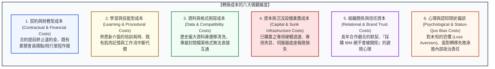

---
{"dg-publish":true,"permalink":"/98/switching-costs/","tags":["商業概念","策略管理","產業分析","波特五力","競爭優勢","護城河","轉換成本","PMBA"],"dg-note-properties":{"aliases":["轉換成本","顧客轉換成本","用戶轉移成本","切換成本","客戶轉換成本","鎖定效應","Switching Costs","Customer Switching Costs","switching-costs","Lock-in Effect"],"tags":["商業概念","策略管理","產業分析","波特五力","競爭優勢","護城河","轉換成本","PMBA"],"類別":"商業概念庫"}}
---


# 轉換成本 (Customer Switching Costs / 顧客鎖定效應)

> **核心名言**：  
> 「當買方更換供應商必須承擔可觀的一次回合成本時，轉換成本便隨之誕生。轉換成本的存在，能將原本在事前（Ex-ante）完全同質的產品，轉化為在事後（Ex-post）具備極高黏著度與定價溢價的非對稱資產。」  
> —— 保羅·克蘭佩雷（Paul Klemperer, 知名經濟學家, 1987）  
>  
> 「讓顧客離開你的痛苦，遠大於他嘗試新產品所帶來的微小邊際愉悅；這就是轉換成本賦予企業的最高護城河。」  
> —— 漢密爾頓·赫爾默（Hamilton Helmer, *7 Powers*, 2016）

---

## 一、 核心定義與經濟學本質

### 1.1 經典理論定義與經濟學意涵
- **經濟學標準定義（Paul Klemperer, 1987）**：
  牛津大學經濟學家保羅·克蘭佩雷（Paul Klemperer）在經典論文《具有轉換成本之市場競爭》（*Markets with Consumer Switching Costs*）中指出：**轉換成本是指顧客在終止與現有供應商的商業關係、轉向採購競爭對手產品或替代方案時，所必須付出的一次性（One-time / Lump-sum）實體成本、時間代價、心理阻力或風險溢價。**
- **波特五力架構視角（Michael Porter, 1980）**：
  波特指出，轉換成本在五力模型中扮演著「雙重防衛樞紐」：
  1. **削弱買方議價能力（Buyer Power）**：客戶轉換成本愈高，越難以透過轉單威脅向在位企業砍價；
  2. **加固進入障礙（Entry Barriers）**：新進入者即使提供更低報價，若不足以覆蓋客戶的轉換代價，客戶依然不會跳槽。
- **赫爾默「7 大市場力量」視角（Hamilton Helmer, 2016）**：
  在《7 Powers》（七大市場力量）中，轉換成本被列為七大持久競爭優勢支柱之一。其獨特本質在於**「鎖定在位用戶（Installed Base Lock-in）」**，使企業能對存量顧客長期收取具有防禦性的溢價（Premium Pricing），創造極高的客戶終生價值（CLV）。

---

### 1.2 轉換決策的淨效益公式模型

一個理性客戶決定是否從「現有供應商（Old）」轉向「新進入者（New）」的決策準則可嚴謹表述為：

$$	ext{轉移激勵值 (Switching Incentive)} = \Big( 	ext{知覺價值}_{	ext{New}} - 	ext{價格}_{	ext{New}} \Big) - \Big( 	ext{知覺價值}_{	ext{Old}} - 	ext{價格}_{	ext{Old}} \Big) - 	ext{轉換成本 (SC)}$$

只有當上述公式計算出的**轉移激勵值大於 0** 時，客戶才會實際發生跳槽行為：

$$\Delta 	ext{淨顧客剩餘} = \Big( V_{	ext{New}} - P_{	ext{New}} \Big) - \Big( V_{	ext{Old}} - P_{	ext{Old}} \Big) > 	ext{Switching Cost (SC)}$$

```
【客戶轉換障礙與溢價定價空間】

  客戶知覺價值
     ▲
     │
     │   新進者產品性能雖然略優 (+ΔV)
     │   或價格略為便宜 (-ΔP)
     │
     │   ┌─────────────────────────────────────┐
     │   │                                     │
     │   │   【轉換成本護城河 (Switching Cost)】│ ◄── 客戶寧可繼續忍受舊系統
     │   │   • 員工重新培訓學習成本            │     也不願冒險承擔轉移代價
     │   │   • 歷史資料遷移中斷風險            │
     │   │   • 軟硬體重新購置沉沒成本          │
     │   │                                     │
     │   └─────────────────────────────────────┘
     │
  0  └─────────────────────────────────────────────────────────────►
```

- **定價特權的來源**：在位企業即使將產品價格 $P_{	ext{Old}}$ 調高，只要調價幅度小於客戶的 $	ext{Switching Cost}$，客戶依然會被「經濟理性鎖定」，這賦予了在位者極度珍貴的定價自由度。

---

## 二、 轉換成本的六大微觀維度 (The Six Dimensions)

轉換成本並非單純指「違約金」等金錢支出，它涵蓋了深層的程序、認知與社會資本維度：



### 2.1 深度拆解六大轉換成本

1. **契約與財務型轉換成本（Financial / Contractual Costs）**：
   - 具有法律約束力的長期合約違約金（Liquidated Damages）；
   - 忠誠度計劃中已累積之巨額福利被清零（如航空公司高等級貴賓會籍、信用卡紅利點數）。
2. **學習與流程技能成本（Learning / Procedural Costs）**：
   - 使用者長年累積的「肌肉記憶」與專業工作流。
   - *典範*：彭博終端機（Bloomberg Terminal）至今仍維持古老的快捷鍵與操作介面，金融交易員經過數千小時練習早已形成指尖直覺；若更換為微軟或路透系統，交易員下單速度哪怕延遲 0.5 秒都可能造成千萬美元損失。
3. **資料與技術規格相容成本（Data & Format Compatibility Costs）**：
   - 企業 10 年以上的 ERP 歷史交易帳務、CRM 客戶銷售線索，儲存於特定資料庫架構內。將數十 TB 的異質資料清洗、轉換並導入新系統，面臨巨大的中斷（Downtime）與資料遺失風險。
4. **專屬資本與週邊設備重置（Capital & Sunk Sockets）**：
   - 既有硬體的週邊相容性。如單眼相機機身與鏡頭卡口（Canon RF 卡口 vs. Sony E 卡口）、Apple MagSafe 生態系配件。更換機身往往意味著數十萬元鏡頭群必須全數折價拋售。
5. **關係與信任資本（Relational / Career Risk Costs）**：
   - 企業 B2B 採購長久流傳的名言：*「沒有人會因為採購 IBM（或 SAP、微軟、台積電）而被開除（Nobody ever got fired for buying IBM）。」*
   - 採購決策者若引進不知名新創廠商的替代方案，若系統崩潰其職業生涯將毀於一旦；這種**「非對稱職涯風險（Career Asymmetry）」**構成了在位龍頭最強大的隱形轉換防護盾。
6. **心理認知成本與現狀偏誤（Status-Quo Bias & Loss Aversion）**：
   - 行為經濟學家康納曼（Daniel Kahneman）指出，人類「失去所帶來的痛苦，是獲得同等利益愉悅感的 2~2.5 倍」（損失趨避）。客戶天然傾向於維持現狀，除非新產品能帶來壓倒性的優越體驗。

---

## 三、 轉換成本在企業生命週期與商業模式中的動態演化

```text
【企業生命週期中的轉換成本演進】

  用戶生命週期階段       企業戰略核心               轉換成本主要形態
 ──────────────────────────────────────────────────────────────────────────
  1. 獲客階段 (Acquisition) ──► 刻意降低進入門檻 ──► 免費試用 (Freemium)、零轉移障礙
  2. 留存階段 (Retention)   ──► 逐步加深用戶投入 ──► 累積資料、設定個人化偏好
  3. 擴展階段 (Expansion)   ──► 打造生態系網狀鎖定──► 跨模組整合、綁定團隊協同工作流
  4. 變現階段 (Monetization)──► 榨取防禦性定價溢價──► 穩步提高續約價格 (每年調漲 3~7%)
```

### 3.1 企業軟體（Enterprise SaaS / ERP）之黃金鎖定公式
在現代訂閱制商業模式中，轉換成本直接決定了頂級科技公司的關鍵財務指標：
- **淨留存率（Net Retention Rate, NRR）**：具備高轉換成本的企業（如 ServiceNow, Snowflake, Datadog），其 NRR 常年維持在 **120% ~ 130% 以上**；
- 意味著即使一年內不開發任何新客戶，單憑既有客戶因為轉換成本高昂而持續增購席次與功能，公司整體營收仍能自然成長 20%~30%！

---

## 四、 經典旗艦實證案例深度剖析 (Flagship Case Studies)

### 4.1 案例一：Apple 圍牆花園（Walled Garden）的個人跨裝置鎖定
蘋果公司（Apple）是全球消費性電子領域構建複合轉換成本的最高境界代表：
1. **資料互通障礙**：iCloud 雲端同步、家庭照片共享庫、AirDrop 跨設備秒傳；
2. **週邊硬體咬合**：Apple Watch 唯有搭配 iPhone 才能啟動所有健康監測與解鎖功能；AirPods 在 Mac、iPad 與 iPhone 之間無感智慧切換；
3. **軟體生態與社交壓力**：iMessage 的「藍色氣泡 vs. 綠色氣泡」在北美青少年群體中創造了巨大的社交排除恐懼（Social Exclusion Cost）；
4. **結果**：即使三星或小米推出性價比更高、相機變焦更強的旗艦機，全球 iPhone 用戶的換機留存率（Retention Rate）始終高踞 **90% 以上**。

### 4.2 案例二：企業級 ERP 巨頭 SAP 的神級轉換防護罩
在財星 500 大企業中，超過 90% 依賴德國 SAP 系統管理其核心財務、生產與供應鏈：
1. **龐大業務流程綁定**：跨國大廠在全球數百個廠區的會計科目、合約流程與出貨標準，歷經 20 年客製化完全依賴 SAP ABAP 程式碼驅動；
2. **災難級轉移代價**：歷史上曾有眾多跨國巨頭嘗試更換 ERP 系統，結果引發庫存大亂、出貨停擺、股價暴跌數十億美元（如 Hershey 巧克力更換系統導致萬聖節斷貨虧損）；
3. **結果**：SAP 具備極強的定價自主權，每年調漲雲端訂閱費用，企業客戶即使心懷不滿也只能照單全收。

---

## 五、 高階經理人決策工具箱：鎖定與突圍攻防指南 (Executive Playbook)

```
┌────────────────────────────────────────────────────────────────────────────┐
│              高階經理人「轉換成本攻防與商業策略」檢核清單                    │
├────────────────────────────────────────────────────────────────────────────┤
│ 【防守方戰略：如何加深客戶轉換成本以鞏固護城河？】                          │
│ ☐ 1. 從「單點工具」演進為「系統平台」：整合更多模組，讓客戶工作流無法分割。│
│ ☐ 2. 協助客戶累積高價值資產：引導客戶將核心數據、歷史記錄存於本體系統內。 │
│ ☐ 3. 建立網狀協同生態：促使客戶組織內多個部門共同使用，增加集體決策反對票。│
│ ☐ 4. 培養社群專業認證：如推出專業證照體系，讓從業人員技能與我方軟體綁定。  │
├────────────────────────────────────────────────────────────────────────────┤
│ 【進攻方戰略：新進挑戰者如何瓦解在位者的轉換成本壁壘？】                    │
│ ☐ 1. 承擔或補貼轉換成本：提供「一鍵資料搬家工具」或全額買斷舊約違約金。     │
│ ☐ 2. 降低學習摩擦：完美相容在位者的快捷鍵、介面排版與檔案格式（零學習成本）│
│ ☐ 3. 提供壓倒性 10 倍價值（10x Value）：性能必須達到劃時代突破，補償轉移代價│
│ ☐ 4. 特洛伊木馬滲透法：初期先以輕量無害的外掛形式共存，逐步取代核心業務。   │
└────────────────────────────────────────────────────────────────────────────┘
```

---

## 六、 知識圖譜關聯與雙向鏈結 (Bidirectional Knowledge Links)

### 6.1 核心系列套裝導航（策略護城河三部曲）
- **[[barriers-to-entry_進入障礙]]** · 潛在進入者防線、結構性與行為性進入壁壘
- **[[switching-costs_轉換成本]]** · 顧客鎖定效應、六大轉換成本維度與定價溢價權（本篇）
- **[[economies-of-scale_規模經濟]]** · 供給端規模效益、最小有效規模 (MES) 與固定成本分攤

### 6.2 核心策略理論對接
- [[Porter's Five Forces Analysis_波特五力分析]] · 轉換成本如何同時削弱買方議價力與提高進入障礙
- [[Firm_Value_Chain_企業價值鏈]] · 輔助活動與服務如何為買方構築獨特相容性壁壘
- [[value-system_產業價值體系|Value_System_產業價值體系]] · 產業垂直分工網絡、五大連結條件與上下游合作鎖定
- [[Porter's Diamond Model_波特鑽石模型]] · 挑剔顧客前導需求與本土產業生態黏著力
- [[value-chokepoint_價值咽喉]] · 轉換成本極致化所鑄造的產業定價咽喉
- [[clv-customer-lifetime-value_顧客終身價值]] · 轉換成本降低流失率 (Churn) 並極大化 CLV

### 6.3 課程筆記與主控台
- [[M1-5_波特五力分析與量化架構]] · 買方轉換成本對五力雷達圖之量化打分
- [[_產業分析與投資策略 MOC]] · 全課導航總地圖
- [[home]] · 全球 PMBA 知識庫總導航主頁面
