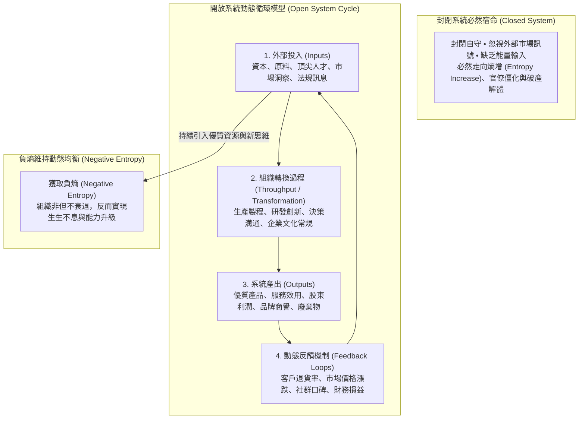

---
{"dg-publish":true,"permalink":"/98/system-2/","tags":["商業概念","組織理論","系統思考","策略管理","PMBA"],"dg-note-properties":{"aliases":["開放系統","開放系統理論","Open Systems Theory","組織系統論","負熵機制"],"tags":["商業概念","組織理論","系統思考","策略管理","PMBA"]}}
---


# 開放系統 (Open Systems Theory)

> [!NOTE]
> **核心概念精粹**：開放系統理論（Open Systems Theory），由生物學家路德維希·馮·貝塔朗菲（Ludwig von Bertalanffy）提出一般系統論，並由丹尼爾·卡茨與羅伯特·卡恩（Katz & Kahn）引進組織管理學。它打破了古典管理學將企業視為封閉機械裝置的盲區，指出：**企業是一個與外部動態環境持續進行物質、能量與資訊交換的「活體組織」**。開放系統依託**「負熵（Negative Entropy）」**輸入抵抗自然的退化衰亡，透過反饋循環與等終極性（Equifinality）維持動態穩定與持續進化。

---

## 一、 學理淵源：從封閉系統的熵增到開放系統的負熵

熱力學第二定律指出：任何與外界隔絕的「封閉系統（Closed System）」，其內部的無序混亂程度（熵 Entropy）將不可逆地單調遞增，最終走向寂滅死亡。

卡茨與卡恩（Katz & Kahn, 1966）在《組織的社會心理學》中確立了組織的開放系統本質：



---

## 二、 開放系統理論的核心九大特徵矩陣

卡茨與卡恩總結了健康開放組織必須具備的深層結構特徵：

| 特徵維度 | 理論定義與內在機理 | 企業管理中的實務體現 | 封閉化失靈警訊 |
| :--- | :--- | :--- | :--- |
| **1. 負熵輸入<br>(Negative Entropy)** | 透過從外部環境輸入多於消耗的能量，抵銷系統走向混亂衰竭的自然趨勢。 | 持續招募異質頂尖人才、引入前沿開源技術、向標竿企業學習。 | 近親繁殖、只提拔聽話的內部平庸老臣、抗拒外部顧問審計。 |
| **2. 反饋機制<br>(Information Feedback)** | 接收環境對產出的評價訊號，用於調節下一步的投入與轉換。 | 建立即時客戶滿意度儀表板、分析退貨原因、監控競品動態。 | 報喜不報憂的寒蟬效應、無視顧客流失數據。 |
| **3. 動態穩態<br>(Dynamic Homeostasis)** | 系統並非靜止不變，而是在不斷吸收外部衝擊的同時，維持核心功能的平衡。 | 受到通膨或疫情衝擊時，迅速調整供應鏈與混合辦公，保證核心營運不斷線。 | 外部稍有風吹草動即陷入內部大恐慌、業務停擺。 |
| **4. 分化與專業化<br>(Differentiation)** | 隨著系統規模擴大，內部組織結構自發朝向更精密的分工與專業化演進。 | 設立專門的資安中心、ESG 永續辦公室、前沿 AI 實驗室。 | 權責不清、所有人什麼都管但什麼都不精通。 |
| **5. 等終極性<br>(Equifinality)** | 系統可以從不同的初始條件、透過完全不同的策略路徑，達到相同的成功目標。 | 在智慧手機市場，蘋果靠高利潤封閉生態登頂，Google 靠開放開源 Android 稱霸。 | 教條主義盲信「成功只有一種唯一正確路徑」，扼殺多元解法。 |

---

## 三、 經典企業實戰案例：微軟從「封閉閉環」向「開放生態」的死而復生

```carousel

<!-- slide -->
### 1. 史蒂夫·鮑爾默時期的「封閉孤島」（熵增危機）
- **封閉教條**：2000 年代微軟將開源 Linux 視為「癌症」，誓死保衛 Windows 的排他壟斷；拒絕讓 Office 登陸蘋果 iOS 或 Android；
- **系統衰竭**：微軟在封閉的 Windows 城堡中越走越窄，徹底錯失了智慧手機、雲端與行動網路大潮，組織陷入嚴重的「熵增」與官僚內耗。
<!-- slide -->
### 2. 薩提亞·納德拉的「開放負熵革命」（死而復生）
- **打破邊界**：2014 年納德拉上任後提出「微軟熱愛 Linux（Microsoft Loves Linux）」，將 Azure 打造成支援所有開源技術的開放平台；
- **擁抱外部**：將 Office 軟體全線無條件免費登陸 iPhone 與 iPad；收購全球最大開源代碼社群 GitHub；重金結盟 OpenAI；
- **系統重生**：透過持續輸入外部開發者生態的「負熵」，微軟徹底擺脫了行將就木的封閉命運，實現跨越週期的宏偉二次涅槃。
```

---

## 四、 經理人開放系統健康度檢核表（Executive Decision Checklist）

高階管理層在審視公司文化與組織架構時，應定期進行「組織熵增體檢」：

- [ ] **負熵輸入管道通暢度（Negative Entropy Inflow）**：
  - 本公司的高階管理團隊與研發核心，有多少比例來自外部不同產業背景的新鮮血液？我們是否經常邀請外部專家與挑釁者來挑戰既有決策？
- [ ] **負反饋訊號真實性（Negative Feedback Accuracy）**：
  - 組織底層在遭遇真實挫敗時，這項負反饋訊號能否在「未被修飾美化」的情況下直達最高決策層？還是被中層幹部層層過濾阻隔？
- [ ] **滲透性邊界與開放創新（Permeable Boundary & Open Innovation）**：
  - 公司的研發是否完全陷入「非我所創症候群（Not Invented Here Syndrome）」？我們是否積極利用外部開源生態、學術合作與技術授權加速創新？
- [ ] **等終極性授權（Equifinality Mindset）**：
  - 管理層在指派戰略目標時，是只緊盯著「最終成果（What）」，還是過度干預甚至強制規定員工「達到目標的每一步具體動作（How）」？是否保留了前線自發創新的空間？

---

## 五、 關聯概念與知識網絡

* 組織社會學與系統理論：
  * [[contingency-theory_權變理論|權變理論 (Contingency Theory)]]：開放系統理論在組織結構與環境適配之深化
  * [[strategic-fitness_策略適配性理論|策略適配性理論 (Strategic Fit)]]：組織各子系統活動與外部環境之動態契合
  * [[corporate-culture_企業文化|企業文化 (Corporate Culture)]]：抵抗組織熵增、激勵內部活水之價值土壤
  * [[core-competence_核心能力|核心能力 (Core Competence)]]：開放系統轉換過程中沉澱之難以模仿專屬資產
* 戰略轉型與領導力：
  * [[great-company_好公司|好公司 (Great Company)]]：跨越百年保持開放適應力、基業長青之偉大組織
  * [[Omniverse|Omniverse 數位孿生]]：基於 OpenUSD 開放標準實現工業全要素數據互聯之當代實踐
  * [[disruptive-innovation_破壞式創新|破壞式創新 (Disruptive Innovation)]]：封閉系統忽視外部弱訊號所引發之致命顛覆
  * [[viable-business_好事業|好事業 (Viable Business)]]：具備健康造血與環境物質交換循環之可持續實體
