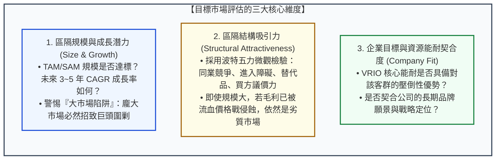

---
{"dg-publish":true,"permalink":"/98/target-market-selection/","tags":["商業概念","行銷管理","策略管理","STP","目標市場","精實創業","PMBA"],"dg-note-properties":{"aliases":["目標市場選擇","目標市場","目標客群選擇","目標客群","Target Market Selection","Target Market","Targeting","target-market-selection","目標市場策略","灘頭堡市場"],"tags":["商業概念","行銷管理","策略管理","STP","目標市場","精實創業","PMBA"],"類別":"商業概念庫"}}
---


# 目標市場選擇 (Target Market Selection / Targeting)

> **核心名言**：  
> 「策略的本質在於決定『不該做什麼』。目標市場選擇就是將有限的組織資源，精準聚焦於勝算最高的戰場，而不是試圖向所有人兜售一切。」  
> —— 麥可·波特（Michael E. Porter）  
>  
> 「在新技術與新創產品跨越鴻溝時，你必須發起諾曼第登陸式的進攻：選擇一個高度聚焦的灘頭堡市場，投入壓倒性的資源，打贏第一場決定性戰役。」  
> —— 傑弗瑞·摩爾（Geoffrey A. Moore, *Crossing the Chasm*）

---

## 一、 核心定義與戰略資源集中法則

### 1.1 理論定義與戰略意涵
- **目標市場選擇（Targeting）** 是經典 STP 行銷戰略流程的第二步（Step 2），指企業在完成「[[98_商業概念庫/market-segmentation_市場區隔\|市場區隔 (Segmentation)]]」之後，**依據特定標準系統性評估各細分市場的吸引力，並挑選出一個或數個具備最高獲利潛力且最契合自身資源優勢的市場區隔作為主攻戰場的決策過程**。
- **克勞塞維茨「集中原則（Principle of Concentration）」**：
  新創企業、中小企業乃至跨國巨頭的資源都是嚴格有限的。試圖以分散的行銷預算涵蓋所有客群，必然導致在每一處戰場上都面臨相對兵力不足；唯有將資源集中於單一目標市場，才能在該利基領域建立壓倒性的局部壟斷（Local Monopoly）。

```
【從市場區隔向目標市場的漏斗過濾】

  ┌────────────────────────────────────────────────────────┐
  │ 【全體潛在市場 (TAM)】: 各類異質需求消費者群體          │
  └──────────────────────────┬─────────────────────────────┘
                             ▼ 透過地理/人口/心理/行為變數切分
  ┌────────────────────────────────────────────────────────┐
  │ 【細分市場區隔 (Segments)】: 區隔A、區隔B、區隔C、區隔D│
  └──────────────────────────┬─────────────────────────────┘
                             ▼ 經由規模/成長/五力結構/能耐契合評估
  ┌────────────────────────────────────────────────────────┐
  │ ★【入選目標市場 (Target Market)】: 聚焦主攻 區隔B 與 區隔C │
  └──────────────────────────┬─────────────────────────────┘
                             ▼ 植入獨特價值主張
  ┌────────────────────────────────────────────────────────┐
  │ 【市場心智定位 (Positioning)】: [[positioning-strategy_定位策略]] │
  └────────────────────────────────────────────────────────┘
```

---

## 二、 目標市場評估的三大維度 (Evaluation Criteria)

評估一個細分市場是否值得作為目標市場，必須在**「市場吸引力」**與**「企業配適度」**之間取得嚴謹平衡：



### 2.1 三大評估維度之實戰指標

1. **區隔規模與成長性（Segment Size and Growth）**：
   - 結合市場空間估算模型：評估其 [[SAM]]（可服務市場）與 [[SOM]]（可獲取市場）；
   - *反直覺思維*：新創企業切忌盲目選擇規模最大的主流市場，那裡充滿了財力雄厚、擁有 [[economies-of-scale_規模經濟]] 的既有霸主；**規模中等但具備高複合年成長率（CAGR > 20%）的高速成長利基，往往才是最佳切入點**。
2. **區隔結構吸引力（Structural Attractiveness - 應用五力分析）**：
   - 該細分市場的 [[barriers-to-entry_進入障礙]] 是否足夠高以阻擋後進者？
   - 買方的 [[switching-costs_轉換成本]] 是否足夠高以保護未來的續約與定價權？
   - 供應商與強勢通路商是否會侵吞該區隔的大多數營業利潤？
3. **企業能耐契合度（Resource & Capability Fit）**：
   - 企業是否具備服務該區隔的專屬技術、專用通路或品牌信譽？
   - 進入該市場是否會與既有業務產生內部衝突（如品牌形象自我瓜分 Cannibalization、或代工客戶與自有品牌的衝突）。

---

## 三、 五大目標市場涵蓋模式 (Five Market Coverage Strategies)

科特勒歸納了企業在選擇目標市場時的五種經典覆蓋戰略模型：

```text
【五大目標市場涵蓋矩陣】

  (P = 產品 Product, M = 市場區隔 Market)

  1. 單一區隔集中化      2. 選擇性專業化        3. 產品專業化          4. 市場專業化          5. 全面市場涵蓋
     (Niche Market)     (Selective Special)   (Product Special)      (Market Special)       (Full Coverage)

     M1  M2  M3            M1  M2  M3            M1  M2  M3            M1  M2  M3            M1  M2  M3
  P1 [X] [ ] [ ]        P1 [X] [ ] [ ]        P1 [X] [X] [X]        P1 [X] [ ] [ ]        P1 [X] [X] [X]
  P2 [ ] [ ] [ ]        P2 [ ] [ ] [X]        P2 [ ] [ ] [ ]        P2 [X] [ ] [ ]        P2 [X] [X] [X]
  P3 [ ] [ ] [ ]        P3 [ ] [X] [ ]        P3 [ ] [ ] [ ]        P3 [X] [ ] [ ]        P3 [X] [X] [X]
```

1. **單一區隔集中化（Single-Segment Concentration / 利基型策略）**：
   - **結構**：以單一產品深耕單一特定客群。
   - **優勢**：極致專業化、極高顧客忠誠度與心智佔有率；
   - **風險**：單一市場若遭遇技術淘汰或需求轉變，公司面臨滅頂之災（如黑膠唱片機專用唱針製造商）。
2. **選擇性專業化（Selective Specialization / 多利基配置）**：
   - **結構**：挑選數個客群與產品互不關聯、但各自具備高度獲利吸引力的區隔分散下注。
   - **優勢**：具備天然的風險分散機制（Portfolio Diversification），單一區隔失守不影響整體獲利。
3. **產品專業化（Product Specialization）**：
   - **結構**：專注生產某一種特定產品，向多個不同的顧客群體銷售。
   - **典型**：高階顯微鏡製造商，同時將同一款顯微鏡銷售給大學科研室、醫院病理科與半導體晶圓品管廠。
4. **市場專業化（Market Specialization）**：
   - **結構**：專注服務特定群體，向該群體提供多樣化所需的商品組合。
   - **典型**：專注服務「大學牙醫系學生與診所」，從牙科器械、消毒設備到專用病歷軟體全包。
5. **全面市場涵蓋（Full Market Coverage）**：
   - **結構**：向全市場所有群體提供所有需要的全系列產品。唯有資金雄厚、產能巨大的產業霸主能夠承擔。
   - **無差異行銷（Undifferentiated）**：如早期亨利·福特「不管消費者要什麼顏色，福特 T 型車只有黑色」；
   - **差異化行銷（Differentiated）**：如豐田汽車集團（Lexus 豪華車、Camry 主管車、Yaris 青年車、RAV4 休旅車），針對每一區隔設計專屬行銷組合。

---

## 四、 新創跨越鴻溝：灘頭堡市場與保齡球道模型 (The Beachhead Market)

在科技創新與新創商業化領域，傑弗瑞·摩爾（Geoffrey Moore）在《跨越鴻溝》（*Crossing the Chasm*）中指出了高科技新創最常犯的致命錯誤：**在尚未跨越主流市場鴻溝前，過早採用「全面市場涵蓋」，導致資源被徹底稀釋**。

```text
【摩爾保齡球道模型 (The Bowling Alley Model)】

   【灘頭堡市場 (Beachhead)】         【相鄰市場 1】           【主流市場全面滲透】
         (第 1 支保齡球瓶)            (被擊倒的相鄰球瓶)
     ┌──────────────────────┐      ┌──────────────────────┐      ┌──────────────────────┐
     │ 痛苦最深、最急迫的客群 │ ──► │  相似痛點的相鄰利基  │ ──► │  保守型主流大眾市場  │
     │ 打造 100% 完整產品方案 │ 撞擊 │  引用第一球瓶成功口碑│ 擊穿 │  (Pragmatists)       │
     └──────────────────────┘      └──────────────────────┘      └──────────────────────┘
```

1. **灘頭堡市場（Beachhead Market）的三大特徵**：
   - 客戶擁有極度痛苦、不解決就會死的問題（Compelling Reason to Buy）；
   - 新創企業具備提供「完整產品方案（Whole Product）」的絕對能耐；
   - 客戶社群高度集聚、彼此口耳相傳，具備強大的口碑引用效應（Word-of-Mouth Referrals）。
2. **打倒第一支球瓶**：
   在灘頭堡市場拿下 **50% 以上的壓倒性市佔率**，以該處的成功案例與客戶口碑為跳板，順勢擊倒相鄰的第二、第三個市場區隔（如 Uber 初期只專注在舊金山攻克科技菁英的黑頭車接送，驗證後順勢席捲全美與全球通勤市場）。

---

## 五、 旗艦實證案例剖析 (Flagship Industrial Cases)

### 5.1 案例一：特斯拉（Tesla）從超高端利基向大眾市場的階梯滲透
特斯拉是完美實踐灘頭堡與階梯式目標市場選擇的教科書典範：
- **第一階段（單一利基集中化：Roadster, 2008）**：
  目標客群是矽谷科技新貴與好萊塢明星，售價超過 10 萬美元。產量極少，主要用來樹立「電動車又酷、又快、又性感」的品牌光環，跨越創新者鴻溝；
- **第二階段（高階豪華市場專業化：Model S / Model X, 2012~2015）**：
  鎖定高資產家庭主管用車，賺取高毛利並累積電池管理專利與超級充電網絡；
- **第三階段（全面大眾市場涵蓋：Model 3 / Model Y, 2017~至今）**：
  產能爬坡至百萬級規模，下探至 3~4 萬美元主流大眾用車，正面迎戰豐田與福斯。

### 5.2 案例二：台灣美妝生活雜貨霸主寶雅（POYA）的市場專業化
- **避開強敵**：面對台北一線都會區超高密度的屈臣氏與康是美，寶雅初期拒絕在台北正面硬碰硬；
- **市場專業化定位**：精準鎖定台灣中南部二三線城鎮的「女性個人保養與居家生活雜貨」客群；
- **門市空間擴展**：以 300~500 坪超大明亮店型提供上萬種 SKU，建立無可撼動的坪效壁壘，最終成功回師反攻雙北都會區。

---

## 六、 高階經理人決策工具箱：目標市場打分決策矩陣 (Executive Playbook)

```
┌────────────────────────────────────────────────────────────────────────────┐
│              高階經理人「目標市場選擇打分矩陣」(評分權重模型)                │
├────────────────────────────────────────────────────────────────────────────┤
│ 評估維度 (權重)         │ 區隔 A (利基市場) │ 區隔 B (主流市場) │ 區隔 C (新興市場)│
├─────────────────────────┼───────────────────┼───────────────────┼──────────────────┤
│ 1. 市場規模與成長率 (25%)│      6 / 10       │      9 / 10       │      8 / 10      │
│ 2. 獲利毛利率空間   (20%)│      9 / 10       │      5 / 10       │      7 / 10      │
│ 3. 競爭與進入障礙   (20%)│      8 / 10 (少對手)│      3 / 10 (血海) │      7 / 10      │
│ 4. 企業能耐契合度   (20%)│      9 / 10       │      6 / 10       │      5 / 10      │
│ 5. 跨越鴻溝跳板價值 (15%)│      9 / 10       │      4 / 10       │      8 / 10      │
├─────────────────────────┼───────────────────┼───────────────────┼──────────────────┤
│ 加權綜合總分            │    ★ 8.15 分     │      5.70 分      │      7.05 分     │
│ 戰略決策行動            │  【優先主攻灘頭堡】│    【暫時迴避】   │  【列為次階段儲備】│
└────────────────────────────────────────────────────────────────────────────┘
```

---

## 七、 知識圖譜關聯與雙向鏈結 (Bidirectional Knowledge Links)

### 7.1 核心系列套裝導航（經典行銷 STP 三部曲）
- **[[market-segmentation_市場區隔]]** · 異質市場切分、四大變數體系與 MASDA 檢驗準則
- **[[target-market-selection_目標市場選擇]]** · 目標市場評估、五大涵蓋模式與跨越鴻溝灘頭堡（本篇）
- **[[positioning-strategy_定位策略]]** · 顧客心智佔領、POP/POD 差異化與知覺定位圖

### 7.2 策略與市場規模對接
- [[TAM]] · 總體潛在市場天花板測算
- [[SAM]] · 可服務市場空間與目標市場選擇標準
- [[SOM]] · 可獲取市場份額與新創灘頭堡攻防
- [[barriers-to-entry_進入障礙]] · 目標市場結構吸引力之防禦壁壘評估
- [[economies-of-scale_規模經濟]] · 全面市場涵蓋策略之成本優勢支撐

### 7.3 課程筆記與主控台
- [[L03_市場區隔與定位策略]] · 行銷管理課程模組三核心講義
- [[_創業與企業財務策略 MOC]] · 全課程創新與行銷架構
- [[home]] · 全球 PMBA 知識庫總導航主頁面
