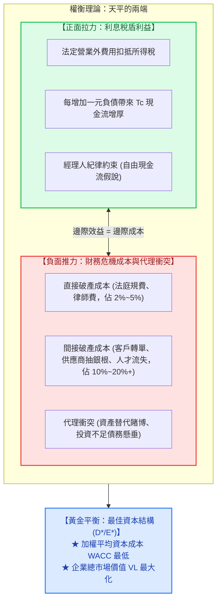
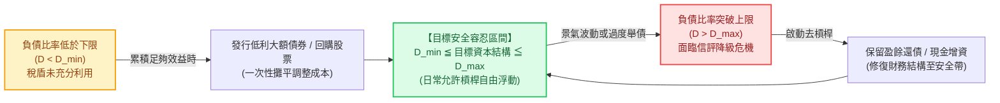

---
{"dg-publish":true,"permalink":"/98/theory-7/","tags":["商業概念","財務管理","公司理財","資本結構","權衡理論","企業財務策略","PMBA"],"dg-note-properties":{"aliases":["權衡理論","靜態權衡理論","Trade-off Theory","Static Trade-off Theory","theory-7_權衡理論","theory-7","最適資本結構權衡模型"],"tags":["商業概念","財務管理","公司理財","資本結構","權衡理論","企業財務策略","PMBA"]}}
---


# 權衡理論 (Trade-off Theory of Capital Structure)

> 💡 **導航與索引**：本篇為現代公司理財（Corporate Finance）決定企業「最佳負債水準」之核心經典理論。探討企業如何在「利息稅盾利益」與「財務危機成本」之間取得黃金平衡。亦可參閱公司理財總覽卡片 [[98_商業概念庫/capital-structure_資本結構\|資本結構 (Capital Structure)]]、最佳點專題 [[98_商業概念庫/capital-structure-2_最佳資本結構\|最佳資本結構 (Optimal Capital Structure)]]、無摩擦基準 [[98_商業概念庫/capital-structure-3_資本結構無關論\|資本結構無關論 (MM Irrelevance)]]、融資階梯對立模型 [[98_商業概念庫/_待改寫草稿庫/theory-6_啄食順序理論\|啄食順序理論 (Pecking Order)]]、折現率函數 [[98_商業概念庫/wacc_加權平均資本成本\|加權平均資本成本 (WACC)]]、資產負債表全局視角 [[98_商業概念庫/financial-structure_財務結構\|財務結構 (Financial Structure)]]、固定利息放大機制 [[98_商業概念庫/financial-leverage_財務槓桿\|財務槓桿 (Financial Leverage / DFL)]]、產銷敏感度 [[98_商業概念庫/DOL_營運槓桿\|營運槓桿度 (DOL)]]、總體風險指標 [[98_商業概念庫/degree-of-total-leverage-dtl_總槓桿\|總槓桿度 (DTL)]]，以及股權定價模型 [[98_商業概念庫/capm_資本資產定價模型\|資本資產定價模型 (CAPM)]]。

---

## 一、 核心定義與理論起源

### 1. 理論起源與核心內涵
- **權衡理論（Trade-off Theory of Capital Structure，亦稱靜態權衡理論 Static Trade-off Theory）** 最早由克勞斯與利岑伯格（Alan Kraus & Robert Litzenberger, 1973）提出，並由史都華·麥爾斯（Stewart Myers, 1984）發揚光大。
- 該理論旨在**修正莫迪利安尼-米勒含稅模型（MM 1963）「100% 負債最適」的極端結論**，將真實商業環境中的**「破產與財務困窘成本（Financial Distress Costs）」**以及**「代理成本（Agency Costs）」**納入資本結構定價方程。
- **核心論點**：
  企業並非負債越多越好，而是透過權衡**舉債帶來的「利息稅盾收益（Tax Shield Benefit）」**與**負債過高引發的「破產危機現值（PV of Financial Distress）」**。當兩者的邊際效應相等時，企業達到**最佳資本結構（$D^*/E^*$）**，此時加權平均資本成本（WACC）降至最低點，企業總市場價值（Firm Value）達到最高峰。

### 2. 靜態權衡理論綜合估值方程
$$V_L = V_U + \text{PV}(\text{利息稅盾}) - \text{PV}(\text{財務危機成本}) - \text{PV}(\text{股東/債權人代理成本}) + \text{PV}(\text{經理人紀律利益})$$

簡化核心模型為：
$$V_L = V_U + T_C \times D - \text{PV}(\text{財務危機成本})$$

- $V_L$：有負債企業（槓桿公司）總市場價值；
- $V_U$：無負債企業（全權益公司）總市場價值；
- $T_C \times D$：永久性負債之法定利息稅盾現值（$T_C$ 為公司邊際所得稅率，$D$ 為負債市值）；
- $\text{PV}(\text{財務危機成本})$：財務困窘與破產清算損失之折現值。

---

## 二、 兩大對立驅動力之微觀解構

權衡理論的本質，是企業在資產負債表右側兩種背道而馳的經濟力量間進行拉鋸博弈：



### 1. 正面推升力量：利息稅盾（Interest Tax Shield）
- **現金流補貼機制**：
  由於稅法允許借款利息作為稅前營業外費用全額扣除，政府實質上為企業分攤了 $T_C$ 比例的利息成本。
  $$\text{每年節稅額} = \text{利息支出} \times T_C = (r_D \times D) \times T_C$$
- **永久負債之稅盾現值**（假定稅盾與債務具相同風險，以負債成本 $r_D$ 折現）：
  $$\text{PV}(\text{利息稅盾}) = \frac{(r_D \times D) \times T_C}{r_D} = T_C \times D$$
- **非債務稅盾（Non-Debt Tax Shields, NDTS）的擠出效應**：
  德安吉洛與馬蘇利斯（DeAngelo & Masulis, 1980）補充指出，企業若享有大量**固定資產折舊、無形資產攤銷或投資研發抵減**，將降低利息稅盾的邊際價值。當企業獲利不足以完全吸收所有抵稅額時，過度舉債將導致利息稅盾浪費。

### 2. 負面侵蝕力量：財務危機成本（Costs of Financial Distress）
當企業負債比率攀升至危險水準，息稅前利潤（EBIT）無法完全覆蓋剛性利息時，企業將步入「財務困窘」狀態。財務困窘造成的實質價值毀損由兩大層面組成：

#### (1) 直接破產成本 (Direct Bankruptcy Costs)
- **實體法律費用**：法院清算與重整訴訟費、破產管理人報酬、外部專案會計師與投資銀行家諮詢費用。
- **資產佔比**：通常僅佔企業總資產市值的 **$2\% \sim 5\%$**，並非摧毀企業價值的最主要元凶。

#### (2) 間接破產成本 (Indirect Bankruptcy Costs) —— 企業致命殺手
間接成本在企業**正式宣告破產前數年即已悄然引爆**，對企業經營商譽與獲利能力造成不可逆的毀滅性打擊，其損失規模高達資產市值的 **$10\% \sim 20\%+$**：
1. **客戶流失與轉單效應**：耐久財（如汽車、高科技設備）、需長期保固與售後維修之產品，客戶擔憂企業倒閉成為「產品孤兒」，紛紛取消合約轉單至財務穩健的對手。
2. **供應商嚴格緊縮信用**：供應商取消放帳期，強制要求貨到付款（COD）甚至預付現金，大幅抽乾企業的營運資金。
3. **頂尖人力資本外流**：關鍵軟體工程師、核心研發主管與王牌業務擔心資遣與職涯中斷，率先大規模跳槽，企業失去核心動態能耐。
4. **管理層精力嚴重扭曲**：高階經理人耗費 80% 以上的管理精力與銀行、債權委員會進行債務展期與違約重組談判，無暇專注於市場競爭、產品研發與策略創新。

#### (3) 財務困窘下的兩大代理衝突（股東 vs. 債權人）
- **資產替代問題（Asset Substitution / 道德風險與冒險傾向）**：
  瀕臨破產時，股東承擔有限責任，而享有潛在剩餘收益。股東傾向於下注高風險、負 NPV 的「賭博性專案」——**賭贏了獲利全歸股東翻身，賭輸了損失由債權人全盤承擔**。
- **投資不足問題（Underinvestment / 債務懸垂 Debt Overhang）**：
  即便出現淨現值為正（$\text{NPV} > 0$）的健全投資專案，但由於專案現金流會被現存債權人強制截流以償付歷史舊債，股東無法獲得合理回報，因此理性股東會**主動放棄有利於公司生存的優質投資**。

---

## 三、 數理建模與最佳平衡點判定

```text
【權衡理論：企業價值倒 U 型曲線與 WACC 碗狀曲線】

  企業市場價值 (V)
       ▲                                 最佳平衡點 (D*/E*)
       │                                     ┌─────┐ (max V_L)
       │                                   ┌─┘     └─┐
       │                             ┌─────┘         └──┐ 權衡理論價值曲線
       │                       ┌─────┘                  └───┐
       │                 ┌─────┘ 稅盾利益主導期              └───┐ 危機成本主導期
       │           ┌─────┘ (邊際稅盾 > 邊際危機成本)             └─── (邊際危機成本 > 邊際稅盾)
       │     ┌─────┘                                              
       │   ┌─┘                                                   
  V_U ─┼───┴───────────────────────────────────────────────────────► 無負債基準線
       │
  WACC │
       │   ╲                                                    ╱
       │    ╲                                                  ╱
       │     ╲                                                ╱
       │      ╲                                              ╱
       │       └───┐                                    ┌───┘
       │           └───────────┐            ┌───────────┘
  min  │                       └────────────┘ 最佳資本結構點 (min WACC)
  WACC ┼────────────────────────────────────────────────────────────►
       0                                D*/E*                      100% 負債比率 (D/V)
```

### 1. 邊際均衡數學條件
企業尋求最大化公司價值 $V_L$ 的一階導數條件為：
$$\frac{d V_L}{d D} = \frac{d[\text{PV}(\text{利息稅盾})]}{d D} - \frac{d[\text{PV}(\text{財務危機成本})]}{d D} = 0$$

$$\iff \frac{d[\text{PV}(\text{利息稅盾})]}{d D} = \frac{d[\text{PV}(\text{財務危機成本})]}{d D}$$

- **當負債水準 $D < D^*$（左側爬坡期）**：
  $$\frac{d[\text{PV}(\text{稅盾})]}{d D} > \frac{d[\text{PV}(\text{危機成本})]}{d D}$$
  由於破產概率極低，每新增一元負債帶來的邊際稅盾 $T_C$ 顯著大於微弱的危機成本。企業此時應**積極擴大負債融資**，以拉低 WACC、推升企業價值。
- **當負債水準 $D = D^*$（最佳平衡頂峰）**：
  邊際稅盾現值恰好完全等於邊際危機成本現值。**企業價值 $V_L$ 達到全局最高峰，加權平均資本成本 WACC 達到全局最低點**。此融資結構即為「最佳資本結構（Optimal Capital Structure）」。
- **當負債水準 $D > D^*$（右側墜落期）**：
  $$\frac{d[\text{PV}(\text{危機成本})]}{d D} > \frac{d[\text{PV}(\text{稅盾})]}{d D}$$
  違約風險呈幾何級數爆發，邊際危機成本急遽凌駕於稅盾利益之上。企業價值遭嚴重侵蝕崩跌，WACC 呈拋物線飆升。

---

## 四、 靜態權衡 vs. 動態權衡理論 (Dynamic Trade-off Theory)

傳統靜態權衡假定企業能無成本、即時調整資本結構。然而實務中發行債券、股票或收回負債均面臨高昂的**「資本調整交易成本（Capital Adjustment Costs）」**，由此催生了**動態權衡理論（Dynamic Trade-off Theory / Fischer, Heinkel & Zechner, 1989）**：

| 比較維度 | 靜態權衡理論 (Static Trade-off) | 動態權衡理論 (Dynamic Trade-off) |
| :--- | :--- | :--- |
| **市場摩擦假定** | 僅考慮稅盾與破產成本，假定**無調整成本** | 納入**證券發行承銷費、股權折價與談判交易成本** |
| **資本結構目標** | 單一固定的**最佳負債比率點位（$D^*$）** | **動態目標容忍區間（Target Debt Band, $[D_{\min}, D_{\max}]$）** |
| **融資再平衡行為** | 任何微小偏離，企業應立即調整回 $D^*$ | 僅在負債比率**突破容忍邊界時**，才啟動大額再平衡 |
| **真實世界吻合度** | 奠定定性分析框架，但無法解釋為何企業容忍槓桿漂移 | 完美解釋企業為何容忍負債率在景氣循環中上下浮動 |



---

## 五、 兩大理論巔峰對決：權衡理論 vs. 啄食順序理論

在現代公司財務學術界，權衡理論與麥爾斯的[[theory-6_啄食順序理論|啄食順序理論 (Pecking Order Theory)]]構成了兩大對立爭鳴：

| 理論對照構面 | 權衡理論 (Trade-off Theory) | 啄食順序理論 (Pecking Order Theory) |
| :--- | :--- | :--- |
| **核心驅動力量** | **利息稅盾 vs. 財務危機成本**（稅制與破產法） | **資訊不對稱與逆向選擇成本**（信號傳遞理論） |
| **負債比率目標** | **存在唯一最佳目標負債比率（$D^*$）** | **無固定最佳目標**，負債只是融資赤字的被動累積 |
| **內部盈餘的角色** | 股東權益的正常組成部分，按成本模型考量 | **絕對第一優先融資來源**，無發行成本與折價懲罰 |
| **對發行新股的看法** | 當槓桿過高時，發行新股有助降低破產風險 | **融資階梯最後手段**，發行新股會被市場判定為高估懲罰 |
| **高獲利企業的現象** | 獲利越高，稅盾價值越大，**應舉借更多債務** | 獲利越高，內部現金流充沛，**負債比率反而越低** |
| **適用產業與情境** | **成熟期企業、重資產、現金流平穩之大型公用與傳產** | **成長期企業、高科技研發、生技新創、輕資產公司** |

> 💡 **高階整合觀點（企業生命週期混合模型）**：
> 企業在不同生命階段應靈活融合兩大理論：
> 1. **新創期與高成長期（遵循啄食順位）**：內部現金脆弱且資訊不對稱極高，應堅守保留盈餘與股權，保持零/極低負債以維繫財務彈性；
> 2. **成熟期與現金牛期（遵循動態權衡）**：營運現金流龐大且穩定，資訊高度透明，此時應大膽擴大債務融資，利用利息稅盾壓低 WACC，並藉由債務剛性支付約束管理層過度投資。

---

## 六、 企業高階經理人（CFO / CEO）實戰決策四大軍規

### 1. 嚴密評估底層資產之「負債容量（Debt Capacity）」
* **高負債容量企業（容許高 $D^*$）**：
  * 特徵：擁有大量具通用轉售價值之實體資產（廠房、土地、收費公路）、現金流量具備抗景氣循環之防禦性。
  * 策略：設定較高負債比率（如 $45\% \sim 60\%$），極大化利息稅盾收益。
* **低負債容量企業（設定低 $D^*$）**：
  * 特徵：核心資產為無形資產、專利智慧財產權（IP）與人力資本，一旦違約資產殘值近乎為零，間接破產成本極高。
  * 策略：嚴守極低負債甚至淨現金（Net Cash）狀態，嚴禁過度槓桿。

### 2. 隨時校準「非債務稅盾（NDTS）」之排擠效應
若企業本身享有鉅額固定資產加速折舊、投資賦稅減免或累計虧損扣抵，邊際有效所得稅率實質上遠低於法定稅率。此時**利息稅盾的邊際價值大幅縮水，企業不應盲目為了節稅而大舉借債**，避免承擔不對稱的破產風險。

### 3. 設定雙重信用指標安全邊際防線
在動態目標區間內，CFO 應以信評與債務契約條款（Covenants）鎖定安全邊際：
* **利息保障倍數（ICR）**：$\text{ICR} = \frac{\text{EBIT}}{\text{利息支出}}$，穩健狀態維持在 **$3.5\times \sim 5.0\times$ 以上**；景氣衰退極限不可跌破 **$2.0\times$**。
* **淨負債槓桿比率**：$\frac{\text{淨負債}}{\text{EBITDA}}$ 控制在 **$2.5\times$ 以內**，避免引發信用評等落入投機級（Junk Bond）引爆借款成本螺旋。

### 4. 預留充裕「財務彈性儲備（Financial Slack）」
最佳資本結構絕非「將借貸額度用盡」，而必須在資產負債表常態化保留**未動用銀行授信額度（Committed Credit Lines）與高流動性金融資產**，確保在產業黑天鵝降臨或突發優質併購機會出現時，具備即刻融通之戰略餘裕。

---

## 七、 關聯主題與模組網絡

- 🧭 **課程核心模組對接**：
  - [[02_核心必修/01_財務管理/L09_資本結構理論與決策|L09 資本結構理論與決策：MM定理與當代權衡模型]]（靜態權衡模型、破產危機成本微觀拆解、最佳平衡點條件推導）
  - [[02_核心必修/01_財務管理/L08_資本結構理論與決策|L08 資本結構理論與決策：財務槓桿與EBIT-EPS分析]]（槓桿損益放大效應、無稅 MM 理論自製槓桿）
  - [[02_核心必修/02_財務報表分析/Ch06_長期償債能力分析|Ch06 長期償債能力分析]]（利息保障倍數、財務槓桿比率與長期資本適足率檢驗）
  - [[04_主題選修/10_創業與企業財務策略/00_課程導航與進度/mindmap_創業與企業財務策略_心智圖導航|創業與企業財務策略 心智圖導航]]（新創融資生命週期、成熟期資本結構優化）
  - [[04_主題選修/12_產業分析與投資策略/02_模組筆記/Module_1_產業框架與動態競爭/M1-2_三大景氣循環與資本評價邏輯|M1-2 三大景氣循環與資本評價邏輯]]（資本市場景氣波段對企業負債承受力與融資窗口之衝擊）
- 🔗 **核心概念原子卡片雙向互聯**：
  - [[capital-structure_資本結構|資本結構 (Capital Structure)]]（公司理財資本結構全局理論總覽與 Hamada 方程試算）
  - [[capital-structure-2_最佳資本結構|最佳資本結構 (Optimal Capital Structure)]]（權衡理論落地之核心決策目標）
  - [[capital-structure-3_資本結構無關論|資本結構無關論 (MM Proposition I)]]（完美市場無摩擦之理論原點）
  - [[theory-6_啄食順序理論|啄食順序理論 (Pecking Order Theory)]]（資訊不對稱驅動之對立經典理論）
  - [[wacc_加權平均資本成本|加權平均資本成本 (WACC)]]（權衡理論極小化之折現率目標函數）
  - [[financial-structure_財務結構|財務結構 (Financial Structure)]]（右側全集資產配置 vs. 資本結構長期資本辨析）
  - [[financial-leverage_財務槓桿|財務槓桿 (Financial Leverage / DFL)]]（固定利息槓桿效應與破產風險源頭）
  - [[degree-of-total-leverage-dtl_總槓桿|總槓桿度 (DTL)]]（營業槓桿與財務槓桿複合乘數）
  - [[capm_資本資產定價模型|資本資產定價模型 (CAPM)]]（計算權益成本與 Beta 槓桿調整之工具）
