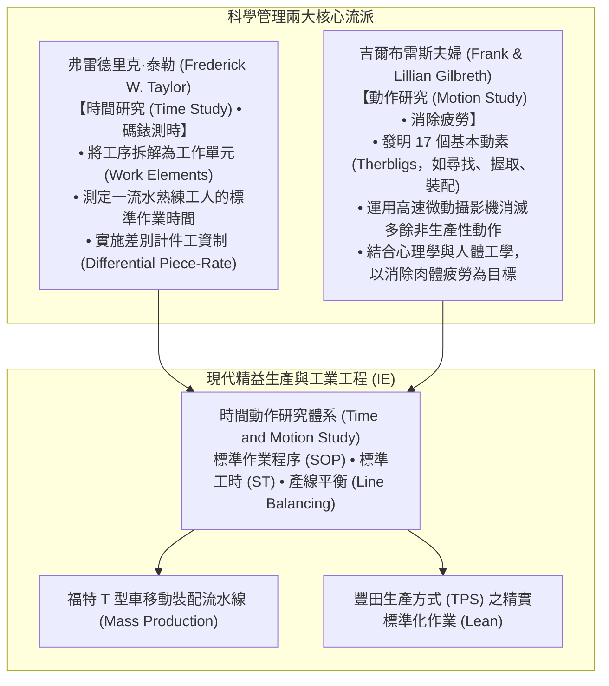
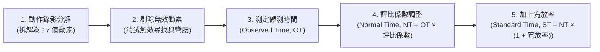

---
{"dg-publish":true,"permalink":"/98/time-and-motion-study/","tags":["商業概念","營運管理","生產管理","管理學史","PMBA"],"dg-note-properties":{"aliases":["時間動作研究","Time and Motion Study","泰勒科學管理法","工時研究","動作研究","動素分析"],"tags":["商業概念","營運管理","生產管理","管理學史","PMBA"]}}
---


# 時間動作研究 (Time and Motion Study)

> [!NOTE]
> **核心概念精粹**：時間動作研究（Time and Motion Study），是現代工業工程（Industrial Engineering, IE）與古典科學管理理論（Scientific Management）的基石工具。它融合了**弗雷德里克·溫斯洛·泰勒（Frederick W. Taylor）的時間研究（Time Study）**與**法蘭克與莉蓮·吉爾布雷斯夫婦（Frank & Lillian Gilbreth）的動作研究（Motion Study）**。其核心使命在於：將繁複的工序拆解為最細微的基本動作（動素 Therbligs），徹底剔除多餘無效耗損，測定「標準工時」，以此實現生產力的極致飛躍；然而，若忽視人性尊嚴，極易異化為冰冷殘酷的演算法監工陷阱。

---

## 一、 學理奠基：泰勒與吉爾布雷斯夫婦的歷史會師

時間動作研究在 20 世紀初徹底粉碎了傳統依靠「工匠師徒經驗與直覺磨洋工（Soldiering）」的作坊模式，將生產流程推入精確可度量的科學殿堂：



---

## 二、 動素分析（Therbligs）與標準工時（Standard Time）測定機制

時間動作研究絕非粗暴地拿碼錶催促工人，而是具備嚴密的工程學推導步驟：



### 標準工時公式解析：
$$\text{Normal Time (正常時間)} = \text{Observed Time (平均觀測時間)} \times \text{Performance Rating (作業評比係數)}$$
$$\text{Standard Time (標準工時)} = \text{Normal Time} \times (1 + \text{Allowance Rate (寬放率)})$$

- **評比係數（Rating）**：衡量被測工人相較於標準熟練工的速度與技能水準（通常基準為 100%）。
- **寬放率（Allowance）**：包含生理寬放（喝水、如廁）、疲勞寬放（肌肉疲勞恢復）與不可避免延遲寬放，確保標準工時具備人性可持續性。

---

## 三、 經典企業實戰案例：福特流水線的神話 vs 現代演算法監工的倫理反思

```carousel

<!-- slide -->
### 1. 福特汽車（Ford）T 型車裝配流水線的傳奇
- **傳統裝配**：1908 年由技工單獨裝配一輛 T 型車底盤需花費 **12 小時 28 分鐘**，工人需滿車間跑動尋找零件；
- **泰勒制革命**：亨利·福特引進時間動作研究，將裝配工序細分為 84 道連續步驟，零件隨輸送帶移動至工人面前；
- **驚人產能**：底盤組裝時間驟降至 **93 分鐘**，生產效率暴增 8 倍；福特將售價從 850 美元降至 300 美元以下，讓汽車走入尋常百姓家，並給予工人創紀錄的「每日 5 美元高薪」。
<!-- slide -->
### 2. 當代亞馬遜（Amazon）演算法監工的倫理危機
- **演算法泰勒制**：亞馬遜在龐大物流倉儲中，將時間動作研究數位化升級為手持掃描儀即時監控系統；
- **殘酷監控**：系統以秒級計算揀貨時間，只要員工停頓數分鐘，即被計入「脫崗時間（Time Off Task, TOT）」；累積超過門檻自動觸發解雇通知；
- **倫理反噬**：員工為防止被演算法開除，被迫以水瓶如廁、高壓導致工傷率翻倍；引發全美工會抗議、監管調查與加州專門立法限制倉儲演算法監工，成為現代商業倫理深刻警鐘。
```

---

## 四、 經理人時間動作研究現代化檢核表（Executive Decision Checklist）

在製造業推動精益管理、或在服務業推行數位化計程監控時，高階管理團隊應檢驗下列平衡維度：

- [ ] **寬放率人性可持續性（Allowance Humanity Audit）**：
  - 我們所測定的標準工時（ST），是否預留了充分合理的生理與疲勞寬放？還是把「極限爆發速度」當成「全天八小時標準工時」來壓榨員工？
- [ ] **動作優化工具賦能（Ergonomic Empowerment）**：
  - 研究的初衷是否遵循吉爾布雷斯原則——「透過改良工具高度、零件擺放位置，讓員工工作得更輕鬆、更少疲勞」？還是僅僅為了把工人當機器零件催速？
- [ ] **反演算法監工反噬（Anti-Algorithmic Dehumanization）**：
  - 我們的數位管理系統中，是否存在「未經人工審核即由演算法自動懲處/開除員工」的冷血條款？是否保障了員工因突發生理不適進行申訴的程序權利？
- [ ] **效率紅利共享機制（Sharing Productivity Gains）**：
  - 透過時間動作研究節省下的巨額成本與產能提升，是否透過獎金、調薪或減少工時實質回饋給前線作業人員？還是全數被管理層與股東侵吞？

---

## 五、 關聯概念與知識網絡

* 古典管理理論與工業工程：
  * [[conceptual-skills_概念技能|概念技能 (Conceptual Skills)]]：高層領導跳脫純工時細節、宏觀綜觀全局
  * [[technical-skills_技術技能|技術技能 (Technical Skills)]]：第一線工程師掌握工時測定與動素分析
  * [[rights-view_權利觀點|權利觀點 (Rights View of Ethics)]]：保障員工身心安全與拒絕非人道監控之權利
  * [[goodharts-law_古德哈特定律|古德哈特定律 (Goodhart's Law)]]：單一追求工時節拍指標引發員工弄虛作假反噬
* 現代營運與激勵體系：
  * [[economies-of-scale_規模經濟|規模經濟 (Economies of Scale)]]：流水線標準工時支撐之大規模生產成本優勢
  * [[cost-leadership-strategy_成本領導策略|成本領導策略 (Cost Leadership Strategy)]]：消除一切動作浪費之極致成本防禦
  * [[theory-8_期望理論|期望理論 (Expectancy Theory)]]：差別計件工資激勵之心理預期鏈接
  * [[great-company_好公司|好公司 (Great Company)]]：兼顧極致營運卓越與以人為本文化之偉大組織
