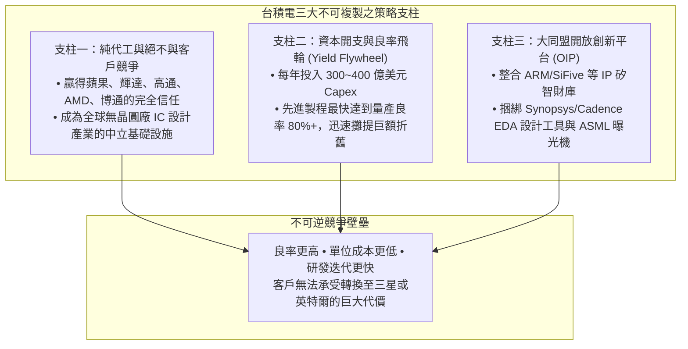
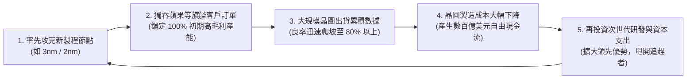

---
{"dg-publish":true,"permalink":"/98/tsmc/","tags":["商業概念","半導體產業","商業模式","競爭優勢","PMBA"],"dg-note-properties":{"aliases":["台積電","TSMC","台灣積體電路製造","護國神山"],"tags":["商業概念","半導體產業","商業模式","競爭優勢","PMBA"]}}
---


# 台積電 (TSMC)

> [!NOTE]
> **核心概念精粹**：台灣積體電路製造公司（TSMC / 台積電），成立於 1987 年，是全球最大且先進製程技術最領先的**純晶圓代工（Pure-play Foundry）霸主**。台積電不僅控制了全球超過 60% 的晶圓代工市場，更在 7 奈米及以下先進製程中佔據逾 90% 的絕對壟斷地位。其核心競爭壁壘由**「純代工商業模式」**、**「龐大重資本支出研發良率飛輪」**與**「開放創新平台（OIP）大同盟生態系」**三大支柱緊密咬合而成，被譽為攸關全球科技與地緣政治穩定的「護國神山（Silicon Shield）」。

---

## 一、 學理定位：純代工商業模式的三大支柱

台積電的成功絕非單純依賴低廉製造成本，而是源於一套麥可·波特式的互鎖[[98_商業概念庫/organizational-activities_組織活動\|策略性活動系統]]：



---

## 二、 台積電先進製程研發良率飛輪（The TSMC Yield Flywheel）

在半導體製造經濟學中，晶圓代工遵循極端殘酷的「贏者全拿」資本規律：



### 晶圓代工雙雄與巨頭現況對照

| 比較構面 | 台灣積體電路（TSMC） | 三星電子（Samsung Foundry） | 英特爾晶圓代工（Intel IFS） |
| :--- | :--- | :--- | :--- |
| **商業模式純粹度** | **100% 純代工**，絕無自有品牌，客戶無利益衝突顧慮。 | 雙重身份：既代工，又生產自有品牌手機與儲存晶片，客戶高度防備。 | 過去 40 年專注於自身 CPU 製造，代工文化與客戶服務常規處於摸索期。 |
| **先進製程市佔率** | **超過 90%**（囊括全球所有 AI 晶片與旗艦手機晶片）。 | 約 8%~10%（良率爬坡較慢，頻遭大客戶轉單）。 | 先進代工市佔率極低，目前處於重組與鉅額虧損陣痛期。 |
| **生態系（OIP）成熟度** | 擁有全球最龐大的驗證 IP 庫，客戶設計晶片直接套用即可投片。 | 自有生態系相對薄弱，第三方 EDA 工具鏈驗證週期長。 | 正在追趕，需花費數年建立第三方 IP 與 EDA 認證互信。 |
| **資本支出（Capex）定力** | 連續多年維持在 300 億至 400 億美元高檔，紀律嚴明。 | 受到記憶體景氣循環巨大衝擊，晶圓代工資本支出浮動大。 | 依賴美國晶片法案（CHIPS Act）補貼，財務自由度受限。 |

---

## 三、 經典企業實戰案例：大同盟阻擊三星與蘋果 A9 轉單之戰

```carousel

<!-- slide -->
### 1. 蘋果 A9 晶片「晶片門（Chipgate）」的歷史轉折（2015 年）
- **雙雄分肥**：蘋果 iPhone 6s 的 A9 處理器分別交由三星（14 奈米）與台積電（16 奈米）代工；
- **實測風暴**：全球消費者與專業評測機構實測發現：採用台積電代工的 iPhone 6s，在發熱控制與續航時間上顯著優於三星代工版本（續航多出近 2 小時）；
- **策略後果**：台積電在封裝（InFO 整合扇出型封裝）與製程均勻度上的全面領先，促使蘋果做出歷史性抉擇——自 A10 處理器起，將全部 iPhone 與 Mac 晶片 100% 獨家交由台積電代工。
<!-- slide -->
### 2. 生成式 AI 狂潮下的絕對壟斷（2023 年～至今）
- **輝達命脈**：黃仁勳的 Hopper（H100）與 Blackwell（B200）架構晶片，必須依賴台積電先進的 4 奈米製程與獨家 CoWoS（晶圓級晶片封裝）先進封裝技術；
- **供不應求**：全球科技巨頭（微軟、Meta、Google、亞馬遜）為了爭搶台積電產能，執行長親自飛抵台灣拜會；台積電成為全球生成式 AI 繁榮的唯一底層硬體供應中樞。
```

---

## 四、 經理人台積電式競爭優勢審計檢核表（Executive Decision Checklist）

在評估重資本投資、平台生態系或客戶信任架構時，決策層應檢核下列維度：

- [ ] **客戶信任防火牆檢驗（Neutral Infrastructure Integrity）**：
  - 我們是否建立了「絕不利用客戶數據、絕不與客戶爭奪終端市場」的鐵律？如果客戶對我們的中立性產生一絲懷疑，我們的商業模式是否會瓦解？
- [ ] **資本規模與良率飛輪（Scale & Learning Curve Acceleration）**：
  - 我們的資本支出能否快速轉化為「學習曲線（Learning Curve）」與「資產週轉率」優勢？我們是否具備在最短時間內將產品良率提升至競爭對手無法追趕水準的工程能力？
- [ ] **生態網絡互鎖效應（Ecosystem Lock-in Audit）**：
  - 圍繞我們的核心產品，是否建立了強大的第三方開發者與工具鏈生態？客戶若想轉移至競爭對手，是否需要耗費數百萬美元與數年時間重新驗證代碼？
- [ ] **地緣政治韌性與多地佈局（Geopolitical Hedging）**：
  - 當核心產能過度集中於單一地理區域時，我們是否制定了穩健的全球在地化擴張策略（如台積電之美、日、歐佈局），同時保持核心母國的研發主導權？

---

## 五、 關聯概念與知識網絡

* 核心奠基人與產業夥伴：
  * [[morris-chang_張忠謀|張忠謀 (Morris Chang)]]：台積電創辦人與純晶圓代工模式奠基者
  * [[jensen-huang_黃仁勳|黃仁勳 (Jensen Huang)]]：台積電大同盟最重要的 AI 運算戰略盟友
  * [[nvidia_輝達|輝達 (NVIDIA)]]：依賴台積電先進製程與 CoWoS 封裝之加速運算巨獸
  * [[schumpeter_熊彼得|約瑟夫·熊彼得 (Joseph Schumpeter)]]：專業分工打破垂直壟斷之創造性破壞
* 策略定位與競爭優勢：
  * [[organizational-activities_組織活動|組織活動 (Organizational Activities)]]：台積電互鎖活動系統與不可複製之策略契合度
  * [[switching-costs_轉換成本|轉換成本 (Switching Costs)]]：客戶轉移晶圓代工產能面臨的天價驗證壁壘
  * [[economies-of-scale_規模經濟|規模經濟 (Economies of Scale)]]：每年數百億美元 Capex 築構的規模護城河
  * [[great-company_好公司|好公司 (Great Company)]]：基於誠信正直造就跨週期卓越之全球典範企業
