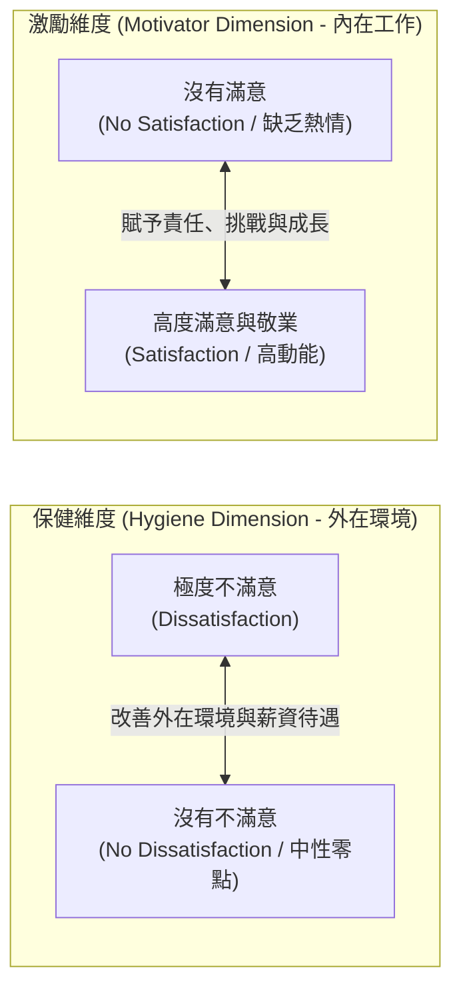
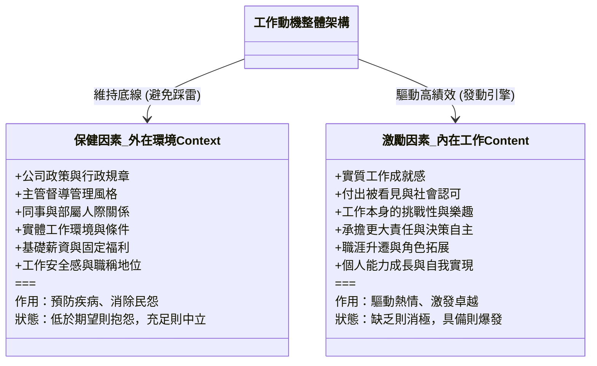
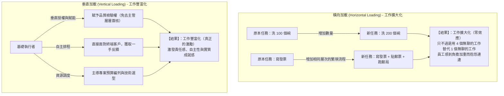
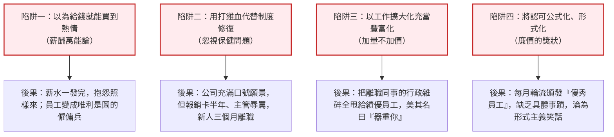

---
{"dg-publish":true,"permalink":"/98/two-factor-theory/","tags":["商業概念","組織行為","領導力","人力資源策略","激勵理論","團隊管理","PMBA"],"dg-note-properties":{"aliases":["雙因素理論","赫茲伯格雙因素理論","激勵保健理論","激勵-保健雙因素理論","Two-Factor Theory","Herzberg's Motivator-Hygiene Theory","Motivator-Hygiene Theory","Dual-Factor Theory"],"tags":["商業概念","組織行為","領導力","人力資源策略","激勵理論","團隊管理","PMBA"]}}
---


# 雙因素理論 (Two-Factor Theory / 赫茲伯格激勵-保健理論)

> **商管核心價值**：  
> 「如果你想要員工把工作做好，首先你得給他們一份好工作；給狗骨頭只能讓牠跑起來，但真正的動力來自於員工內心裝上了發動機。消除工作中的不滿意，並不等於帶來滿意；防止不滿只能維持現狀，唯有賦予工作挑戰、自主與成就，才能真正激發卓越績效。」——弗雷德里克·赫茲伯格（Frederick Herzberg）  
> 
> 在現代組織行為與人才策略中，**雙因素理論（Two-Factor Theory）** 徹底顛覆了傳統「滿意與不滿意為同一線性光譜」的認知誤區。它指出職場滿意度由兩套完全獨立的心理維度構成：消除環境弊端的「**保健因素（Hygiene Factors）**」與驅動心理成長的「**激勵因素（Motivator Factors）**」。高階經理人若僅靠加薪與福利留人，只不過是購買了員工的「不抱怨」；唯有透過工作豐富化與內在賦能，才能點燃知識工作者的主動裁量努力（Discretionary Effort）。

---

## 一、 理論淵源與範式轉移

### 1.1 學術奠基與經典論文
- **提出學者**：美國著名行為科學家、臨床心理學家 **弗雷德里克·赫茲伯格（Frederick Herzberg）**。
- **奠基著作**：1959 年發表《工作激勵因素》（*The Motivation to Work*），透過對匹茲堡地區 200 多名工程師與會計師的「關鍵事件訪談法（Critical Incident Method）」，系統歸納工作满意與不滿意的心理觸發點。
- **管理學標竿**：1968 年於《哈佛商業評論》（HBR）發表傳世名作 **《One More Time: How Do You Motivate Employees?》（再問一次，你如何激勵員工？）**，長年穩居 HBR 創刊以來被要求加印與轉載量最高的管理學經典之一。

---

### 1.2 傳統觀點 vs. 赫茲伯格雙維度獨立假說

傳統管理哲學深受泰勒制（Taylorism）物化思維影響，認為員工滿意度是一條連續的一維光譜：

```
【傳統管理單維光譜（錯誤假設）】：
極度不滿意 <----------------------------------------> 極度滿意
                （給予更多薪水/改善環境）
```
> **傳統假設的盲點**：管理者誤以為只要改善工作環境、多發獎金、改善管理態度，員工就會熱愛工作、主動加班、爆發創造力。但實踐結果往往是：員工拿了獎金依然摸魚，環境變好只是減少了工會罷工。

---

赫茲伯格提出了劃時代的**「雙維度獨立結構（Dual-Continuum Paradigm）」**：滿意與不滿意絕非互為反面，而是兩種截然不同的心理歷程：



> **核心名言**：  
> *"The opposite of job satisfaction is not job dissatisfaction, but, rather, no job satisfaction; and similarly, the opposite of job dissatisfaction is not job satisfaction, but no job dissatisfaction."*  
> （工作滿意的對立面不是不滿意，而是沒有滿意；工作不滿意的對立面不是滿意，而是沒有不滿意。）

---

## 二、 雙因素架構深度拆解：保健 vs. 激勵



### 2.1 保健因素（Hygiene Factors / Extrinsic / 外在維持因素）
- **詞源譬喻**：源自醫學中的「衛生（Hygiene）」概念——保持良好衛生習慣（洗手、消毒）能「預防疾病」，但無法讓一個健康人自動變成「超級運動員」。
- **心理本質**：源於工作環境的**外在脈絡（Context）**，滿足人類避免痛苦、追求生理與安全舒適的本能。
- **典型構成維度**：
  1. **公司政策與行政（Company Policy & Administration）**：官僚僵化、流程繁瑣、制度不公會迅速累積負面情緒。
  2. **監督品質（Supervision）**：微觀管理（Micromanagement）、主管能力不足或態度惡劣。
  3. **人際關係（Interpersonal Relations）**：辦公室政治、同儕冷漠或敵對。
  4. **工作環境與條件（Working Conditions）**：工時過長、照明通風不良、工具設備陳舊落後。
  5. **基本薪資與福利（Salary & Benefits）**：赫茲伯格特別指出，常態性薪資主要扮演保健角色，低於同業會立刻引發離職與抗議。
  6. **工作保障（Job Security）**：隨時面臨裁員威脅會摧毀最基本的安全感。
- **邊際效應特質**：**邊際滿足感快速遞減**。提高冷氣溫度、多發零食咖啡，員工一週後便視為理所當然；一旦取消，卻會引發劇烈抗爭（即「棘輪效應 Ratchet Effect」）。

---

### 2.2 激勵因素（Motivator Factors / Intrinsic / 內在成長因素）
- **心理本質**：源於**工作內容本身（Content）**，滿足人類渴望自我實現、發揮潛能、獲得社會尊重的精神成長需求。
- **典型構成維度**：
  1. **工作成就（Achievement）**：克服棘手難題、按時交付高價值專案所帶來的內在勝任感。
  2. **認可與讚賞（Recognition）**：主管、同儕或客戶對其卓越貢獻的公開肯定與真誠感謝。
  3. **工作本質（Work Itself）**：工作充滿趣味、多樣性、智力挑戰，能發揮自身獨特優勢。
  4. **責任與授權（Responsibility）**：享有端到端的主導權、決策自由度與資源支配權。
  5. **晉升與進階（Advancement）**：明確的職涯晉升階梯與承擔更大領導角色的機會。
  6. **個人心智成長（Growth）**：在工作中不斷解鎖新技能、拓寬眼界與認知邊界。
- **作用機制**：能直接喚醒員工的**自主裁量努力（Discretionary Effort）**——即合約規範之外、員工出於熱情願意主動多做 20%~50% 的卓越產出。

---

### 2.3 保健因素與激勵因素對照表

| 比較維度 | 保健因素 (Hygiene Factors) | 激勵因素 (Motivator Factors) |
| :--- | :--- | :--- |
| **滿足的需求層次** | 生理、安全、歸屬（馬斯洛低階需求） | 尊重、自我實現（馬斯洛高階需求） |
| **關注的核心焦點** | 工作環境外在條件（Work Context） | 工作內容本質本身（Work Content） |
| **主要功能目標** | **預防抱怨、降低離職率（維持基線）** | **驅動卓越、激發創造力（突破上限）** |
| **若供給不足** | 引發強烈憤怒、抱怨、怠工與離職 | 不會引發憤怒，但工作失去熱情，機械化應付 |
| **若供給充足** | 達到「不抱怨、沒有不滿意」的中性狀態 | 達到「極度投入、熱情奉獻、高敬業度」 |
| **時效性特徵** | **暫時性**（易適應，很快被視為理所當然） | **持久性**（深植於心理成長與內在價值感） |
| **典型管理手段** | 調薪、健檢、升級辦公椅、改善員工餐廳 | 專案授權、敏捷自治、創新大賽、公開表揚 |

---

## 三、 組織氣候 2x2 矩陣診斷

企業內部團隊的士氣與產出，可由「保健水準」與「激勵水準」兩個坐標軸構成四種典型組織狀態：

```
             高激勵 (High Motivation)
                      ▲
                      │
   【高壓熱血型 / 創業血汗】   │   【理想型組織 / 卓越夢幻隊】
   • 工作極具挑戰與使命感      │   • 待遇優渥、制度公平
   • 薪資混亂、制度缺乏保障    │   • 授權充分、使命明確
   • 員工短期極限燃燒，容易   │   • 離職率極低、創新湧現
     走向過勞倦怠 (Burnout)   │   • 標竿：Top Tech 頂尖研發團隊
                      │
 ─────────────────────┼─────────────────────► 高保健 (High Hygiene)
                      │
   【噩夢深淵型 / 組織潰散】   │   【養老摸魚型 / 溫水煮青蛙】
   • 薪水差、環境惡劣、內鬥   │   • 福利待遇極佳、工作極安逸
   • 工作無聊、毫無成就感      │   • 體制官僚、缺乏挑戰與淘汰
   • 充滿抱怨、效率低劣、      │   • 員工不抱怨但也絕不主動付出，
     優秀人才全部流失         │     形成高薪「搭便車」文化
                      │
             低激勵 (Low Motivation)
```

### 3.1 四大象限對應之管理決策與處方

1. **高保健 + 高激勵（理想境界 Ideal State）**：
   - **狀態**：員工高敬業度、極少不滿、主動追求突破。
   - **策略**：保持制度透明，持續提供更高階的策略挑戰，防止官僚主義滋生。
2. **高保健 + 低激勵（溫水煮青蛙 Golden Handcuffs）**：
   - **狀態**：薪資優渥（黃金手銬）、環境舒適，但工作枯燥，員工進入「退休倒數」摸魚心態。
   - **策略**：**實施工作再設計**；打破大鍋飯，引進 OKR 與績效挑戰；賦予專案自主權；推動內部創業機制。
3. **低保健 + 高激勵（創業燃盡 Sweatshop / High-Burnout Startup）**：
   - **狀態**：靠創始人願景與改變世界的熱血支撐，但薪資過低、朝令夕改、工具落後，員工身心耗竭。
   - **策略**：**盡速補足管理與薪酬基建**；制度化規範工時與晉升路徑，避免核心骨幹在產品爆發前因過勞離職。
4. **低保健 + 低激勵（潰敗地獄 Nightmare State）**：
   - **狀態**：怨聲載道、推諉塞責、劣幣驅逐良幣。
   - **策略**：進行休克療法；整頓管理高層與有害文化，重新梳理薪酬結構，淘汰害群之馬後重構業務流程。

---

## 四、 赫茲伯格的深刻洞察：KITA 批判與工作設計

### 4.1 著名的 KITA（Kick In The Ass）批判
在 1968 年的 HBR 經典中，赫茲伯格辛辣地抨擊了企業界常用的「KITA 手段」：
- **消極性 KITA（Negative KITA，罰則與威脅）**：用解僱、扣獎金、公開羞辱強迫員工工作。赫茲伯格指出：「消極 KITA 不叫激勵，那叫**強迫（Coercion）**。它只能帶來短暫的服從，同時製造反抗與破壞。」
- **積極性 KITA（Positive KITA，胡蘿蔔誘餌）**：用一次性獎金、升官發財來誘使員工做事。赫茲伯格直言：「這同樣不是激勵，因為**發動機不在員工身上，而在管理者的口袋裡**。管理者必須不斷拿出更大的胡蘿蔔，一旦停止餵食，拉車的驢子立刻停下。」
- **真激勵的標準**：
  > 「只有當員工體內自備發電機（Generator inside），即使主管不在場、沒有額外獎金懸賞，他依然為了解決問題而廢寢忘食時，真正的動機才算誕生。」

---

### 4.2 工作擴大化 (Job Enlargement) vs. 工作豐富化 (Job Enrichment)

赫茲伯格強烈反對管理者自欺欺人的「偽變革」，提出了工作重構的清晰邊界：



#### 垂直工作加載（Vertical Job Loading）七大設計原則：
1. **解除部分控制（Remove some controls while retaining accountability）**：保留最終問責，但免除瑣碎的過程審批。
2. **增加個人責任（Increase personal accountability）**：讓員工對完整成果端到端負責。
3. **分配完整工作單元（Assign complete, natural units of work）**：拒絕螺絲釘化，提供任務完整性（Task Identity）。
4. **授予決策自由度（Grant additional authority / job freedom）**：給予在專業範疇內的自主裁決權。
5. **開放內部直接反饋（Make periodic reports directly available to the worker）**：反饋直接來自工作本身或客戶，而非主管二手過濾。
6. **引入全新挑戰任務（Introduce new and more difficult tasks）**：持續拓展能力極限。
7. **指派專精角色（Assign specific or specialized tasks）**：讓員工成為某個領域的「內部專家（Go-to Person）」。

---

## 五、 與其他經典動機/管理理論的橫向融通

### 5.1 雙因素理論與馬斯洛需求層次理論（Maslow）之映射

```
【馬斯洛需求層次 (Maslow)】             【赫茲伯格雙因素 (Herzberg)】
┌────────────────────────┐              ┌────────────────────────┐
│  自我實現 (Self-Actualization)│ ◄───────────► │                        │
├────────────────────────┤              │   激勵因素 (Motivator)  │
│  尊重需求 (Esteem Needs)      │ ◄───────────► │  (內在成長、成就、責任) │
├────────────────────────┤              ├────────────────────────┤
│  社交歸屬 (Belongingness)    │ ◄───────────► │                        │
├────────────────────────┤              │   保健因素 (Hygiene)    │
│  安全需求 (Safety Needs)      │ ◄───────────► │  (外在環境、薪資、人際) │
├────────────────────────┤              │                        │
│  生理需求 (Physiological)    │ ◄───────────► │                        │
└────────────────────────┘              └────────────────────────┘
```
- **核心聯繫**：馬斯洛低階需求對應保健因素，高階需求對應激勵因素。
- **維度差異**：馬斯洛假定需求是由下而上循序滿足（滿足階梯論）；赫茲伯格則強調低階（保健）與高階（激勵）在職場中是**並行不悖的雙軌運作**。即使薪資尚未達到極致滿意，富有挑戰性的工作依然能激發驚人創造力。

---

### 5.2 與自我決定理論（Self-Determination Theory, SDT）之現代共鳴
Deci & Ryan 的 SDT 理論進一步從神經科學與心理學驗證了赫茲伯格的洞察：
- **自主感（Autonomy）** $\longleftrightarrow$ 赫茲伯格的「責任承擔與決策自由度」。
- **勝任感（Competence）** $\longleftrightarrow$ 赫茲伯格的「工作成就感與能力成長」。
- **關聯感（Relatedness）** $\longleftrightarrow$ 保健中的良好協同關係，以及激勵中的「被集體高度認可」。

---

### 5.3 跨界映射：雙因素與產品設計之「卡諾模型 (Kano Model)」

管理學中的員工激勵與產品學中的用戶體驗，在底層邏輯上存在驚人的對偶性：

| 赫茲伯格雙因素理論 (Herzberg) | 卡諾模型 (Kano Model - 產品體驗) | 用戶/員工心理狀態反饋 |
| :--- | :--- | :--- |
| **保健因素 (Hygiene)** | **必要品質 (Must-be Quality)** | 沒有時**極度憤怒/抱怨**；做好時只覺得**理所當然**（如冷氣、無 Bug 登入）。 |
| **激勵因素 (Motivator)** | **魅力品質 (Attractive Quality)** | 沒有時**不會主動挑剔**；一旦具備則產生**極致驚艷與超高忠誠度**。 |

---

## 六、 經理人常見謬誤與實務避坑指南

### 6.1 經理人最容易踩的四大管理陷阱



---

### 6.2 雙因素理論的學術局限與批判性反思
在將雙因素理論應用於當代組織管理時，亦需理解其理論邊界：
1. **關鍵事件法的自利歸因偏差（Self-Serving Bias）**：
   - 心理學研究發現，受訪者在成功時傾向將功勞歸於自己的能力與成就（激勵因素），在受挫或不快時傾向歸咎於外部環境與主管制度（保健因素）。
2. **忽視個體異質性與價值觀差異**：
   - 對於處於經濟高壓期的基層員工，高額獎金可能具備極強的直接激勵效用；而對高淨值資深專家，工作彈性與自主性更具決定性。
3. **情境脈絡動態性（Context Fluidity）**：
   - 在遠距辦公（WFH）時代，彈性工時過去屬於「激勵因素」，如今在許多年輕世代工程師眼中已轉變為不可妥協的「基本保健因素」。

---

## 七、 實務落地工具：團隊動能自我診斷檢核表

經理人每季可透過以下十項自我提問，快速診斷團隊的雙因素健康度：

```markdown
### 🛡️ 保健維度防護檢核 (目標：維持沒有不滿意)
- [ ] 1. 【制度透明】：公司的績效考評、加薪與分紅規則是否白紙黑字且嚴格執行？
- [ ] 2. 【行政減負】：員工是否需要花費超過 20% 的精力應對無效審批與繁冗報銷？
- [ ] 3. 【工具設備】：團隊日常開發、協同、辦公所需的軟硬體工具是否低劣卡頓？
- [ ] 4. 【心理安全】：員工在會議中指出流程缺陷或提出異議時，是否會遭到主管秋後算賬？
- [ ] 5. 【市場水準】：關鍵核心骨幹的底薪是否已顯著脫離業界中位數（P50）？

### 🚀 激勵維度發動檢核 (目標：驅動主動敬業度)
- [ ] 6. 【專案自主】：員工對於「如何完成工作」是否享有足夠的決策自由度？
- [ ] 7. 【即時回饋】：團隊成員在上個月是否至少獲得過一次針對具體貢獻的真誠讚賞？
- [ ] 8. 【任務完整】：員工是否能看見自己的工作對最終用戶產生的真實影響？
- [ ] 9. 【挑戰躍升】：過去半年內，是否為核心成員安排了能突破其現有舒適圈的關鍵挑戰？
- [ ] 10. 【職涯連結】：成員是否清楚當前專案與其個人未來三年的職涯成長目標有何關聯？
```

---

## 八、 PMBA 模組與知識網絡鏈結

### 8.1 官方課程與模組雙向鏈結
- [[04_主題選修/10_創業與企業財務策略/02_模組筆記/Module_1_創新思維與商業模式/M1-9_商業模式畫布架構與價值主張設計\|M1-9 商業模式畫布架構與價值主張設計]]：在「關鍵資源（Key Resources）」與「關鍵活動（Key Activities）」中，人力資本的激勵機制是維持營運飛輪運轉的核心底層。
- [[04_主題選修/10_創業與企業財務策略/02_模組筆記/Module_1_創新思維與商業模式/M1-10_七大市場力量與商業戰略價值公式\|M1-10 七大市場力量與商業戰略價值公式]]：剖析「流程力量（Process Power）」與頂尖研發團隊的留存機制，卓越工程文化正是高保健與高激勵的結晶。
- [[04_主題選修/12_產業分析與投資策略/02_模組筆記/Module_1_總論與架構/M1-3_產業獲利結構差異與十大經典理論\|M1-3 產業獲利結構差異與十大經典理論]]：組織能力（RBV 資源基礎觀點）視角下，無法被競爭對手輕易複製的默會知識與高敬業度團隊。

### 8.2 商業概念庫相關卡片
- [[maslow-hierarchy-of-needs_馬斯洛需求層次理論\|maslow-hierarchy-of-needs_馬斯洛需求層次理論]]（高階與低階需求的理論對位）
- [[self-determination-theory_自我決定理論\|self-determination-theory_自我決定理論]]（自主、勝任、關聯三大核心動機驅動力）
- [[kano-model_卡諾模型\|kano-model_卡諾模型]]（產品滿意度中的必要品質 vs. 魅力品質）
- [[okr-objectives-and-key-results_目標與關鍵成果\|okr-objectives-and-key-results_目標與關鍵成果]]（藉由野心目標激發內在工作成就）
- [[98_商業概念庫/competitive-advantage_競爭優勢\|competitive-advantage_競爭優勢]]（組織執行力作為可持續競爭優勢的來源）
- [[98_商業概念庫/dfm-design-for-manufacturability_可製造性設計\|dfm-design-for-manufacturability_可製造性設計]]（跨部門協同中的責任賦能與動機設計）
