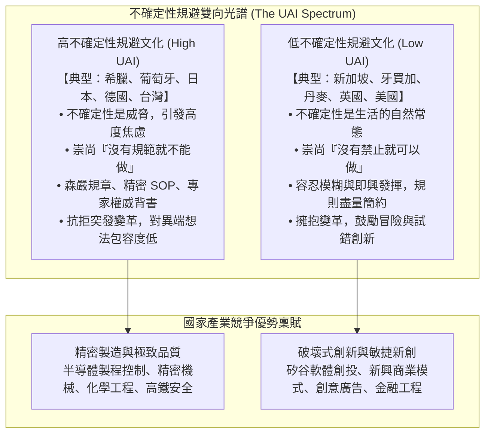

---
{"dg-publish":true,"permalink":"/98/uncertainty-avoidance/","tags":["商業概念","跨文化管理","組織行為","決策科學","PMBA"],"dg-note-properties":{"aliases":["不確定性規避","Uncertainty Avoidance","不確定性規避指數","UAI文化維度"],"tags":["商業概念","跨文化管理","組織行為","決策科學","PMBA"]}}
---


# 不確定性規避 (Uncertainty Avoidance)

> [!NOTE]
> **核心概念精粹**：不確定性規避（Uncertainty Avoidance Index, UAI），是吉爾特·霍夫史泰德（Geert Hofstede）文化維度理論中的關鍵維度。它衡量一個社會的成員在面對**未知、結構模糊、不可預測或突發的未來情境時，感受到的內在威脅與焦慮程度，以及他們試圖透過正式規章、標準作業程序（SOP）、權威專家與宗教信仰來消除這種焦慮的傾向**。高 UAI 文化長於精密品質與合規執行，但易落入官僚僵化；低 UAI 文化長於敏捷創新與大膽試錯，但易忽略細節穩定。

---

## 一、 學理定位：焦慮應對與制度化防禦

霍夫史泰德特別強調：**不確定性規避絕不等於純粹的「風險規避（Risk Avoidance）」**。
- 風險（Risk）是已知結果與概率的具體事件（如玩俄羅斯輪盤或購買股票）；
- 不確定性（Uncertainty）則是未知、模糊、完全無法計算的情境。不確定性規避文化的核心驅動力是**「抗拒模糊（Fight against Ambiguity）」**。



---

## 二、 高 UAI vs 低 UAI 文化組織管理模式全維度對比

當跨國企業在不同 UAI 國家推動管理改革時，將面臨截然相反的員工心理預期：

| 管理維度 | 高不確定性規避文化（High UAI） | 低不確定性規避文化（Low UAI） | 經理人跨國適配準則 |
| :--- | :--- | :--- | :--- |
| **作業程序與規範** | 制定鉅細靡遺的 SOP、緊急應變手冊，任何工作步驟必須有章可循。 | 流程保持高度彈性，強調原則指導而非教條約束，鼓勵因地制宜。 | 向德國/日本團隊交代任務時，必須提供完整文件與清晰指標；向美國團隊則需保留自主發揮空間。 |
| **對權威與專家的態度** | 崇尚高學歷專家、技術權威（如博士、技師證照），尊重資深顧問的正式鑑定。 | 實用主義至上，不迷信權威證書，更看重現場解決問題的實際能力。 | 在高 UAI 市場推出新產品時，應大幅強調權威認證、官方檢驗報告與專利背書。 |
| **創新與變革節奏** | 漸進式改良（Kaizen）、消除一切缺陷，抗拒顛覆性重組。 | 大膽推動破壞式創新，能容忍「帶著缺陷先上線（Move fast and break things）」。 | 高 UAI 團隊長於做 $1 \to N$ 的極致優化；低 UAI 團隊長於做 $0 \to 1$ 的無中生有。 |
| **職場安全感與忠誠度** | 極度渴望長期雇傭保障、養老金體系健全，頻繁跳槽被視為不穩定。 | 習慣工作流動與專案制合作，將跳槽與未知轉職視為自我挑戰的良機。 | 在高 UAI 國家應強調企業歷史悠久、財務穩健，提供終身職涯安全感。 |

---

## 三、 經典企業實戰案例：高 UAI 精密神話 vs 低 UAI 破壞創新

```carousel

<!-- slide -->
### 1. 高 UAI 典範：台積電的晶圓良率與神級 SOP
- **文化土壤**：台灣具備典型的高不確定性規避特質，工程師與技術員敬畏規則、嚴格執行程序、抗拒隨意變異；
- **競爭優勢**：在極紫外光（EUV）3 奈米製程中，包含數千道繁複工序，任何微米級的浮動都會導致良率崩盤；台積電將高 UAI 文化轉化為「極致紀律」——每道工序嚴格對照標準，24 小時三班倒無縫交接；
- **商業結果**：創造了全球超過 60% 的晶圓代工壟斷份額，良率將英特爾與三星甩在身後。
<!-- slide -->
### 2. 低 UAI 典範：矽谷的「精實創業」與快速失敗
- **文化土壤**：美國文化具備顯著的低不確定性規避特質，習慣擁抱未知與模糊（Tolerance of Ambiguity）；
- **策略邏輯**：臉書早期核心座右銘「快速行動，打破常規（Move Fast and Break Things）」；軟體產品在只有 60% 完善度時即以 MVP 形式直接推向市場，在真實用戶的反饋中邊被罵邊修復；
- **成果**：孕育了全球最強大的軟體與網路平台生態系，壟斷了搜尋、社群與生成式 AI 底層架構。
```

---

## 四、 經理人不確定性規避組織配置檢核表（Executive Decision Checklist）

在進行組織架構設計與任務指派時，高階管理團隊應依序審計下列維度：

- [ ] **部門屬性與 UAI 心理契合度（Departmental UAI Fit）**：
  - 組織內部是否進行了文化分流？（財務審計、資安合規、晶圓產線應配置高 UAI 嚴謹人才；前沿研發、新創孵化、跨界行銷應配置低 UAI 容忍模糊人才）。
- [ ] **轉型變革溝通手冊（Change Management Clarity）**：
  - 在高 UAI 文化團隊中推動組織架構轉型時，是否提供了足夠詳盡的「過渡期路線圖、薪資權益不變承諾與轉型指引」？如果缺乏透明細節，員工會因極端焦慮而引發強烈集體抗拒。
- [ ] **官僚SOP除贅機制（SOP Anti-Bloat Review）**：
  - 高 UAI 組織容易為了規避責任而無限制疊加審批流程；我們是否定期清理過時、低效且阻礙創新的冗餘程序？
- [ ] **失敗容忍度制度化（Institutionalizing Failure Tolerance）**：
  - 組織是否明文確立了「經深思熟慮的智能失敗（Intelligent Failure）」不予懲戒的文化？防止高 UAI 員工因害怕未知責任而人人「踢皮球、不作為」。

---

## 五、 關聯概念與知識網絡

* 跨文化理論與心智模型：
  * [[culture-dimension_霍夫斯泰德文化維度|霍夫斯泰德文化維度 (Hofstede Dimensions)]]：文化大一統架構
  * [[individualism-vs-collectivism_個人主義與集體主義|個人主義與集體主義 (Individualism vs Collectivism)]]：群體忠誠與個人自主之維度互補
  * [[Tolerance_of_Ambiguity_不確定性容忍度與控制感|不確定性容忍度與控制感 (Tolerance of Ambiguity)]]：心理學視角下個體駕馭不確定性之核心素養
  * [[power-distance_權力距離|權力距離 (Power Distance)]]：威權服從與不確定性規避之交織效應
* 策略執行與風控工具：
  * [[contingency-planning_應變計畫|應變計畫 (Contingency Planning)]]：高 UAI 組織抵禦未知風險之制度化 BCP
  * [[lean-startup_精實創業|精實創業 (Lean Startup)]]：低 UAI 文化下以小規模實驗消除不確定性之方法論
  * [[risk-control_風險控制|風險控制 (Risk Control)]]：消除營運變異之標準化防禦線
  * [[goodharts-law_古德哈特定律|古德哈特定律 (Goodhart's Law)]]：過度依賴刻板 SOP 規則所引發的系統僵化
