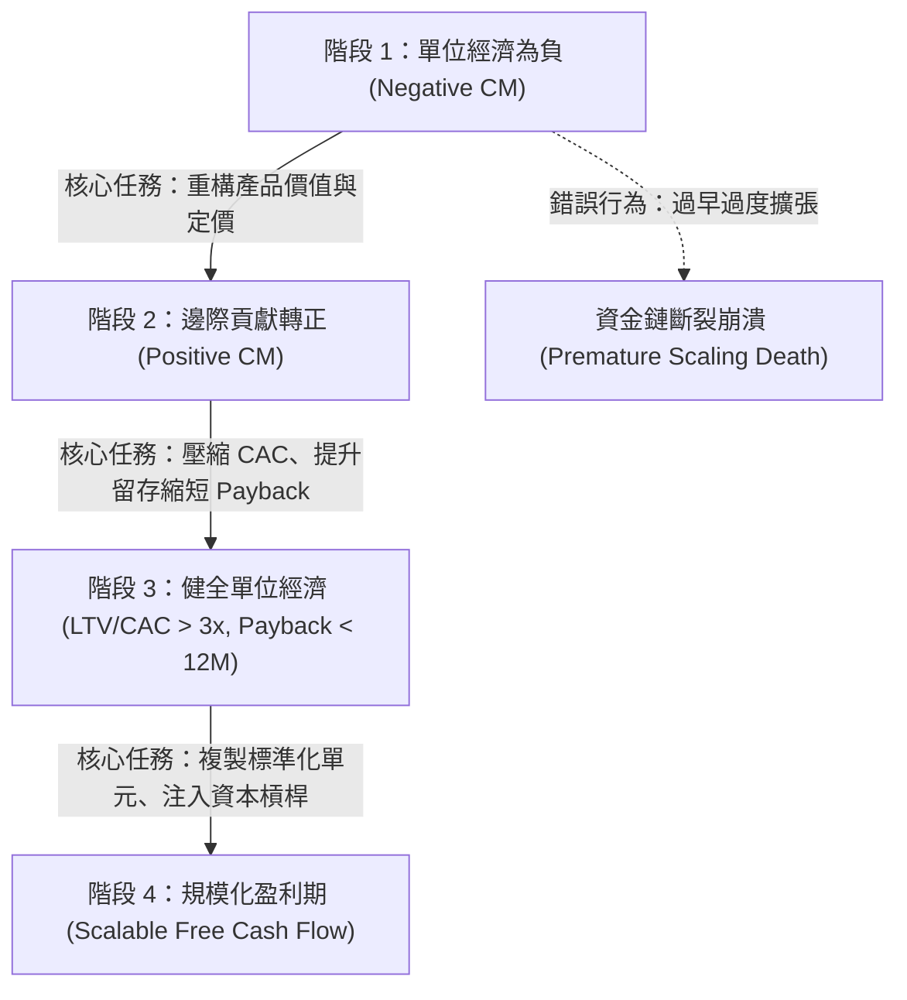

---
{"dg-publish":true,"permalink":"/98/unit-economics-model/","tags":["商業概念","創業管理","財務策略","投資策略","PMBA"],"dg-note-properties":{"aliases":["單位經濟模型","Unit Economics","單位經濟效益","LTV-CAC比率","回收期"],"tags":["商業概念","創業管理","財務策略","投資策略","PMBA"]}}
---


# 單位經濟模型 (Unit Economics Model)

> **【核心決策摘要】**
> **單位經濟模型（Unit Economics Model）** 是指以企業最微觀、最本質的「單一運作單元（Unit）」（如單一顧客、單一訂單、單輛車、單間門市）為核算維度，分析該單元在生命週期內所產生的**直接邊際營收與其直接變動成本之間的結構性比例關係**。它是檢驗一項商業模式究竟是「具備規模槓桿的高利潤引擎」，抑或是「越賣越虧的規模化毒藥」的唯一真理標尺。若單位經濟為負，盲目追求 GMV 擴張只會加速企業邁向破產；唯有在單位經濟實現正向閉環且回本期受控的前提下，注入融資資本才能轉化為可持續的企業價值。

---

## 1. 概念核心定義與本質 (Executive Definition & Theoretical Essence)

### 1.1 核心定義
單位經濟模型在管理會計與創業財務學中定義為：**在排除總部固定行政負擔（Overhead）的前提下，衡量企業產出單一邊際產品或交付單次服務所對應的邊際收益（Marginal Revenue）與邊際變動成本（Marginal Cost）之配比結構**。

其最核心的檢驗邏輯為：
```
單位邊際貢獻 (Unit Contribution Margin) = 單位營收 (Unit Revenue) - 單位變動成本 (Unit Variable Costs)
```
若單位邊際貢獻不能完全覆蓋該單元的初期獲取成本（CAC），則該商業模式在微觀層面不成立。

### 1.2 本質解析：破除「規模化迷思 (The Scale Fallacy)」
商業史中最昂貴的謬誤是：**「我們現在每單虧錢，但只要規模做大，就能靠量大扭虧為盈（Losing money on every sale, but making it up on volume）」**。
1. **固定成本 vs. 變動成本的邊界混淆**：規模經濟只能攤薄「固定成本（Fixed Costs）」，如廠房租金、研發專利支出；但永遠無法消除「直接變動成本（COGS、履約運費、原料消耗）」。如果每單的價格低於直接交付成本，規模越大，虧損總額便呈幾何級數放大。
2. **資本市場估值邏輯的結構性位移**：在低利率寬鬆時期，創投可能暫時容忍負單位經濟以換取市場份額（TAM 圈地）；但在正常資本市場環境下，投資人與經理人最嚴苛審查的指標就是**每單位現金流的正向造血能力**。
3. **單元選擇的戰略意義**：不同商業模式有其本質不同的單元定義（SaaS 定義為「單一付費客戶」；外送平臺定義為「單筆配送訂單」；共享運具定義為「單輛滑板車全生命週期」）。選錯分析單元，將直接導致管理決策失焦。

---

## 2. 數理模型與三大黃金黃金指標 (Mathematical Modeling & The Golden Metrics)

### 2.1 黃金指標一：CLV / CAC 比率 (The LTV to CAC Ratio)

評估客戶終身創造毛利與初期獲取成本之比值：

$$\text{Ratio}_{\text{LTV/CAC}} = \frac{\text{CLV}}{\text{CAC}} = \frac{\frac{\text{ARPU} \times \text{Gross Margin \%}}{\text{Churn Rate}}}{\text{CAC}}$$

#### 經理人決策標準區間：
| LTV / CAC 數值 | 診斷結論 | 高階經理人決策與戰略行動 |
| :---: | :---: | :--- |
| **$< 1.0x$** | **死亡深淵 (Value Destruction)** | 模式嚴重畸形。每獲取一名客戶即摧毀部分資本；立即叫停付費投放，徹底重構定價或產品價值。 |
| **$1.0x \sim 2.5x$** | **危險失血 (Fragile State)** | 容錯空間極窄。微小的客戶流失或運營成本波動將引發整體虧損；缺乏對外部經濟衝擊的防禦力。 |
| **$3.0x \sim 5.0x$** | **黃金健康區 (The Sweet Spot)** | 資本配置極佳。具備極強的自我造血與可持續擴張能力；可全力推進市場擴張與銷售融資。 |
| **$> 5.0x$** | **保守過度 (Under-investing)** | 市場份額被動流失。獲客預算可能過度收縮，未充分挖掘市場潛能；應加大行銷投資以搶佔 [[TAM|總體潛在市場]]。 |

---

### 2.2 黃金指標二：CAC 回本週期 (CAC Payback Period)

衡量企業透過客戶產生的淨毛利，完整收回最初投入獲客成本所需的時間月數：

$$\text{CAC Payback Period (Months)} = \frac{\text{CAC}}{\text{ARPU} \times \text{Gross Margin \%}}$$

- **意義**：直接決定了企業的**現金週轉速度與資本跑道（Runway）消耗速率**。
- **標竿準則**：
  - **$< 12$ 個月**：世界級頂尖水準（新創可在同一會計年度內實現現金再投資，形成高速自循環）。
  - **$12 \sim 18$ 個月**：健康優良標準（多數成熟 B2B SaaS 企業所處區間）。
  - **$> 24$ 個月**：極度危險（高度依賴外部融資輸血，一旦資本市場降溫，公司將迅速面臨斷流危機）。

```mermaid
gantt
    title 典型客戶現金流回本軌跡 (CAC Payback Timeline)
    dateFormat  X
    axisFormat %d 個月
    section 現金流累計
    初始獲客支出 (-CAC)    :crit, 0, 1
    毛利持續回填 (虧損區)   :active, 1, 12
    回本平衡點 (Payback=12M) :milestone, 12, 12
    純毛利貢獻期 (淨利潤區) :done, 12, 36
```



---

### 2.3 黃金指標三：Magic Number (SaaS 銷售效率指標)

衡量每投入 1 美元行銷與銷售費用，能在次季催生出多少新增年度經常性收入（ARR）：

$$\text{Magic Number} = \frac{(\text{ARR}_Q - \text{ARR}_{Q-1}) \times 4}{\text{S\&M Spend}_{Q-1}}$$

- **$\text{Magic Number} > 1.0$**：銷售效率極高，應大舉擴張銷售團隊與行銷投放。
- **$0.75 \sim 1.0$**：運作效率良好，具備持續擴展價值。
- **$< 0.75$**：模式存在堵塞，應檢修漏斗轉換率與銷售賦能流程，暫緩盲目增聘銷售人員。

---

## 3. 戰略框架與典型業態單元拆解 (Strategic Framework & Unit Breakdown)

### 3.1 四大主流商業模式的單位經濟解構

```
┌─────────────────────────────────────────────────────────────────────────┐
│                        商業模式單位經濟剖析矩陣                         │
├─────────────────┬───────────────┬───────────────────┬───────────────────┤
│ 商業型態        │ 最小核算單元  │ 單位收入構成      │ 單位直接變動成本  │
├─────────────────┼───────────────┼───────────────────┼───────────────────┤
│ 1. 訂閱制 SaaS  │ 單一付費帳號  │ 月費/年費 (MRR)   │ 伺服器託管、客服  │
│                 │ (Account)     │ + 增購功能模組    │ 支援、金流手續費  │
├─────────────────┼───────────────┼───────────────────┼───────────────────┤
│ 2. 電商平台/DTC │ 單筆交易訂單  │ 商品售價 (AOV)    │ 採購成本、倉儲包  │
│                 │ (Order)       │ + 買方負擔運費    │ 裝、幹線物流、退貨│
├─────────────────┼───────────────┼───────────────────┼───────────────────┤
│ 3. 共享叫車/外送│ 單次行程/配送 │ 乘客車資/配送費   │ 司機拆帳提成、保  │
│                 │ (Trip / Ride) │ + 平台抽成佣金    │ 險費、動態補貼券  │
├─────────────────┼───────────────┼───────────────────┼───────────────────┤
│ 4. 連鎖實體門市 │ 單一標準門市  │ 門市總營業額      │ 食材原料、門市水  │
│                 │ (Store Unit)  │ (Store Sales)     │ 電、店員計時工資  │
└─────────────────┴───────────────┴───────────────────┴───────────────────┘
```

### 3.2 單位經濟從負轉正的動態進化路徑



---

## 4. 經典企業個案深度剖析 (Deep Dive Case Studies)

### 4.1 成功典範：DoorDash 藉由微觀訂單單位經濟優化逆襲對手
- **背景困境**：外送平臺常被視為「燒錢泥淖」，每筆訂單因客單價低、司機高額補貼而長期虧損（Uber Eats、Grubhub 皆深陷其中）。
- **微觀單位經濟重構戰役**：
  1. **郊區市場定位策略**：避開擁擠繁華的曼哈頓都會區，聚焦家庭為主的郊區市場。郊區訂單具備「高客單價（AOV）、高餐點件數、家庭聚餐頻率高」的天然優勢。
  2. **批量路由演算法（Batching & Routing）**：優化調度演算法，使單一外送員單次出行能同時交付 2~3 筆鄰近訂單，將每單邊際交付成本壓降 35%。
  3. **向餐廳收取階梯抽成 + 廣告促銷收入**：在每單配送基礎上增添高毛利的數位廣告與優選推薦收入，全面拓寬單筆訂單邊際貢獻。
- **成果**：DoorDash 率先生產出正向的單筆訂單 EBITDA 貢獻，在疫情期間超越 Grubhub 與 Uber Eats，躍居全美外送市佔第一。

### 4.2 失敗警示：WeWork 共享辦公空間的「單元模型塌陷」
- **本質謬誤**：WeWork 宣稱自己是具備網絡效應的「高科技平臺」，理應享受高科技估值倍數；但其微觀核算單元本質上是——**單一辦公工位（Desk Unit）**。
- **致命的單元錯配**：
  1. **資產負債期限錯配**：承擔 10~15 年不可撤銷的昂貴長期租約（剛性固定成本），轉手出租給僅簽約數月至一年的新創客戶（彈性不穩定收入）。
  2. **真實工位改造成本高昂**：每個工位的奢華裝潢、咖啡啤酒等維護費用極其高昂，單一工位回本週期遠超客戶平均續約週期。
  3. **空置率敏感度極端脆弱**：一旦出租率跌破 80% 的損益平衡線，單工位現金流立即翻轉為負。
- **後果**：在未驗證單一門市工位單位經濟可持續獲利前，依賴軟銀數十億美元注資盲目全球瘋狂拓點，最終隨擴張失控而聲請破產重組。

---

## 5. 高階經理人決策實戰工具箱 (Executive Action Playbook)

### 5.1 單位經濟診斷與決策四象限

```
                    高 LTV/CAC 比率 (> 3x)
                            │
            【象限 II：資本受限型】 │ 【象限 I：全速衝刺型】
            • 現象：每單賺錢但回本慢  │ • 現象：利潤豐厚、回本極快
              (Payback > 18 個月)    │   (Payback < 12 個月)
            • 決策：改善收款週期，    │ • 決策：全力加槓桿推進融資，
              推動客戶年繳預付現金流   │   迅速擴大市場份額封鎖競品
    ───────────────┼───────────────
            【象限 III：瀕死毒藥型】│ 【象限 IV：現金流轉化型】
            • 現象：越賣越虧且血流不止│ • 現象：回本極快但生命週期短
              (LTV/CAC < 1x)         │   (急進急出、易流失)
            • 決策：立即叫停擴張！    │ • 決策：壓低後續服務固定支出，
              全面重整產品與邊際成本   │   轉化為短期現金牛業務
                            │
                    低 LTV/CAC 比率 (< 1.5x)
    長回本週期 (> 18M) ────────────────── 短回本週期 (< 12M)
```

### 5.2 執行長防禦過早擴張（Premature Scaling）五大檢核表
- [ ] **檢核 1：在加速行銷支出前，是否已連續 3 個季度驗證正向單位邊際貢獻？**
- [ ] **檢核 2：新進同期群（Cohort）的 CAC 回本期是否穩定控制在 12~14 個月內？**
- [ ] **檢核 3：高階團隊是否清楚定義出全公司的「單一核心核算單元」？**
- [ ] **檢核 4：是否已對營收施加極端壓力測試（例如：若同業引發價格戰，毛利率下滑 15%，單位經濟是否仍能維持為正）？**
- [ ] **檢核 5：業務增長是否依靠產品本身的價值黏性，而非不可持續的補貼券驅動？**

---

## 6. 關聯知識網絡與導航地圖 (Knowledge Network & Cross-References)

### 6.1 本主題核心三部曲
- **[[cac-customer-acquisition-cost_獲客成本]]** · 獲客投入全負擔精算、流量歸因與邊際效率遞減
- **[[clv-customer-lifetime-value_顧客終身價值]]** · 折現現金流模型、同期群留存微笑曲線與負流失率擴張
- **[[unit-economics-model_單位經濟模型]]** · LTV/CAC 比率、回本週期（Payback Period）與規模化可行性驗證（本篇）

### 6.2 跨領域財務與策略鏈結
- [[economies-of-scale_規模經濟]] · 釐清規模經濟攤薄固定成本之界限，避免墜入變動成本規模化迷思
- [[capital-structure_資本結構]] · 單位經濟造血能力對企業負債融資容量與權益定價之決定性影響
- [[equity-financing_股權融資]] · 創投盡職調查評估企業「資本效率（Capital Efficiency）」之核心量尺
- [[positioning-strategy_定位策略]] · 佔據高溢價定位以強化單元定價權（Pricing Power）

### 6.3 課程筆記與導航主頁
- [[M1-5_創業構想發展與兩階段可行性評估]] · 創業構想深入評估之財務可行性分析模型
- [[_創業與企業財務策略 MOC]] · 創業財務與資本結構核心導航地圖
- [[home]] · 全球 PMBA 知識庫總導航主頁面