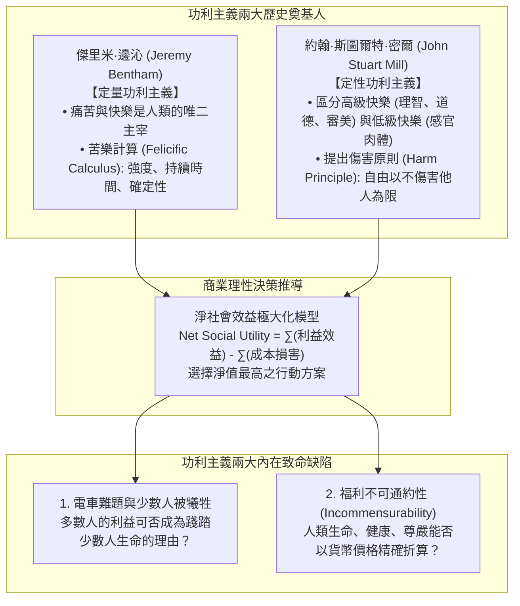

---
{"dg-publish":true,"permalink":"/98/utilitarian-view/","tags":["商業概念","商業倫理","決策科學","哲學","PMBA"],"dg-note-properties":{"aliases":["功利主義觀點","效益主義觀點","Utilitarian View of Ethics","結果論倫理觀","Consequentialism"],"tags":["商業概念","商業倫理","決策科學","哲學","PMBA"]}}
---


# 功利主義觀點 (Utilitarian View of Ethics)

> [!NOTE]
> **核心概念精粹**：功利主義觀點（Utilitarian View of Ethics / 效益主義），在倫理學中屬於**結果論（Consequentialism）**的核心流派。它主張一項決策或行動的道德正當性，完全取決於其所產生的最終後果——**「能否為最大多數人創造最大程度的整體淨幸福與福祉（The Greatest Happiness for the Greatest Number）」**。在商業管理中，它是成本效益分析（Cost-Benefit Analysis, CBA）與資源最佳化配置的理論基石；但若缺乏權利與正義的制衡，極易滑向侵犯少數人基本權利與將生命冷血定價的道德深淵。

---

## 一、 學理淵源：從邊沁的苦樂計算到密爾的定性效益

功利主義哲學在 18 至 19 世紀的演進，確立了當代經濟學與公共政策評估的底層邏輯：



---

## 二、 功利主義在現代管理中的合法應用與制度邊界

在微觀經濟學與企業營運中，功利主義是極度實用且高效的決策工具，但必須清楚其適用邊界：

| 管理應用領域 | 功利主義決策邏輯 | 正面營運價值 | 潛在倫理風險 |
| :--- | :--- | :--- | :--- |
| **資本預算與專案評估<br>(Capital Allocation)** | 比較各專案的淨現值（NPV）與內部報酬率（IRR），優先投資為股東與顧客創造最高經濟價值的案子。 | 極大化資本配置效率，避免稀缺資源浪費。 | 忽視被排擠弱勢專案利害關係人的生存權益。 |
| **公共衛生與防疫資源<br>(Healthcare Triage)** | 檢傷分類（Triage）：在加護病房與疫苗稀缺時，優先救治存活率最高與挽救生命年限最長者。 | 在極端資源匱乏下拯救最多生命。 | 年長者與重症慢性病患被制度性邊緣化。 |
| **企業組織重組與精簡<br>(Restructuring & Layoffs)** | 透過關閉虧損部門與裁員 10%，挽救全體公司剩餘 90% 員工的飯碗與企業生存。 | 避免整艘企業巨輪全盤沉沒。 | 離職員工承受極大生計代價，容易忽視補償程序。 |

---

## 三、 經典企業實戰案例：福特 Pinto 汽車的冷血成本效益分析

```carousel

<!-- slide -->
### 1. 致命設計缺陷與冷血計算
- **背景**：1970 年代初福特推出平價小車 Pinto。測試發現其油箱置於後軸後方，一旦遭遇後方追撞極易破裂起火爆炸；
- **功利主義計算表**：福特內部撰寫了一份臭名昭著的成本效益分析：
  - **改善成本**：每輛車加裝防護零件需 11 美元，全美 1,250 萬輛車合計需花費 **1.37 億美元**；
  - **預估效益**：根據美國監管機關對每條人命 20 萬美元、燒傷賠償 6.7 萬美元的估值，不改進預計導致 180 人死亡、180 人重傷，合計損害僅為 **4,950 萬美元**；
  - **決策結論**：改善成本（1.37 億）遠大於生命損害效益（4,950 萬），福特高層決定「不予召回改進」。
<!-- slide -->
### 2. 倫理崩潰與天價懲罰
- **悲劇爆發**：數百名無辜駕駛因追撞慘遭活活燒死或嚴重毀容；
- **審判反噬**：1978 年 Grimshaw 案陪審團獲悉這份將生命以 20 萬美元冷血定價的備忘錄後出離憤怒，判定福特賠償創紀錄的 1.25 億美元懲罰性賠償（後調降至 350 萬），Pinto 品牌全盤覆滅；
- **學理啟示**：單純的功利主義計算若忽視了人類基本[[rights-view_權利觀點|生命權利]]與[[justice-view_正義觀點|正義底線]]，將成為毀滅企業聲譽的道德毒藥。
```

---

## 四、 經理人功利主義決策審計檢核表（Executive Decision Checklist）

在運用成本效益分析推動重大變革或裁決時，高階管理團隊應進行下列倫理壓力測試：

- [ ] **少數人權益侵犯防禦（Minority Rights Protection）**：
  - 本方案為「多數人」帶來的利益，是否建立在「殘酷剝奪少數人基本尊嚴、健康或生計」的基礎之上？如果是，該方案必須被否決或重新設計防禦性補償。
- [ ] **生命與尊嚴定價禁區（Non-Monetizable Goods Audit）**：
  - 我們的效益評估公式中，是否試圖給「人身安全、環境污染不可逆損害」打上可以隨意用利潤對沖的折價標籤？
- [ ] **長期外部性納入（Long-Term Externalities Check）**：
  - 效益計算是否只納入公司內部的短期會計利潤，而把環境碳排、社區公共衛生的代價全數外化給社會（Socializing Costs）？
- [ ] **資訊透明與公眾審視（New York Times Test）**：
  - 如果我們這份決策背後的「成本效益計算表」明天被洩露並刊登在主流媒體頭版，全體社會大眾是否會對本公司的價值觀感到震驚與唾棄？

---

## 五、 關聯概念與知識網絡

* 核心商業倫理三大觀點：
  * [[rights-view_權利觀點|權利觀點 (Rights View of Ethics)]]：康德義務論對功利主義侵害少數人權利的絕對制衡
  * [[justice-view_正義觀點|正義觀點 (Justice View of Ethics)]]：羅爾斯無知之幕與差異原則對弱勢群體的制度保障
  * [[ethical-responsibility_倫理責任|倫理責任 (Ethical Responsibility)]]：企業社會責任金字塔之超越法律義務
  * [[business-ethics-environment_商業倫理環境|商業倫理環境 (Business Ethics Environment)]]：總體經營環境中利害關係人道德期望
* 決策與治理工具：
  * [[NPV_淨現值法 _Net Present Value|淨現值法 (NPV)]]：財務成本效益分析的量化核心工具
  * [[short-term_短期主義|短期主義 (Short-Termism)]]：功利主義偏向短期量化指標所引發的治理異化
  * [[goodharts-law_古德哈特定律|古德哈特定律 (Goodhart's Law)]]：效益指標被單一目標化時的系統反噬
  * [[enterprise-dao-de-gui-fan_企業道德規範|企業道德規範 (Code of Conduct)]]：將倫理底線轉化為組織具體行為守則
