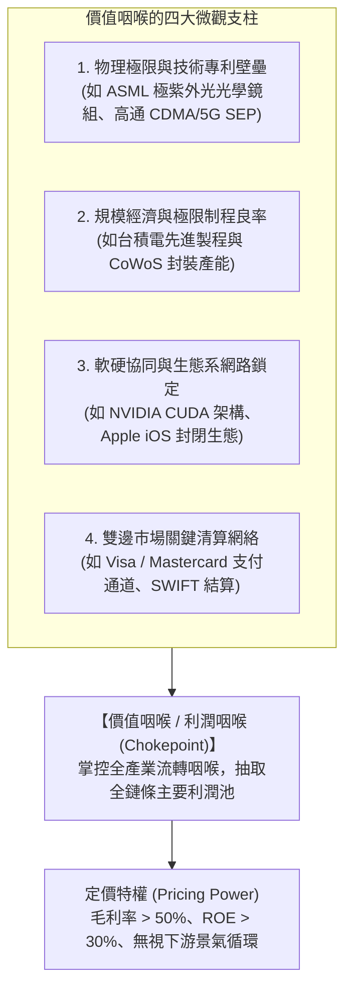
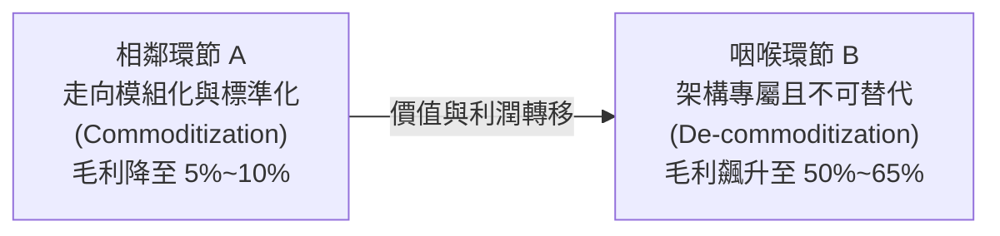
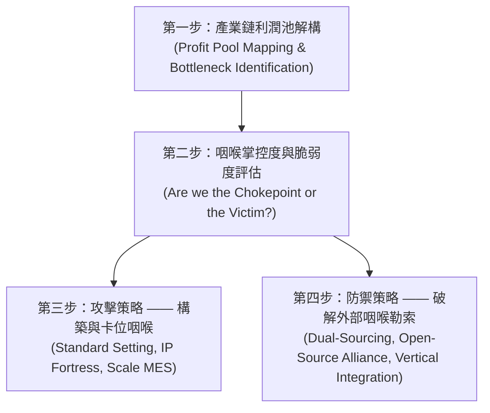

---
{"dg-publish":true,"permalink":"/98/value-chokepoint/","tags":["商業概念","產業分析","策略管理","價值體系","競爭優勢","護城河","PMBA"],"dg-note-properties":{"aliases":["價值咽喉","利潤咽喉","策略咽喉","Value Chokepoint","Profit Bottleneck","Strategic Chokepoint","咽喉點","產業咽喉","價值瓶頸","Value_Chokepoint_價值咽喉"],"tags":["商業概念","產業分析","策略管理","價值體系","競爭優勢","護城河","PMBA"],"類別":"商業概念庫"}}
---

# 價值咽喉 (Value Chokepoint / Profit Bottleneck)

> **核心名言**：「在一個模組化的世界裡，利潤並不會均勻分佈；它會從已經商品化的環節流出，不可逆地湧向整個產業鏈中最難被替代、也是最具不確定性的那個瓶頸環節。」  
> —— 克雷頓·克里斯汀生（Clayton M. Christensen, *The Innovator's Solution*）

---

## 一、 核心定義與經濟學本質

- **價值咽喉（Value Chokepoint）**，亦稱**利潤咽喉（Profit Bottleneck）**或**戰略咽喉點**，指在產業垂直分工鏈條或商業生態體系中，**所有商業交易、產品流動或數據網絡必定會通過、且被極少數關鍵企業以高度排他性優勢牢牢鎖死的不可替代環節**。
- **經濟租（Economic Rent）與定價特權**：
  處於價值咽喉的廠商，擁有向整條產業鏈徵收「技術過路費」或「地租」的絕對戰略特權。無論上下游其他環節如何競爭削價，價值鏈創造的大多數超額利潤最終皆會被咽喉環節所攫取。
- **咽喉形成指數公式（Chokepoint Formation Index）**：
  $$\text{價值咽喉指數 (VCI)} = f\left(\text{供需緊俏程度}, \frac{\text{技術與物理壁壘}}{\text{替代方案可得性}}, \text{產業轉換成本 (Switching Cost)}\right)$$
  - **分子（排他壁壘）**：極高的技術專利門檻、製程良率、規模經濟門檻，使後進者在經濟上或物理上無法模仿。
  - **分母（替代方案）**：客戶在當前市場找不到第二供應來源（Zero Alternative），若繞過該環節將導致整體系統崩潰。
  - **敲竹槓風險（Hold-up Risk）**：咽喉掌控者具備強大的議價能力，上下游企業面臨專屬性資產投資被「敲竹槓」的結構性脆弱點。

---

## 二、 價值咽喉的四大結構性驅動機制

1. **技術專利與物理極限壟斷（Technological Monopoly）**：
   - 掌握了突破物理瓶頸的核心專利或工程極限，使該環節成為產業向前演化的唯一閘口。
2. **極致規模與資本沉沒壁壘（Capital & Scale Moat）**：
   - 最小有效規模（MES）極高，單一廠房投資動輒上百億美元（如先進晶圓代工），新進者面臨不可逆的巨額沉沒成本。
3. **軟硬一體架構與生態系網路效應（Architecture Lock-in）**：
   - 透過專屬軟體工具鏈（如 CUDA）鎖定全球數百萬開發者的工作習慣，使硬體替換成本達到天文數字。
4. **標準必要性與通道排他性（Standard Essentiality）**：
   - 該環節被寫入國際產業通訊協議或公認標準（如 5G 標準必要專利 SEP），所有市場參與者皆無法繞道而行。

---

## 三、 動態價值遷移：克里斯汀生「利潤守恆定律」

克雷頓·克里斯汀生（Clayton Christensen）提出的**「魅力利潤守恆定律（Law of Conservation of Attractive Profits）」**，精闢解釋了價值咽喉在產業演化中的動態轉移軌跡：

- **動態演進規律**：
  1. 當產業鏈中的某一環節變得「模組化、標準化且足夠好（Commoditized）」時，該環節的超額利潤便會迅速蒸發（如 PC 組裝代工）。
  2. 蒸發的利潤不會憑空消失，而是**逆向流動並聚集在相鄰的「專屬、專利、尚未標準化且性能不足」的瓶頸環節**（如微處理器 CPU 與作業系統 OS）。
  3. **經理人策略啟示**：高明的策略家絕不固守即將被商品化的紅海領域，而是主動向未來產業鏈最嚴苛的瓶頸環節卡位。

---

## 四、 標竿商業實務案例深度剖析

### 案例 1：台積電（TSMC）—— AI 算力落地的物理咽喉（CoWoS 先進封裝）
- **咽喉成因**：2023~2026 年生成式 AI 爆發，全球 NVIDIA H100、B200 算力晶片的產能瓶頸不在晶圓蝕刻，而在於將高頻寬記憶體（HBM）與運算邏輯晶片立體封裝的 **CoWoS（Chip-on-Wafer-on-Substrate）先進封裝製程**。
- **定價特權**：台積電掌握 CoWoS 專利技術與 80% 以上的關鍵產能，形成全球算力出貨的絕對物理咽喉。即便將成熟的矽中介層外包，台積電依然掌握全套封裝架構標準，毛利率穩踞 55%~60% 以上。

### 案例 2：艾斯摩爾（ASML）—— 半導體物理極限微縮的設備咽喉
- **咽喉成因**：全球晶片邁入 7nm、3nm、2nm 乃至埃米級，必須使用 ASML 獨家供應的極紫外光（EUV）微影設備。一台 High-NA EUV 設備造價超過 3.5 億歐元，涉及數十萬個高精密光學鏡組與真空雷射系統。
- **定價特權**：ASML 訂單能見度長期排至 3~5 年後，全球晶圓巨頭（台積電、三星、Intel）必須提前數年爭相預付款排隊，享有整條半導體價值鏈最持久的超額定價權。

### 案例 3：輝達（NVIDIA）—— 軟硬一體架構的開發者咽喉（CUDA）
- **咽喉成因**：AMD 與 Intel 在純硬體算力（FLOPs）上能勉強逼近 NVIDIA，但全球上千萬 AI 研究員與工程師的演算法皆基於 NVIDIA 於 2006 年建立的 **CUDA 軟體平行運算平台**編寫。
- **定價特權**：CUDA 構築了堅不可摧的軟體轉換成本壁壘，硬體晶片得以享有 75% 以上的超高毛利率，成為 AI 基礎設施的戰略咽喉。

### 案例 4：高通（Qualcomm）—— 行動通訊通訊協議的專利咽喉（SEP）
- **咽喉成因**：高通在 3G/4G/5G 通訊標準中佈局了大量無法規避的標準必要專利（SEP）。
- **定價特權**：高通採用「整機售價比例」而非單純晶片成本收取專利授權費（俗稱「高通稅」）。只要手機需要連接行動網路，即使不採購高通晶片，也必須向高通支付授權過路費。

---

## 五、 經理人決策工具箱：價值咽喉攻防四步法

### 1. 自家企業身為「咽喉掌控者」的強化戰略
- **推高技術與資本天花板**：將抽取的大量超額現金流，超前投入下一代物理瓶頸技術（如台積電龐大 CapEx 再投資），使後進者永遠處於追趕絕望期。
- **推動周邊相鄰環節商品化**：促使上游零組件與下游應用標準化，壓低其他環節的利潤率，使全產業鏈的價值進一步向自身的咽喉集中。

### 2. 自家企業面臨「被咽喉敲竹槓（Hold-up）」的反制戰略
- **扶植第二供應來源（Dual-Sourcing）**：主動向咽喉者的競爭對手注資或轉單，人為扶植備援力量（如各大科技巨頭向 AMD 採購以牽制 NVIDIA）。
- **籌組開源標準同盟（Open Standards Coalition）**：結合產業受害者共同推動去專利化之通用架構（如 Linux 對抗 Windows，PyTorch 與 Triton 對抗 CUDA）。
- **向前/向後垂直整合（Vertical Integration）**：具備龐大資源的巨頭，可選擇自研核心環節繞過咽喉（如 Apple 自研 M 系列晶片擺脫 Intel 掣肘）。

---

## 🔗 關聯主題與知識網絡

- **產業中層與價值結構**：
  - [[value-system_產業價值體系|Value_System_產業價值體系]] · 產業間垂直分工、微笑曲線與利潤池轉移
  - [[Firm_Value_Chain_企業價值鏈]] · 企業內部九大價值活動與競爭優勢
  - [[M2-1_產業垂直價值體系]] · 產業垂直分工、微笑曲線演進與價值鏈解構
  - [[M1-6_產業分析模式與九大分析工具矩陣]] · 策略工具矩陣橫向對比
- **競爭優勢與結構壁壘**：
  - [[economic-moat_經濟護城河]] · 結構性競爭壁壘與定價特權
  - [[competitive-advantage_競爭優勢]] · 成本領導與差異化戰略
  - [[switching-costs_轉換成本]] · 敲竹槓問題與鎖定效應
- **實務標竿案例庫**：
  - [[cases_企業與產業案例庫]] · 台積電、ASML、高通之咽喉實證剖析
  - [[tsmc_台積電]] · 純晶圓代工與先進封裝戰略咽喉
  - [[nvidia_輝達]] · CUDA 軟硬一體架構壟斷
