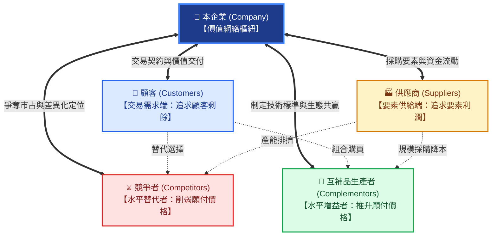
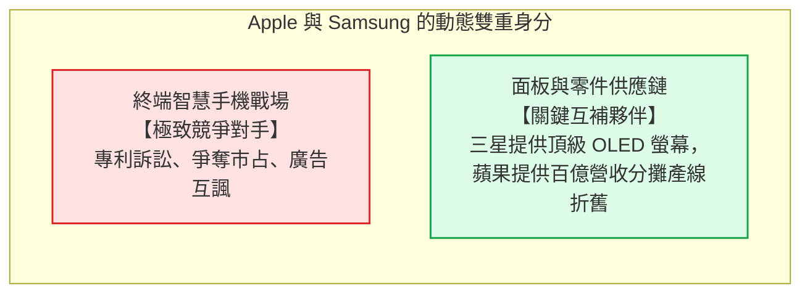
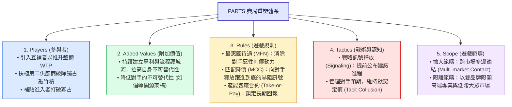
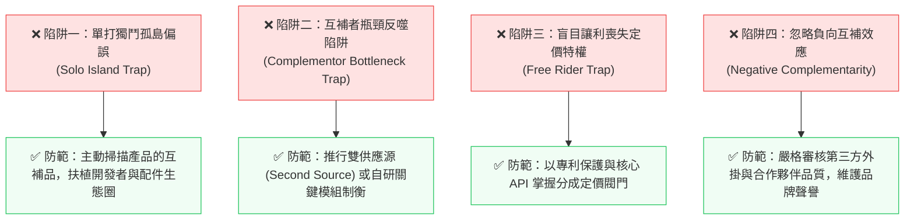

---
{"dg-publish":true,"permalink":"/98/value-net/","tags":["商業概念","賽局理論","策略管理","產業分析","價值創造","生態系","商業模式","PMBA"],"dg-note-properties":{"aliases":["價值網","價值網絡","價值網模型","Value Net","Value Network","賽局價值網","商業價值網"],"tags":["商業概念","賽局理論","策略管理","產業分析","價值創造","生態系","商業模式","PMBA"]}}
---


# 價值網 (Value Net Framework / 價值網絡架構)

> **商管核心價值**：  
> 「在傳統的商業思維中，經理人往往緊盯著競爭對手，把商業看成一場非死即傷的零和戰爭；然而在現實中，許多企業的失敗不是因為競爭者太兇殘，而是因為他們看不見自己的『互補者（Complementors）』。波特價值鏈是單向線性的輸送帶，而**價值網（Value Net）** 是一個多維對稱、引力共生的動態價值場。」——亞當·布蘭登伯格（Adam M. Brandenburger）與貝利·內勒巴夫（Barry J. Nalebuff）  
> 
> 在現代產業組織與生態系競爭中，**價值網（Value Net Framework）** 打破了傳統產業分析將上下游與同業全面對立化的偏誤。它以合作賽局理論為基底，確立了**顧客（Customers）、供應商（Suppliers）、競爭者（Competitors）、互補者（Complementors）**四大對稱核心，引導經理人將戰略焦點從「狹隘的殺價搶市占（分大餅）」轉向「協同互補夥伴重塑遊戲規則、共同擴大市場利潤池（做大餅）」。

---

## 一、 核心定義與理論演進

### 1.1 學術淵源與理論奠基
- **價值網模型（Value Net）** 由哈佛商學院教授 **Adam M. Brandenburger** 與耶魯管理學院教授 **Barry J. Nalebuff** 於 1996 年在《Co-opetition（競合策略）》中正式提出。
- **範式轉移之核心**：
  傳統策略管理學長年受麥可·波特（Michael E. Porter）的兩大工具主導——**產業價值鏈（Value Chain）** 與 **波特五力分析（Five Forces）**。然而這兩大架構皆存在嚴重的時代局限：
  1. **波特價值鏈的局限**：將商業視為由「上游原料 ➔ 製造組裝 ➔ 下游通路 ➔ 終端買方」單向流動的「線性輸送帶」，無法解釋現代數位平台、軟體生態圈與多邊網絡的雙向互動。
  2. **波特五力的局限**：將潛在進入者、替代品、買方、賣方與同業全部定義為侵蝕利潤的「五股威脅力量」，本質是純粹的「零和防禦思維」，**完全忽略了能與企業共同創造超額價值的「互補者（Complementors）」**。

---

### 1.2 三大經典策略分析工具範式對比

| 比較維度 | 波特產業價值鏈 (Value Chain) | 波特五力分析 (Five Forces) | 價值網模型 (Value Net) |
| :--- | :--- | :--- | :--- |
| **提出時間與學者** | Michael Porter (1985) | Michael Porter (1979) | Brandenburger & Nalebuff (1996) |
| **結構形態** | **一維線性鏈條**（內部活動流） | **二維星狀對抗**（外部威脅） | **二維對稱菱形網絡**（競合格局） |
| **底層賽局哲學** | 追求單點流程極致優化 | **零和博弈（Zero-Sum）**<br>各方互相掠奪利潤池 | **正和與變和博弈（Positive-Sum）**<br>做大餅（合作）＋ 分大餅（競爭） |
| **同業角色認定** | 外部對比標竿 | 殘酷爭奪市占的對手 | 既是爭奪利潤的對手，也是做大產業的潛在盟友 |
| **是否包含互補者** | ❌ 否（僅看垂直上下游） | ❌ 否（僅視為潛在威脅） | **✅ 是（將互補品提升為獨立核心支柱）** |
| **核心管理命題** | 活動如何配置以降低內部成本？ | 如何在不利的產業結構中自保防禦？ | 如何重構參與者與規則，做大整體價值？ |

---

### 1.3 價值網全景架構圖



---

## 二、 價值網四大節點與兩大對稱軸深度解構

價值網的幾何美感在於其完美的**「雙軸對稱性（Symmetry Principle）」**：

### 2.1 垂直軸（交易流動對稱軸）：顧客（Customers）與 供應商（Suppliers）
- **顧客端對稱性**：
  - 顧客向企業支付貨幣價格 $P$，換取產品的使用價值 $V$；
  - 顧客獲得**[[98_商業概念庫/vpc-value-price-cost_價值價格成本分析\|顧客剩餘]] $(V - P)$**；顧客剩餘越大，購買動力與留存率越高。
- **供應商端對稱性**：
  - 企業向供應商支付採購成本 $C$，換取原材料或零組件；
  - 供應商獲得**供應商剩餘 $(C - \text{SOC})$**（其中 $\text{SOC}$ 為供應商機會成本）；
  - 供應商與企業共同切分上游價值鏈利潤。
- **管理意涵**：企業不能只把供應商當作殺價對象。如果供應商無法享有合理的剩餘，將喪失投入研發與保證品質的動力，最終反噬終端產品的競爭力。

---

### 2.2 水平軸（外部影響對稱軸）：競爭者（Competitors）與 互補者（Complementors）

水平軸代表不與企業直接發生買賣交易、但深刻影響交易價值的第三方力量：

| 水平節點 | 顧客端嚴謹學術定義 | 供給端嚴謹學術定義 | 典型商業範式 |
| :--- | :--- | :--- | :--- |
| **[[98_商業概念庫/existing-competitors_現有競爭者\|競爭者 (Competitors)]]** | 當顧客擁有對手產品時，會**降低**對本公司產品的願付價格（WTP）。 | 當供應商為對手供貨時，為本公司供貨的意願降低或採購單價提高（要素爭奪）。 | **iOS vs. Android**<br>**波音 vs. 空中巴士** |
| **[[98_商業概念庫/complementary-goods_互補品\|互補者 (Complementors)]]** | 當顧客同時擁有該夥伴產品時，會**顯著提升**對本公司產品的願付價格（WTP）。 | 當供應商同時為互補者供貨時，能因總量規模經濟使本公司的零件採購成本降低。 | **硬體 GPU ＋ 水冷散熱模組**<br>**電動車 ＋ 超級充電樁** |

---

### 2.3 競合身分的動態流動與兼具（Role Fluidity）

經理人切忌以靜止眼光將外部企業劃入死板陣營。在高度整合的高科技與數位產業中，**企業往往同時兼具「競爭者」與「互補者」的雙重身分**：



- **其他經典範例**：
  - **Sony 與 Microsoft**：在主機遊戲硬體（PS5 vs. Xbox）是死敵（競爭者）；但 Sony 的雲端遊戲伺服器底層卻採購微軟 Azure 雲端基礎設施（互補夥伴）。
  - **Google 與 Apple**：在作業系統（Android vs. iOS）是激烈競爭者；但 Google 每年向蘋果支付近 200 億美元，讓 Google 成為 Safari 的預設搜尋引擎（互補利益共生）。

---

## 三、 價值網的數理博弈與附加價值計算（Added Value）

在價值網賽局中，任何企業最終能獲取的利潤上限，取決於其**不可替代的「附加價值（Added Value）」**：

### 3.1 附加價值定量公式（Added Value Theorem）

$$\text{企業 } i \text{ 的附加價值} = V(\text{整個網絡全員在場}) - V(\text{扣除企業 } i \text{ 離開後的網絡})$$

- **若企業無可替代（Unique Monopolist）**：例如當前全球只有台積電能穩定供應 2nm 先進製程晶圓，若台積電停擺，全球 AI 算力產值將崩跌 80% 以上。此時台積電的附加價值極為巨大，享有恐怖的定價話語權（高毛利與超額 ROIC）。
- **若企業同質化（Commodity Provider）**：如果市場上有數十家規格完全相同的代工廠，扣除本公司後，顧客與供應商隨時能找到替代者，本公司的附加價值為零！**附加價值為零的企業，即使營收幾千億，其經濟利潤必然被壓制在損益平衡邊緣**。

---

### 3.2 互補品效應與顧客願付價格推升（Superadditivity）

互補者之所以能做大餅，其數學本質在於**效用的超加性（Superadditivity）**：

$$V(\text{核心產品} + \text{互補品}) \gg V(\text{核心產品}) + V(\text{互補品})$$

```text
單純一台沒有遊戲與 App 的 iPhone ➔ 顧客願付價格 WTP = $200 美元 (甚至不願買)
iOS 生態系擁有 200 萬個優質 App ➔ 顧客願付價格 WTP 飆升至 = $1,200 美元！
▲ 額外創造的 $1,000 美元價值楔子，由蘋果與 App 開發者共同享受！
```

---

## 四、 重塑價值網的 PARTS 五大戰略槓桿

經理人若想掌握價值網的主導權，必須運用 PARTS 架構主動改變賽局結構：



---

## 五、 跨產業代表性標竿案例對標

### 5.1 案例一：台積電（TSMC）——以 OIP 打造全球半導體最強價值網
- **傳統代工思維**：僅將自己視為買賣晶圓的「單純製造商」，每天與客戶針對代工價格進行零和廝殺。
- **台積電的價值網創新（開放創新平台 OIP）**：
  - 將全球 EDA 工具巨頭（Synopsys、Cadence）、IP 提供商（ARM、Synopsys）及封測夥伴納入為**最核心的互補者**；
  - 晶片設計客戶（Apple、NVIDIA、AMD、Qualcomm）在市場上雖是競爭者，但只要進入台積電 OIP 平台，就能無縫調用數十萬個經過預先驗證的矽智財 IP，將晶片開發週期縮短數月。
  - **戰略結果**：台積電將自身塑造成整個半導體價值網不可撼動的**核心中樞（Keystone）**，所有互補者的研發都在持續加固台積電的生態護城河。

---

### 5.2 案例二：特斯拉（Tesla）——開放 NACS 充電標準化敵為友
- **策略背景**：早期特斯拉自建封閉式超級充電站網絡（Supercharger），作為與其他電動車品牌競爭的專屬護城河（競爭者邏輯）。
- **轉向價值網思維（2023 年）**：
  - 馬斯克主動開放北美的專利 NACS 充電接口標準，邀請福特（Ford）、通用（GM）、賓士（Mercedes-Benz）、Rivian 等競爭對手加入特斯拉超充網絡；
  - **競合躍遷**：
    1. **化競爭為互補**：競爭車廠的車主成為特斯拉超充網絡的付費顧客，大幅攤平特斯拉充電站的龐大初期固定資產 CapEx 折舊；
    2. **標準鎖定**：NACS 正式擊敗官方 CCS 標準，成為全北美實質產業公認標準（Industry Standard），特斯拉得以向全體車廠抽取長期的能源服務利潤。

---

### 5.3 案例三：個人電腦 Wintel 聯盟——互補者彼此推動的世紀增長飛輪
- **雙巨頭共生**：
  - **Intel（處理器）** 與 **Microsoft（作業系統）** 並不互相買賣晶片或系統，兩者在純商業上是百分之百的**互補者（Complementors）**。
  - **安迪-比爾定律（Andy and Bill's Law）**：
    「安迪（Andy Grove, Intel CEO）給予的硬體算力提升，瞬間就被比爾（Bill Gates, Microsoft 創辦人）膨脹的軟體程式碼吃光！」
  - 微軟推出更龐大、更絢麗的 Windows 與 Office，迫使消費者必須採購更強大的 Intel CPU；Intel 研發更快頻率的 CPU，又讓微軟能開發更多多媒體軟體。
  - **利潤池壟斷**：這對互補者聯手瓜分了全 PC 產業逾 **80% 的利潤池**，將終端組裝代工廠（Acer、HP、Dell、聯想）全部壓縮至「毛三到四」的微利境地。

---

## 六、 經理人常見四大認知陷阱與實務防範



### 1. 單打獨鬥孤島偏誤（Solo Island Trap）
- **現象**：許多工程團隊只專注於將主產品打磨到極致，完全忽視周邊配套互補品（如硬體缺乏好用的軟體、電動車缺乏足夠的充電站、新遊戲主機上市缺乏首發 3A 遊戲大作）。
- **後果**：儘管核心產品性能卓越，但因互補品匱乏，顧客總感知價值 $V$ 極低，產品叫好不叫座。

### 2. 互補者瓶頸反噬陷阱（Complementor Bottleneck Trap）
- **現象**：在生態系中，某一個關鍵互補者掌握了無可替代的咽喉技術（如 PC 時代的微軟作業系統、早期智慧型手機的 Google 服務）。
- **後果**：生態系創造的大部分超額利潤，全被關鍵互補品業者抽走，主產品業者淪為替互補者打工的廉價通道。

---

## 七、 課程講義與模組網絡無縫對接

本原子卡片深度貫穿並支撐 PMBA 兩大核心學程之產業分析與商業模式模組：

### 📚 官方教材與模組講義深度對接

1. **《產業分析與投資策略》官方教材對接**：
   - 📖 **Class 3 講義** ➔ [[04_主題選修/12_產業分析與投資策略/02_模組筆記/Module_1_總論與架構/M1-6_產業分析模式與九大分析工具矩陣\|M1-6 產業分析模式與九大分析工具矩陣]]：
     - 模式六：**「價值網分析（Value Net Framework）」**全解構，作為連接「產業結構層（五力/SCP）」走向「企業內部層（VRIO/BCG）」的核心中樞。
   - 📖 **Class 1 講義** ➔ [[04_主題選修/12_產業分析與投資策略/02_模組筆記/Module_1_總論與架構/M1-3_產業獲利結構差異與十大經典理論\|M1-3 產業獲利結構差異與十大經典理論]]：
     - 十大經典理論之**「賽局理論（Game Theory）」**——分析寡占市場中的策略互賴與正和競合。
   - 📖 **Class 2 講義** ➔ [[04_主題選修/12_產業分析與投資策略/02_模組筆記/Module_1_總論與架構/M1-5_波特五力分析與量化架構\|M1-5 波特五力分析與量化架構]]：
     - 批判波特五力之「靜態零和博弈偏誤」，確立互補品生產者在打破利潤天花板上的戰略樞紐地位。

2. **《創業與企業財務策略》官方教材對接**：
   - 📖 **Class 4 講義** ➔ [[04_主題選修/10_創業與企業財務策略/02_模組筆記/Module_1_創新思維與商業模式/M1-9_商業模式畫布架構與價值主張設計\|M1-9 商業模式畫布架構與價值主張設計]]：
     - 商業模式畫布九大模組之**「關鍵合作夥伴（Key Partnerships）」**——透過策略聯盟、非競爭者合資與競合共生降低新創不確定性。
   - 📖 **Class 4 講義** ➔ [[04_主題選修/10_創業與企業財務策略/02_模組筆記/Module_1_創新思維與商業模式/M1-10_七大市場力量與商業戰略價值公式\|M1-10 七大市場力量與商業戰略價值公式]]：
     - 七大市場力量之「網絡效益（Network Economies）」——雙邊平台網絡夥伴的競合飛輪。
   - 📖 **Class 2 講義** ➔ [[04_主題選修/10_創業與企業財務策略/02_模組筆記/Module_1_創新思維與商業模式/M1-4_創意思考工具與設計思考方法\|M1-4 創意思考工具與設計思考方法]]：
     - **「兩全思維（Trade-On Thinking）」**——破除競爭與合作非黑即白的傳統對立二分法。

---

### 🔗 核心概念原子卡片雙向鏈結

- **賽局與競合戰略體系**：
  - [[98_商業概念庫/strategy-coopetition_競合戰略 Coopetition\|strategy-coopetition_競合戰略 Coopetition (Coopetition 競合關係)]]
  - [[98_商業概念庫/complementary-goods_互補品\|complementary-goods_互補品]]（提升顧客願付價格 WTP 的共創夥伴）
  - [[98_商業概念庫/competitive-advantage_競爭優勢\|competitive-advantage_競爭優勢]]（以獨特活動體系與附加價值拉開超額經濟租金）
  - [[98_商業概念庫/vpc-value-price-cost_價值價格成本分析\|vpc-value-price-cost_價值價格成本分析]]（在做大 $V - C$ 的同時，精準防禦並切分 $P - C$）
- **競爭與策略分析工具體系**：
  - [[98_商業概念庫/competitive-matrix_競爭矩陣\|competitive-matrix_競爭矩陣]]（多維動態競爭定位圖、CPM 態勢矩陣與空白區發掘）
  - [[98_商業概念庫/value-chain_價值鏈\|value-chain_價值鏈]]（波特內部垂直活動鏈條）
  - [[98_商業概念庫/value-proposition_價值主張\|value-proposition_價值主張]] ｜ [[98_商業概念庫/value-curve_價值曲線\|value-curve_價值曲線]]
  - [[98_商業概念庫/economic-moat_經濟護城河\|economic-moat_經濟護城河]] ｜ [[98_商業概念庫/switching-costs_轉換成本\|switching-costs_轉換成本]]
- **財務績效與資本評價體系**：
  - [[98_商業概念庫/return-on-invested-capital_資本投入報酬率\|return-on-invested-capital_資本投入報酬率]]（透過生態圈協同降低 CapEx 投資，推升 ROIC）
  - [[98_商業概念庫/cash-switching-cycle_現金轉換週期\|cash-switching-cycle_現金轉換週期]] ｜ [[98_商業概念庫/total-asset-turnover-ratio_總資產週轉率\|total-asset-turnover-ratio_總資產週轉率]]
