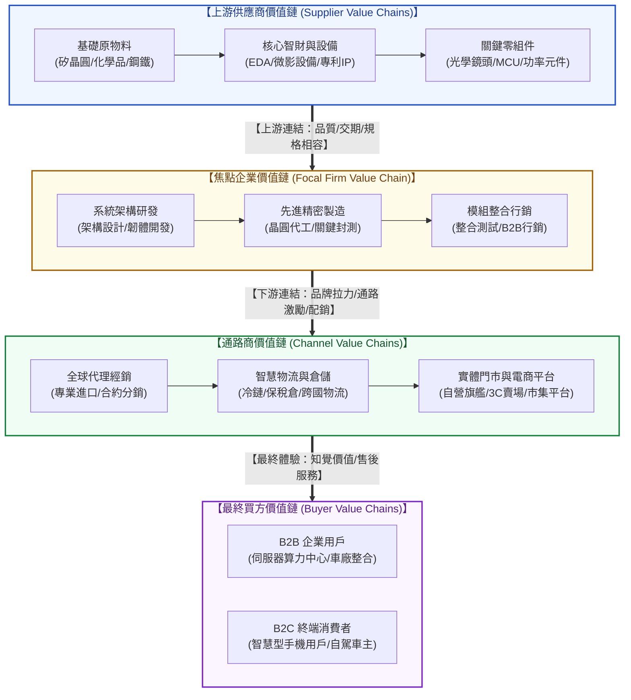
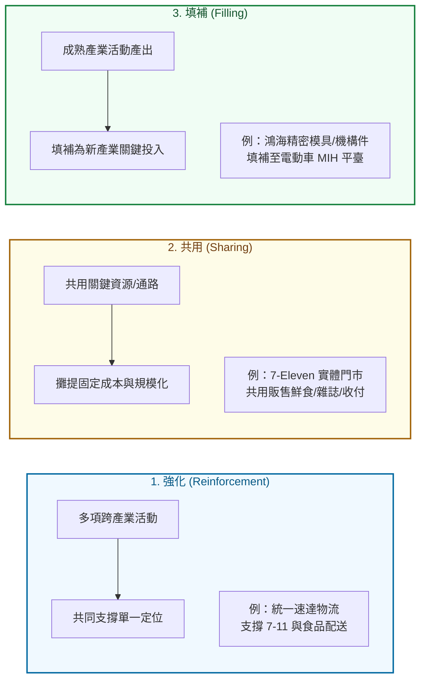
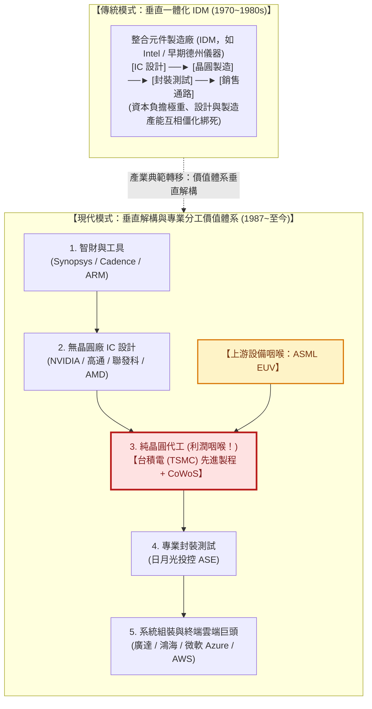
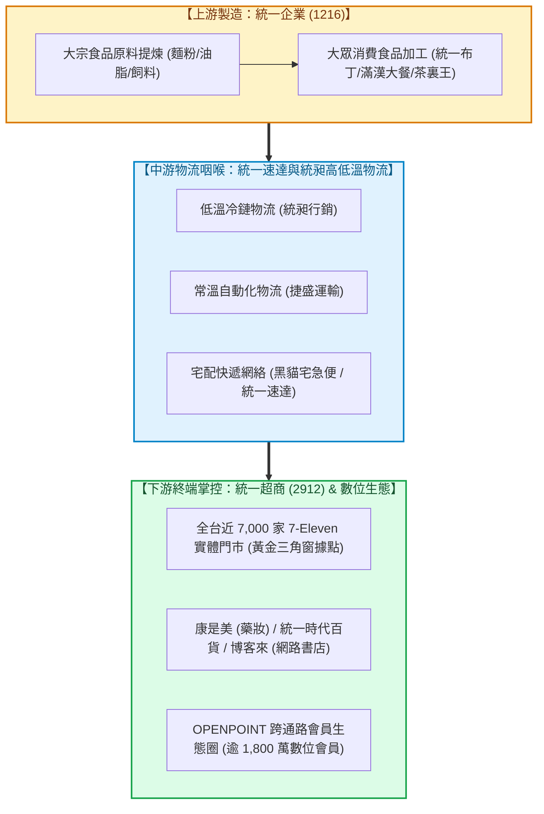

---
{"dg-publish":true,"permalink":"/98/value-system/","tags":["商業概念","策略管理","產業分析","價值體系","價值鏈","垂直整合","微笑曲線","交易成本","利潤咽喉","競合策略","PMBA"],"dg-note-properties":{"aliases":["價值體系","產業價值體系","產業垂直價值體系","產業垂直分工網絡","價值系統","Value System","Industry Value System","Vertical Value System","Value_System_產業價值體系","value-system_產業價值體系"],"tags":["商業概念","策略管理","產業分析","價值體系","價值鏈","垂直整合","微笑曲線","交易成本","利潤咽喉","競合策略","PMBA"],"類別":"商業概念庫"}}
---

# 產業價值體系 (Industry Value System / 產業垂直價值體系)

> **核心名言**：  
> 「單一企業的價值鏈並非孤立存在，它深深嵌入於一個更宏大的活動流之中——這就是我所稱的『價值體系（Value System）』。獲得並維持競爭優勢，不僅取決於理解企業自身的價值鏈，更取決於企業如何融入整體的價值體系，以及如何調適與上下游活動的鏈結關係。」  
> —— 麥可·波特（Michael E. Porter, *Competitive Advantage*, 1985）  
>  
> 「在存在資產專屬性與有限理性的世界裡，市場交易與組織層級並非隨機選擇；企業的垂直邊界取決於交易成本與內部協調成本的邊際均衡。」  
> —— 奧利佛·威廉森（Oliver E. Williamson, 諾貝爾經濟學獎得主, 1985）

---

## 一、 核心定義與理論本質

### 1.1 麥可·波特之「產業價值體系」定義
- **產業價值體系（Industry Value System）**，亦稱**產業垂直價值鏈**或**垂直分工體系**，是由哈佛商學院競爭策略之父麥可·波特（Michael E. Porter）於 1985 年在《競爭優勢》（*Competitive Advantage*）中提出的宏觀產業結構分析模型。
- 波特明確指出：**任何單一企業的內部價值鏈（Firm Value Chain），都只是整個產業從最源頭原物料提煉到最終消費者手中這一漫長價值流動網絡中的「一個特定區段」**。
- 一個完整成熟的產業價值體系，至少由四大垂直銜接的組織價值鏈所構成：
  1. **上游供應商價值鏈 (Supplier Value Chains)**：提供生產所需的原材料、零組件、核心智財 (IP) 與生產設備；
  2. **焦點企業價值鏈 (Focal Firm Value Chains)**：進行產品研發、零組件加工、模組組裝或核心服務運營；
  3. **下游通路商價值鏈 (Channel Value Chains)**：執行經銷代理、批發配送、實體/電商零售、物流倉儲與現場展示；
  4. **最終買方價值鏈 (Buyer Value Chains)**：B2B 企業客戶之生產與運營流程，或 B2C 最終家庭與個人之消費與使用歷程。

```
【波特產業價值體系之垂直傳導架構】

  ┌─────────────────────────┐
  │ 上游供應商價值鏈        │ ── 原物料、關鍵零組件、設備、專利授權
  │ (Supplier Value Chains) │
  └───────────┬─────────────┘
              ▼ 【上游連結 (Upstream Linkages)】
  ┌─────────────────────────┐
  │ 焦點企業內部價值鏈      │ ── 產品設計、核心製造、系統整合、品質控管
  │ (Firm Value Chain)      │
  └───────────┬─────────────┘
              ▼ 【下游連結 (Downstream Linkages)】
  ┌─────────────────────────┐
  │ 通路商價值鏈            │ ── 經銷網絡、物流倉儲、實體/數位門市、陳列銷售
  │ (Channel Value Chains)  │
  └───────────┬─────────────┘
              ▼ 【最終交付 (Buyer Integration)】
  ┌─────────────────────────┐
  │ 最終買方價值鏈          │ ── B2B 買方生產活動投入 / B2C 消費者生活體驗
  │ (Buyer Value Chains)    │
  └─────────────────────────┘
```

---

### 1.2 「內部價值鏈 (Firm Value Chain)」vs.「產業價值體系 (Value System)」深度對照

許多管理決策者常將「企業內部價值鏈」與「產業價值體系」混為一談，導致策略視野局限於組織內部而忽略了產業結構性制約。兩者在分析維度與管理意涵上存在根本性差異：

| 比較維度 | 企業內部價值鏈 (Firm Value Chain) | 產業價值體系 (Industry Value System) |
| :--- | :--- | :--- |
| **分析層次** | **微觀層次 (Micro-level)**：單一組織內部 | **中觀/宏觀層次 (Meso/Macro-level)**：垂直產業跨組織網絡 |
| **核心範疇** | 九大價值活動（五大主要活動 + 四大輔助活動） | 供應商 ➔ 製造商 ➔ 通路商 ➔ 最終顧客之垂直鏈條 |
| **治理機制** | **層級組織權威 (Hierarchical Authority)**：主管指派、KPI 考核、內部流程管制 | **市場契約、混合治理與權力博弈 (Contract & Power)**：買賣合約、策略聯盟、議價博弈 |
| **利潤衡量** | 企業營收 (Revenue) 扣除 內部九大活動總成本 (Internal Cost) | **產業利潤池 (Profit Pool)** 在不同垂直產業節點間的流動與瓜分 |
| **競爭優勢來源** | 活動執行的卓越性 (Operational Effectiveness)、成本動因與差異化動因控制 | **結構性位置 (Positioning)**、對「利潤咽喉 (Chokepoint)」的掌控力、跨組織連結協同 |
| **企業邊界考量** | 如何優化組織內部流程資源配置 | **自製或外購 (Make or Buy)**、垂直整合或垂直解構、專業分工邊界 |
| **主要理論工具** | [[Firm_Value_Chain_企業價值鏈]]、VRIO 分析、杜邦分析 | [[M2-1_產業垂直價值體系]]、[[Smile_Curve_微笑曲線]]、[[value-chokepoint_價值咽喉]]、TCE 交易成本理論 |

---

### 1.3 經濟學本質：利潤池 (Profit Pool) 與超額利潤的結構性決定
- **超額利潤不僅源自內部效率**：古典管理學強調「向內看」，認為利潤源自企業卓越的管理效率；然而產業經濟學（Industrial Organization Economics）指出，**企業賺取超額經濟租（Economic Rent）的能力，高達 60% 以上取決於它在價值體系中所處的「結構性節點」**。
- **產業利潤池（Profit Pool）概念**（Gadiesh & Gilbert, 1998）：
  $$	ext{產業利潤池總額} = \sum_{k=1}^{M} \left( 	ext{環節營收}_k 	imes 	ext{環節營業利益率}_k 
ight)$$
  - 利潤在價值體系中**絕非均勻分佈**，亦非與營收規模成正比。許多佔據整條產業鏈 70% 營收的「代工組裝環節」，可能僅分得全產業 5% 的微薄利潤（如電子代工產業「毛三到四」）；反之，營收僅佔 10% 的關鍵材料或晶片架構，卻攫取了產業鏈 70% 以上的淨利潤。
- **產業價值體系研究的核心命題**：
  1. 產業利潤池目前聚集在價值體系的哪一個節點？
  2. 隨著技術變革與產業生命週期演進，利潤池將如何發生動態位移？
  3. 企業應如何透過**垂直整合（Integration）**、**垂直解構（Disintegration）**或**卡位價值咽喉（Chokepoint）**，最大化自身捕獲（Capture）利潤的份額？

---

## 二、 價值體系的架構圖譜與三大核心流向

### 2.1 價值體系的垂直架構圖 (Mermaid Architecture)



---

### 2.2 跨組織價值體系的三大關鍵流向
在現代數位化與全球化供應鏈中，產業價值體系仰賴三大流動的無縫協同，任何一項流動的阻滯或失真都會嚴重損害全體系競爭力：

1. **實體物流 (Material Flow / Physical Stream) ——「由上而下順向流動」**：
   - 原料 ➔ 零組件 ➔ 次模組 ➔ 成品 ➔ 通路 ➔ 終端買方。
   - 追求目標：最低庫存持有成本、最快產銷週轉率（Inventory Turns）、最高良率與準時交付率（OTD, On-Time Delivery）。
2. **資金與利潤流 (Financial & Margin Stream) ——「由下而上逆向回流」**：
   - 買方支付總款項 ➔ 通路扣除進銷差價 ➔ 焦點企業扣除毛利 ➔ 支付供應商採購款。
   - 追求目標：營運現金流循環（Cash Conversion Cycle, CCC）最佳化、防止下游應收帳款倒帳壞帳、抵禦通膨與原物料價格波動。
3. **資訊與需求訊號流 (Information & Demand Stream) ——「跨組織即時雙向聯網」**：
   - 傳統供應鏈中，資訊由下游向上游傳遞時，因預測偏差與延遲反應，會引發劇烈震盪的**「長鞭效應（Bullwhip Effect）」**。
   - 現代價值體系透過跨組織 ERP/EDI、API 數據對接與雲端供應鏈可視化平台，實現「端到端（End-to-End）實時需求拉動」，以真實消費 POS 數據直接驅動上游原物料排程。

---

### 2.3 跨組織價值鏈協同的「五大連結條件 (Linkage Criteria)」
在台大 PMBA《[[_產業分析與投資策略 MOC|產業分析與投資策略]]》M2-1 模組中，深入推導了決定上下游企業價值鏈能否完美咬合、甚至激發出超額綜效的**五大連結條件**：

```
                    ┌─────────────────────────┐
                    │  1. 策略符合性          │ (Strategic Fit)
                    ├─────────────────────────┤
                    │  2. 產出投入匹配        │ (Input-Output Match)
  價值鏈間五大連結條件  │  3. 資訊條件連結        │ (Information Linkage)
  (Linkage Criteria)│  4. 人際關係協調        │ (Interpersonal Coordination)
                    ├─────────────────────────┤
                    │  5. 技術規格相容        │ (Compatibility & Standards)
                    └─────────────────────────┘
```

1. **策略符合性 (Strategic Fit)**：
   - 上游夥伴的產出屬性與競爭戰略，必須與下游企業的整體市場定位高度契合。
   - *反例*：若下游焦點企業主打「極速交期與高客製化（如 Zara 快時尚）」，而上游織布廠卻採取「追求大規模量產、壓低單位成本、交期長達 60 天」的成本領導模式，則兩者價值鏈將產生致命衝突。
2. **產出投入匹配 (Input-Output Match)**：
   - 上游各批次產品的物理公差、交付頻率、批次規模（Batch Size）與生產節拍（Takt Time），必須完全對接下游生產線的進料容忍度，消弭中繼緩衝庫存（Buffer Inventory）浪費。
3. **資訊條件連結 (Information Linkage)**：
   - 上下游跨組織邊界的數據通透性。透過即時 API、共同架構的供應商關係管理（SRM）與產銷協調會議，將市場脈動同步廣播至所有供應鏈節點，徹底平抑長鞭效應。
4. **人際關係協調 (Interpersonal Coordination)**：
   - 跨組織研發（R&D）、品保（QA）與採購團隊間長年積累的**社會資本（Social Capital）**與「關係契約（Relational Contracts）」。高信任度的人際網絡能顯著降低溝通摩擦，大幅縮短突發工程變更（ECN）的應變時間。
5. **技術規格相容 (Compatibility & Standards)**：
   - 跨模組之間的物理介面、電子訊號協定與通訊標準是否相容。高規格相容性允許模組化即插即用（Plug and Play），降低轉換成本；而專屬封閉式規格則能鑄造技術護城河，阻止競爭者滲透。

---

## 三、 利潤分佈動態：微笑曲線與利潤咽喉 (Profit Distribution & Chokepoint)

### 3.1 施振榮「微笑曲線 (Smile Curve)」在價值體系中的映射
1992 年宏碁集團創辦人施振榮先生提出著名的**「微笑曲線（Smile Curve）」**理論，完美詮釋了個人電腦產業、乃至全球高科技製造業在產業價值體系中的附加價值與利潤分佈軌跡：

```text
【產業垂直價值體系的微笑曲線分佈】

  附加價值 / 毛利率 (%)
    ▲
 高 │   【左端：研發/專利】                          【右端：品牌/通路】
    │    • 核心架構 IP (ARM, x86)                    • 終端品牌價值 (Apple, Nike)
    │    • 關鍵材料與設備 (ASML, 矽晶圓)               • 直營通路與生態圈 (App Store)
    │    • 特殊製程演算法 (CUDA, AI晶片)              • 顧客終身數據與售後服務
    │           \                                         /
    │            \                                       /
    │             \                                     /
    │              \                                   /
 底 │               \________【中段：組裝製造】________/
    │                        • 代工組裝 (OEM/EMS)
    │                        • 標準模組封裝
    │                        • 產能過剩、高資本支出、低毛利
    └─────────────────────────────────────────────────────────────►
                     產業垂直價值體系各分工環節 (Value System Stages)
```

- **左端（技術研發與關鍵零組件）**：
  具備高智財門檻、高物理極限壁壘與長研發週期。例如 ASML 的極紫外光（EUV）微影設備、NVIDIA 的 GPU 架構與高通的 5G 通訊專利。此類環節享有高定價權（Pricing Power）與超額毛利（毛利率常高達 50% ~ 70%）。
- **中段（組裝製造與一般代工）**：
  由於生產設備可直接自市場外購、製程標準化、進入門檻相對較低，導致全球各國廠商競相擴產，深陷「產能過剩」與「價格戰」泥淖。其毛利率被嚴重壓縮在曲線底部（通常低於 5% ~ 8%），承擔著龐大的固定資產折舊與人力存貨風險。
- **右端（品牌行銷、通路直營與服務生態）**：
  直接掌握最終買方的注意力與交易介面。具備品牌心智份額（Mind Share）、直營通路控制權、使用者數據累積與高轉換成本。例如星巴克的體驗溢價、Apple 的 App Store 30% 分潤，以及電動車自駕軟體訂閱服務（毛利率高達 70% ~ 80%）。

---

### 3.2 克里斯汀生「利潤守恆定律 (Law of Conservation of Attractive Profits)」
哈佛商學院克雷頓·克里斯汀生（Clayton M. Christensen）在《創新者的解答》（*The Innovator's Solution*）中提出了深刻揭示價值體系利潤遷徙的經濟學定律：
> **利潤守恆定律**：  
> 「當一個產品的某個環節變得商品化（Commoditized）與模組化、產品性能超越了市場主流需求而變得『足夠好（Good Enough）』時，該環節原有的超額利潤並不會憑空蒸發，而是會不可逆地**位移到與其相鄰、架構未完全成熟、最具技術不確定性且尚未被商品化的瓶頸環節（Proprietary Bottleneck）**。」

- **個人電腦（PC）產業的歷史印證**：
  1980 年代以前，IBM 掌控整合型大型主機的垂直體系，賺取巨額利潤；隨著 IBM PC 推出開放式標準架構，PC 組裝製造迅速模組化、商品化，PC 主機利潤崩跌；但超額利潤並未消失，而是完整轉移至兩大關鍵非對稱瓶頸——**微處理器晶片（Intel）** 與 **作業系統（Microsoft）**，締造了長達 20 年的「Wintel」暴利帝國。

---

### 3.3 利潤咽喉 (Value Chokepoint) 的量化評估與掌控力
在價值體系中，並非所有高毛利環節都具備長久統治力，唯有形成**「[[value-chokepoint_價值咽喉|價值咽喉 (Value Chokepoint)]]」**的節點，才能擁有持續向整條產業鏈徵收「過路費」的特權：

$$	ext{價值咽喉指數 (VCI)} = f\left( 	ext{供需緊俏係數 (Tightness)}, rac{	ext{技術與物理壁壘 (Technical Barrier)}}{	ext{替代方案可得性 (Substitutes)}}, 	ext{下游產業轉換成本 (Switching Cost)} 
ight)$$

```
【價值咽喉的四大微觀護城河】

  1. 物理極限與專利壁壘 ────► ASML EUV 微影設備（全光學鏡組與雷射光源獨家寡占）
  2. 極限製程與良率規模 ────► 台積電 (TSMC) 先進製程與 CoWoS 封裝產能
  3. 軟硬協同與生態鎖定 ────► NVIDIA CUDA 平臺（全球百萬 AI 開發者生態黏著）
  4. 通路壟斷與交易閘口 ────► 統一超商 (7-Eleven) 實體據點密度與代收付網絡
```

處於價值咽喉位置的企業，享有**非對稱議價能力（Asymmetric Bargaining Power）**，能在原料漲價時將成本 100% 轉嫁給下游，並在下游繁榮時率先調漲服務費，最大化自身捕獲的利潤份額。

---

## 四、 企業垂直邊界決策：垂直整合 vs. 垂直解構 (Make vs. Buy & TCE Governance)

### 4.1 奧利佛·威廉森之「交易成本經濟學 (TCE)」框架
企業究竟應該將價值體系中的某一活動「自製（Make / 內部化）」還是「外購（Buy / 市場採購）」？諾貝爾經濟學獎得主奧利佛·威廉森（Oliver E. Williamson）建立了**交易成本經濟學（Transaction Cost Economics, TCE）**模型。

Williamson 指出，企業的垂直邊界取決於**市場交易成本（Transaction Costs）**與**內部組織官僚成本（Internal Governance Costs）**的動態權衡：

$$\min_{	ext{邊界決策}} \Big( 	ext{生產製造成本 } C_p + 	ext{交易/協調成本 } C_t \Big)$$

其中，驅動交易成本急劇攀升、迫使企業選擇「垂直整合（自製）」的核心維度為**資產專屬性（Asset Specificity）**：

```
                高 ▲                    【混合治理模式】                 【垂直整合 (自製)】
                   │                   (Hybrid Governance)           (Hierarchical / Make)
                   │                    • 長期排他性合約                • 企業內部一體化
                   │                    • 策略聯盟 / 合資企業           • 消除敲竹槓風險
  資產專屬性       │                    • 相互股權滲透                  • 組織層級權威控制
  (Asset Specificity)
                   │    【古典市場採購】
                   │      (Market / Buy)
                   │      • 價格機制導向
                   │      • 隨機現貨交易
                低 ┼─────────────────────────────────────────────────────────────►
                  低                                                          高
                                   不確定性 / 交易頻率 (Uncertainty & Frequency)
```

#### 資產專屬性的四大關鍵形態：
1. **場地專屬性 (Site Specificity)**：生產設施因運輸成本或即時供應考量，必須緊鄰特定買方設立（如煉鋼廠旁直接建造煉焦廠、晶圓廠旁設置專用高純度氣體槽）。
2. **實體資產專屬性 (Physical Asset Specificity)**：專門為特定客戶設計模具、專屬治具或客製化機器，若該客戶毀約，設備毫無轉售殘值。
3. **專屬人力資產 (Human Asset Specificity)**：工程師長年積累掌握特定客戶專利或專用系統的深層隱性知識（Tacit Knowledge）。
4. **專用資產專屬性 (Dedicated Assets)**：為承接特定大客戶訂單而進行的大規模離散產能擴充（如富智康為 Apple 擴建數十萬人生產園區）。

> [!WARNING] 敲竹槓風險 (Hold-up Problem)
> 當一方投入高昂的「專屬性資產」後，該資產便產生了巨大的退出成本（Sunk Cost）。此時若交易條件未完全契約化，另一方極易依仗其不可替代性，在後續談判中惡意砍價或要求重新分潤，這就是著名的**「敲竹槓問題（Hold-up Problem）」**。為杜絕敲竹槓風險，企業傾向選擇向前或向後**「垂直整合」**。

---

### 4.2 垂直整合 (Vertical Integration) 的利弊權衡矩陣

```
             【向後整合 (Backward Integration)】          【向前整合 (Forward Integration)】
                   (往上游原物料與零組件端)                     (往下游通路、品牌與服務端)
                              ▲                                          ▲
                              │                                          │
                   [原料/零組件供應商] ──────► [焦點企業核心活動] ──────► [經銷通路與終端門市]
```

| 決策方向 | 核心優勢 (Pros) | 潛在致命陷阱 (Cons / Risks) |
| :--- | :--- | :--- |
| **垂直整合 (Make / 一體化)** | 1. **消除敲竹槓與供應斷鏈**：保障關鍵材料穩定供應。<br>2. **消除雙重邊際化 (Double Marginalization)**：內部調撥價取代兩次利潤加成，降低終端定價提升競爭力。<br>3. **嚴密保護核心技術機密**：杜絕專利技術外洩。<br>4. **跨活動高度無縫協同**：設計與製程緊密咬合。 | 1. **官僚組織成本暴增**：喪失市場競爭壓力，內部工廠效率低落。<br>2. **資本密集與退出障礙高**：固定資產沉沒過多，轉身困難。<br>3. **難以達到外部規模經濟**：內部需求量不足以支撐單一工廠的最優規模。<br>4. **技術鎖定 (Technological Lock-in)**：受制於自製舊技術，錯失外部革命性技術突破。 |
| **垂直解構 (Buy / 外包採購)** | 1. **充分享受外部規模經濟**：供應商服務多家客戶，具備最低單位生產成本。<br>2. **高度策略靈活性 (Agility)**：能隨景氣波動彈性增減採購單。<br>3. **專注於高報酬核心能耐**：將資本集中配置於高附加價值環節。<br>4. **引入外部市場競爭激勵**：迫使供應商持續降價與創新。 | 1. **核心技術外洩與被反噬**：代工夥伴學會技術後轉型為競爭對手。<br>2. **面臨供應鏈斷鏈風險**：地緣政治衝突或缺料時無人保證供貨。<br>3. **交易與協調成本高昂**：需耗費大量人力進行供應商評選、稽核與法律合約談判。<br>4. **喪失對價值體系咽喉的掌控**。 |

---

### 4.3 垂直解構 (Vertical Disintegration) 與模組化浪潮
- **模組化革命（Modularity Revolution）**：
  當產業技術規格與跨組件介面（Interfaces）達到全球高度標準化時，交易成本急劇下降。此時，龐大臃腫的「一體化企業（Integrated Firms）」必然裂解為高度專業分工的「模組化網絡（Modular Networks）」。
- **典型演化軌跡**：
  - *早期產業（技術未成熟）*：架構高度相互依賴（Interdependent），必須高度垂直整合才能讓系統順暢運作（例如早期 IBM 大型電腦、早期福特汽車自己種橡膠養牛皮）。
  - *成熟產業（技術標準化）*：介面完全被界定清楚，產業迅速「垂直解構」，誕生無數專注於單一價值鏈節點的全球隱形冠軍（例如半導體產業的 Fabless、Foundry、OSAT 專業分工體系）。

---

## 五、 跨產業協同機制與二維網絡躍遷 (Cross-Industry Synergies & Value Net)

### 5.1 跨產業價值鏈的三大協同關聯 (Synergy Linkages)
在《[[_產業分析與投資策略 MOC|產業分析與投資策略]]》M2-1 模組中，波特的價值體系進一步跨越了單一產業範疇，演繹出跨產業擴張的三大核心協同機制：



1. **強化 (Reinforcement)**：
   企業在多個相鄰產業所佈局的價值活動彼此相互增強，緊密咬合以共同強化企業唯一的戰略定位。
2. **共用 (Sharing)**：
   不同產品線或事業部共用同一條上游採購管道、生產設備、物流車隊或終端經銷門市，透過範圍經濟（Economies of Scope）將昂貴的固定資產折舊分攤至最大產能。
3. **填補 (Filling)**：
   當核心成熟產業的某一價值活動出現剩餘產能或專屬技術時，企業創造性地將其產出「填補」成為進入一個全新產業所需的關鍵要素投入，大幅降低新事業的進入門檻與試錯成本。

---

### 5.2 從「一維線性價值體系」向「二維十字價值網絡 (Value Net)」的範式升級
在進階策略分析中，波特的單向線性垂直鏈條進一步被擴展為布蘭登柏格（Adam Brandenburger）與奈勒波夫（Barry Nalebuff）在《競合理論》（*Co-opetition*）中確立的**「二維價值網絡（Value Net）」**模型：

```text
【價值體系向二維價值網絡之躍升】

                         顧客 (Customers)
                               ▲
                               │ 
                               │ 【縱軸：交易價值流 (Transactions Flow)】
                               │  上下游買賣合約、實體物流與毛利分配
                               │
       競爭者 ◄──────────── 本體企業 ────────────► 互補者
    (Competitors)          (The Firm)          (Complementors)
                               │
                               │ 【橫軸：認知與評價流 (Perception & Valuation)】
                               │  心智影響、總體市場餅做大、正和博弈
                               │
                               ▼
                        供應商 (Suppliers)
```

- **縱向交易維度（波特傳統價值體系）**：
  聚焦於上中下游實體交易、議價博弈與利潤池瓜分，往往容易陷入「你多賺一塊錢、我就少賺一塊錢」的零和博弈（Zero-Sum Game）。
- **橫向認知維度（互補者與競爭者維度）**：
  引進了**互補者（Complementors）**。互補者的存在讓顧客更願意為本體企業的產品支付更高溢價（如軟體應用程式之於智慧型手機、充電樁網絡之於特斯拉電動車）。
- **策略啟發**：
  高明的企業不僅要在垂直價值體系中奪取咽喉，更要跨界聯合互補者進行「正和博弈（Win-Win）」，**先將整體產業的餅做大（Grow the Pie），再在垂直鏈條中憑藉咽喉實力分走最大塊的餅（Claim a Bigger Slice）**。

---

## 六、 旗艦產業經典實證案例解構 (Flagship Industrial Case Studies)

### 6.1 案例一：半導體產業價值體系的典範轉移 —— IDM 裂解與台積電的咽喉統治
全球半導體產業在過去 40 年間經歷了全球商業史上最壯麗的價值體系重組：



1. **商業模式創新解構一體化**：
   1987 年張忠謀創立台積電（TSMC），在全球率先確立「純晶圓代工（Pure-play Foundry）」模式，並立下**「絕不與客戶競爭、絕不做自有品牌晶片」**的鐵律。這一承諾徹底打破了傳統 IDM 廠商既幫客戶代工又銷售競品晶片的利益衝突，瓦解了客戶被「敲竹槓」的恐懼。
2. **催生全球無晶圓廠 IC 設計（Fabless）大爆發**：
   台積電承擔了價值體系中資本密集度最高、風險最集中的晶圓製造環節，讓全球成千上萬的 IC 設計天才僅需數百萬美元便能成立晶片公司（如輝達、高通、聯發科），極大加速了全球科技創新節奏。
3. **鑄造先進製程與 CoWoS 的「超級利潤咽喉」**：
   隨著摩爾定律逼近物理極限，全球僅剩台積電具備 3nm/2nm 極致良率與 CoWoS 3D 晶片堆疊先進封裝產能。如今輝達（NVIDIA）、蘋果（Apple）、超微（AMD）乃至微軟與 Google 自研晶片，**100% 必須排隊爭搶台積電產能**。台積電從昔日的「外包代工廠」，躍升為整條全球 AI 與高科技價值體系中定價權最高、無可撼動的超級咽喉。

---

### 6.2 案例二：Apple 的非對稱垂直價值體系掌控 —— 雙供應源壓榨與封閉生態壟斷
Apple 是全球商業界操盤產業價值體系的極致大師，其獲利模式展現了如何牢牢扣住價值體系兩端、最大化榨取全鏈條利潤的教科書級實踐：

```text
【Apple 價值體系之超額利潤榨取模型】

    【掌控前端：晶片與軟體架構】
      • 自研 A 系列 / M 系列 Apple Silicon (自主架構設計，毛利高)
      • 獨家 iOS 作業系統與封閉生態系
               │
               ▼
    【中游代工：雙重供應鏈殘酷賽局 (Dual-Sourcing)】
      • 鴻海 (Foxconn) ◄────── 產能博弈 ──────► 立訊精密 (Luxshare)
      • Apple 指派二線供應商、指定原物料採購、掌控所有機台設備所有權
      • 代工廠毛利率被死死壓制在 3% ~ 6% 邊緣，承擔龐大勞工與庫存管理風險
               │
               ▼
    【掌控後端：品牌溢價與服務生態】
      • Apple Store 全球直營旗艦門市與官方網站 (無中間商賺取差價)
      • App Store 數位內容分潤 (抽取 30% / 15% 蘋果稅 Apple Tax)
      • iCloud, Apple Music, Apple Pay 數位金融閉環 (毛利率 > 70%)
```

- **全鏈條利潤瓜分現實**：
  在一部售價超過 1,000 美元的旗艦 iPhone 中，組裝代工廠（如鴻海）獲得的組裝費用通常**不足 30 美元（佔比不到 3%）**；而 Apple 憑藉其在研發設計、iOS 軟體體驗與品牌通路的極致壟斷，獨自囊括了整部手機**超過 60% 的毛利份額**。全球智慧型手機產業中，Apple 的出貨量份額僅佔約 18%~20%，卻常年獨吞整個產業**85% 以上的總營業利潤池**。

---

### 6.3 案例三：台灣零售霸權之價值體系縱深 —— 統一企業與統一超商的協同壁壘
台灣零售龍頭統一集團（Uni-President），透過數十年的垂直縱深整合與跨產業協同，建立起令跨國外資巨頭難以撼動的通路帝國：



1. **跨產業強化（Reinforcement）**：
   統一超商（7-Eleven）遍佈全台的門市，成為統一企業食品新品上市最快速、最直接的驗證戰場；而統一食品的高知名度與研發能力，又為超商提供了具備獨家排他性的鮮食貨架競爭力。
2. **中游自建物流咽喉（Chokepoint Control）**：
   統昶低溫物流與黑貓宅急便構築了台灣密度最高的日配冷鏈系統，使第三方食品供應商若想進入 7-Eleven 通路，必須依賴統一自建的物流體系配送，牢牢鎖住物流利潤與貨架調度權。
3. **終端數位生態閉環（Ecosystem Lock-in）**：
   透過 OPENPOINT 點數生態系，將實體超商、藥妝店、加油站、外送平台與數位支付全面打通，不僅完全掌握消費者的即時購物數據，更大幅提升了消費者跳槽至全家（FamilyMart）或全聯的轉換成本。

---

## 七、 高階經理人決策工具箱：價值體系體檢五步法 (Executive Actionable Playbook)

對於身處激烈產業競爭中的企業領導者與策略長，可依照下列檢核清單對自身在價值體系中的定位進行全方位戰略體檢：

```
┌────────────────────────────────────────────────────────────────────────────┐
│              高階經理人「產業價值體系」戰略體檢與躍遷五步法                  │
├────────────────────────────────────────────────────────────────────────────┤
│ ☐ Step 1. 繪製全產業利潤池地圖 (Map the Profit Pool)                        │
│    • 沿著原料、零件、代工、軟體、通路到服務，逐一推估各環節的營收與利益率。│
│    • 辨識當前產業利潤究竟聚集在何處？未來三年利潤池將向哪裡轉移？          │
├────────────────────────────────────────────────────────────────────────────┤
│ ☐ Step 2. 檢驗上下游五大連結條件 (Audit Linkage Criteria)                   │
│    • 逐項審查：策略符合性、產出投入匹配、資訊聯網、人際協調、技術規格相容。│
│    • 任一連結條件薄弱處，即為供應鏈未來潛在斷裂點，需優先建立冗餘備援。     │
├────────────────────────────────────────────────────────────────────────────┤
│ ☐ Step 3. 評估資產專屬性與防範敲竹槓 (TCE Boundary Audit)                   │
│    • 盤點企業對特定大客戶或大供應商是否投入了高度專屬性設備或團隊？         │
│    • 若專屬性極高且缺乏合約保護，應評估：向前/向後整合、或推行雙供應源策略。│
├────────────────────────────────────────────────────────────────────────────┤
│ ☐ Step 4. 偵測並卡位價值咽喉點 (Identify & Capture the Chokepoint)          │
│    • 檢驗整條產業鏈中，是否有哪一個關鍵環節是「所有同業都繞不開的不可替代點」？│
│    • 企業自身是否具備技術、專利、規模或網絡效應，足以將該節點封鎖為自身咽喉？│
├────────────────────────────────────────────────────────────────────────────┤
│ ☐ Step 5. 規劃跨越微笑曲線底部的躍遷路徑 (Smile Curve Elevation)            │
│    • 若企業深陷中段代工製造紅海，應擬定三條突圍路徑：                      │
│      路徑 A（向左跨越）：向上游掌控核心晶片 IP、特殊材料或專利演算法；       │
│      路徑 B（向右跨越）：向下游直建品牌、D2C 通路、訂閱服務與數位會員生態； │
│      路徑 C（原點極致）：如台積電，將製造推向極限技術與良率寡占，重構微笑曲線！│
└────────────────────────────────────────────────────────────────────────────┘
```

---

## 八、 知識圖譜關聯與雙向鏈結 (Bidirectional Knowledge Links)

### 8.1 課程模組筆記導航
- **對應模組精讀**：
  - [[M2-1_產業垂直價值體系]] · 產業間分析起始站、跨產業三大協同與五大連結條件推導
  - [[M1-5_波特五力分析與量化架構]] · 供應商與買方議價能力之深層驅動因子
  - [[M2-3_產業價值網與競合分析]] · 從垂直鏈條躍遷至二維價值網 (PARTS 模型與競合博弈)
  - [[M1-4_台灣產業發展歷程與決策工具箱]] · 台灣代工王國之價值體系升級轉型之路
- **課程總覽地圖**：
  - [[_產業分析與投資策略 MOC]] · 全課導航總地圖與知識體系索引
  - [[mindmap_產業分析與投資策略_心智圖導航]] · 產業分析心智圖動態視角

### 8.2 核心商業概念底座
- [[Firm_Value_Chain_企業價值鏈]] · 企業內部九大價值活動、成本動因與差異化動因
- [[value-chokepoint_價值咽喉]] · 產業鏈關鍵瓶頸、定價特權與超額利潤抽取機制
- [[Smile_Curve_微笑曲線]] · 研發製造與通路兩端之附加價值分佈與商品化陷阱
- [[Added_Value_附加價值與定價權]] · 合作賽局理論下的價值創造與價值捕獲
- [[business-ecosystem_商業生態系]] · 樞紐主導者 (Keystone) 與利基者之生態系共生架構
- [[cases_企業與產業案例庫]] · 台積電先進封裝、ASML EUV 與 Apple 供應鏈實戰案例集

### 8.3 知識回流主控台
- [[home]] · 全球 PMBA 知識庫總導航主頁面
