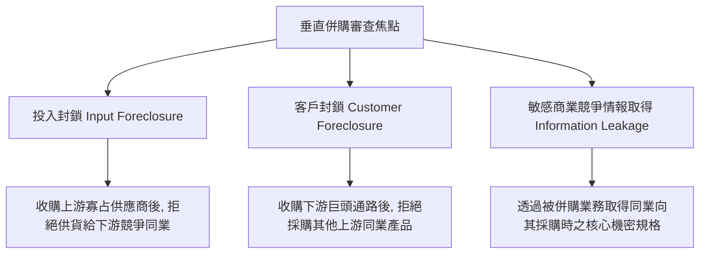

---
{"dg-publish":true,"permalink":"/98/vertical-merger-acquisition/","tags":["商業概念","企業併購","垂直整合","反壟斷法","價值鏈","PMBA"],"dg-note-properties":{"aliases":["垂直併購","Vertical Merger","Vertical Acquisition","垂直購併"],"tags":["商業概念","企業併購","垂直整合","反壟斷法","價值鏈","PMBA"]}}
---


# 垂直併購 (Vertical Mergers & Acquisitions Architecture)

> **【核心決策摘要】**
> **垂直併購（Vertical M&A）** 是指處於**同一產業垂直價值鏈中不同生產或分銷階段的兩家獨立企業**進行的合併或收購交易。垂直併購包含[[98_商業概念庫/backward-integration_後向整合\|後向收購上游原物料與零組件供應商]]，以及[[98_商業概念庫/forward-integration_前向整合\|前向收購下游經銷代理與零售通路]]。其戰略核心在於藉由所有權的一體化，**徹底消弭[[98_商業概念庫/TCE_Transaction_Cost_Economics_交易成本理論\|市場交易成本]]、消除雙重邊際化加價、防範供應鏈斷供與專屬性資產套牢**。然而，垂直併購也是各國反托拉斯（Antitrust）監管機構（如美國 FTC、DOJ 與歐盟委員會）嚴格審查的焦點，其核心爭議在於是否引發**投入封鎖（Input Foreclosure）** 或 **客戶封鎖（Customer Foreclosure）** 以扼殺同業競爭。

---

## 1. 概念核心定義與類型對照 (Executive Definition & Typology)

### 1.1 核心定義
在公司理財與戰略管理中，垂直併購被定義為：**買方透過外部資本手段，將處於自身產品生命週期或生產工序緊密相連之供應端或銷售端的企業產權完全吸收，進而實現跨價值鏈階段的縱向一體化**。

```
                    ┌─────────────────────────────────────────────────────────┐
                    │               垂直併購的兩大方向架構                    │
                    └────────────────────────────┬────────────────────────────┘
                                                 ▼
        ┌───────────────────┐        ┌───────────────────┐        ┌───────────────────┐
        │  上游：供應商端   │ ◀───── │   核心併購方企業  │ ─────▶ │   下游：通路客戶端 │
        └───────────────────┘        └───────────────────┘        └───────────────────┘
                  ▲                                                         ▲
                  │                                                         │
       【後向垂直併購 (Upstream)】                               【前向垂直併購 (Downstream)】
       • 買下關鍵晶片設計/材料廠                                 • 買下全球連鎖零售門市
       • 目標：鎖定供應, 保障技術機密                            • 目標：掌控定價, 獲取顧客數據
       • 案例：微軟收購遊戲開發工作室 (動視暴雪)                 • 案例：亞馬遜收購全食超市 (Whole Foods)
```

---

## 2. 垂直併購的經濟動機與綜效來源 (Economic Motivations & Synergies)

### 2.1 交易成本最小化（Minimizing Transaction Costs）
當企業與供應商或經銷商之間的合作涉及高額的**資產專屬性（Asset Specificity）** 時，長期的合約談判、監督成本與伺機主義風險極高。透過垂直併購，雙方化為同一經濟實體，原先的外部市場摩擦即轉化為內部科層協調，大幅提升投資專用技術的意願。

### 2.2 消除雙重邊際化（Eliminating Double Marginalization）
上下游各自獨立定價時會發生重複加價（Double Mark-up），導致終端售價過高並壓抑整體市場產出。垂直併購使集團能以內部轉移邊際成本定價，在終端市場展現更強的價格競爭力並極大化總利潤。

### 2.3 協同研發與產品生命週期加速（Integral Product Architecture）
在高度複雜的高科技領域（如自動駕駛、AI 伺服器），軟體演算法與專用晶片若由獨立公司開發，介面磨合耗時耗力。垂直併購使軟硬體團隊在第一天即可共享底層架構參數，縮短產品推向市場時間（Time-to-Market）。

---

## 3. 反托拉斯監管與反競爭審查焦點 (Antitrust & Foreclosure Concerns)

各國競爭法主管機關（如美國 FTC、司法部 DOJ、歐盟 DG COMP、台灣公平交易委員會）在審查垂直併購時，主要檢驗兩大「封鎖效應（Foreclosure）」：



1. **投入封鎖（Input Foreclosure）**：
   - 買方收購了市場上具有獨佔或寡占地位的上游關鍵要素供應商後，拒絕向自身在下游的競爭對手供貨，或故意拉高供應價格、降低品質，進而削弱下游競爭對手的生存能力（如 FTC 審查微軟收購動視暴雪時，極度關注其是否會將《決勝時刻 Call of Duty》從索尼 PlayStation 平台獨佔下架）。
2. **客戶封鎖（Customer Foreclosure）**：
   - 買方在下游擁有龐大市場佔有率，在收購某家上游製造商後，全面切斷與其他外部獨立供應商的業務往來，導致其他上游供應商失去關鍵銷售管道而破產。
3. **競爭情報不正獲取（Sensitive Competitive Information）**：
   - 併購後，買方得以合法查閱競爭對手過去向被併購方採購時所提供的產品設計藍圖、訂單預測與定價機密，引發嚴重的不公平競爭疑慮。

---

## 4. 垂直併購 vs. 水平併購 深度對照 (Vertical vs. Horizontal M&A)

| 比較維度 | 垂直併購 (Vertical M&A) | 水平併購 (Horizontal M&A) |
| :--- | :--- | :--- |
| **價值鏈位置** | 處於上下游不同生產階段 | 處於同一產業同一直接競爭階段 |
| **主要目標** | 供應安全、降低交易成本、消除雙重邊際化 | 消除競爭對手、擴大市場份額、提高定價權 |
| **主要綜效** | 營運流程協同、保護核心技術 Know-how | 規模經濟（MES）、後勤與行政職能重複裁撤 |
| **反壟斷審查焦點** | 投入封鎖、客戶封鎖、通路排他性 | 市場集中度（HHI 指數增量）、直接價格壟斷 |
| **典型案例** | 亞馬遜收購 Whole Foods；微軟收購 Activision | 迪士尼收購 21 世紀福斯；臉書收購 Instagram |

---

## 5. 關聯概念與延伸閱讀 (Cross References)

- [[backward-integration_後向整合]]：向價值鏈上游整合的策略理論基礎。
- [[forward-integration_前向整合]]：向價值鏈下游通路整合的策略理論基礎。
- [[horizontal-merger-acquisition_水平併購]]：同產業橫向併購的特徵與反壟斷審查。
- [[merger-acquisition_併購綜效]]：併購創造營運與財務綜效的量化評價模型。
- [[merger-acquisition-integration_併購後整合]]：垂直併購後的組織協同與文化融合。
- [[TCE_Transaction_Cost_Economics_交易成本理論]]：決定是否採用產權併購的資產專屬性分析。
- [[home]]：PMBA 知識庫首頁與模組導航。