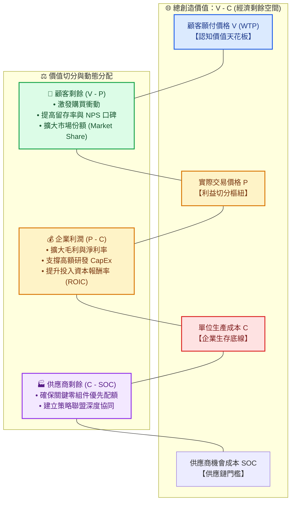
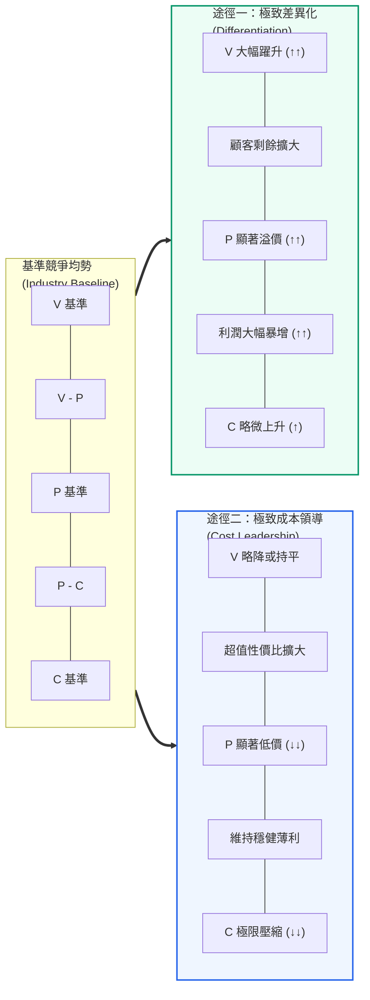
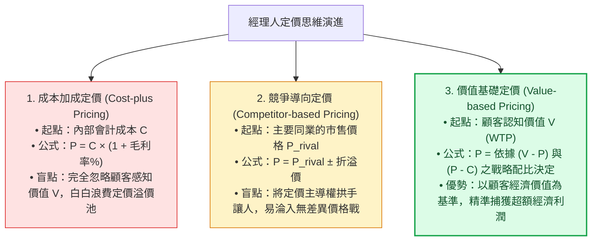
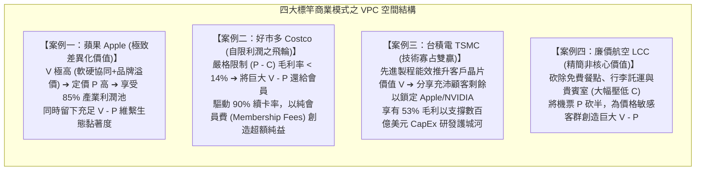
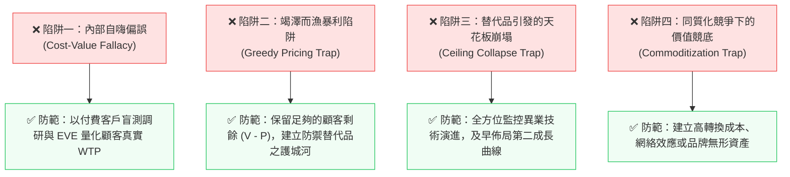

---
{"dg-publish":true,"permalink":"/98/vpc-value-price-cost/","tags":["商業概念","策略管理","商業模式","定價策略","價值創造","競爭策略","PMBA"],"dg-note-properties":{"aliases":["VPC_Value_Price_Cost 分析","VPC","VPC分析","VPC架構","VPC模型","Value-Price-Cost","Value-Price-Cost Framework","價值價格成本分析","價值價格成本模型","價值楔子模型","Value Wedge Model"],"tags":["商業概念","策略管理","商業模式","定價策略","價值創造","競爭策略","PMBA"]}}
---


# VPC 分析 (Value-Price-Cost Framework / 價值-價格-成本分析)

> **商管核心價值**：  
> 「價格是你付出的，價值是你得到的。（Price is what you pay; value is what you get.）」——華倫·巴菲特（Warren Buffett）  
> 
> 在現代策略管理與商業模式設計中，**VPC 分析（Value-Price-Cost Framework / 價值-價格-成本分析）** 是解構企業「價值創造（Value Creation）」與「價值捕獲（Value Capture）」最經典且根本的微觀經濟決策工具。任何商業策略的成敗、市場競爭優勢的強弱以及資本回報率的高低，本質上皆取決於經理人如何動態拉開 **$V$（顧客感知價值）、$P$（產品交易價格）、$C$（企業生產成本）** 三者之間的差距，並在顧客、企業與供應鏈夥伴之間進行具備持續防禦力的利益分配。

---

## 一、 核心定義與理論基石

### 1.1 VPC 分析的三大維度解構

VPC 框架將商業交易與策略定位簡化為三個最關鍵的正交維度：

```text
▲ 【顧客認知價值上限 (WTP Ceiling)】
│   V (Value / Perceived Value / Willingness to Pay)
│   顧客對該產品或服務所感知的總效益與「最高願付價格」
│
├──────────────────────── 【顧客剩餘 (Consumer Surplus) = V - P】
│                         (驅動顧客購買動機、轉換率、滿意度與市占率)
│   P (Price / Transaction Price)
│   企業向顧客收取的「實際成交價格」
│
├──────────────────────── 【企業利潤 / 價值捕獲 (Firm Profit) = P - C】
│                         (決定企業毛利率、營業利潤、現金流與 ROIC)
│   C (Cost / Total Unit Economic Cost)
│   企業研發、生產、行銷與交付該產品所耗費的「總單位經濟成本」
▼ 【企業生存成本地板 (Cost Floor)】
```

1. **$V$（Value / Perceived Value / Willingness to Pay, WTP）**：
   - **定義**：顧客心中主觀感受到的「總顧客價值」，即顧客在不買該產品時的效用與買了之後的效用差額，折算成貨幣形式的**最高願付價格**。
   - **策略角色**：構成市場定價的**絕對天花板（Ceiling）**。若定價 $P > V$，交易絕不可能發生。
2. **$P$（Price / Actual Transaction Price）**：
   - **定義**：產品在市場中最終成交的貨幣金額（包含各類折扣後的淨價格）。
   - **策略角色**：作為**價值分配的樞紐閥門**，決定創造的價值中有多少歸於顧客、多少被企業自身所捕獲。
3. **$C$（Cost / Unit Economic Cost）**：
   - **定義**：企業創造並交付一單位產品所耗費的總會計成本與資本機會成本（原料、製造、物流、研發攤提、通路抽成）。
   - **策略角色**：構成商業運營的**生存地板（Floor）**。若定價 $P < C$，企業陷入做越多賠越多的失血泥淖。
4. **延伸維度：$S$ / SOC（Supplier Opportunity Cost, 供應商機會成本）**：
   - 奠基於 Brandenburger & Stuart (1996) 的價值網絡模型，供應商提供生產要素所要求的最低回報。$C - \text{SOC}$ 構成**供應商剩餘（Supplier Surplus）**。

---

### 1.2 數理框架與四大核心差距（Gaps & Surpluses）

$$\text{總創造經濟價值 (Total Value Created)} = V - C = (V - P) + (P - C)$$

若完整計入供應鏈要素，則：
$$\text{總創造經濟價值} = V - \text{SOC} = \underbrace{(V - P)}_{\text{顧客剩餘}} + \underbrace{(P - C)}_{\text{企業利潤}} + \underbrace{(C - \text{SOC})}_{\text{供應商剩餘}}$$

| 差距 / 剩餘名稱 | 計算公式 | 經濟學與商管本質 | 經理人管理意涵與策略目標 |
| :--- | :---: | :--- | :--- |
| **1. 總創造價值<br>(Total Value Created)** | $$V - C$$ | 衡量企業商業模式為社會經濟整體創造的「真實淨增量」。 | • 若 $V - C \le 0$，該事業本質上在「毀滅價值」，不可行。<br>• 競爭優勢的終極源泉，在於拉開比對手更大的 $(V - C)$。 |
| **2. 顧客剩餘<br>(Consumer Surplus)** | $$V - P$$ | 顧客感受到的「性價比超值感」與心理愉悅剩餘。 | • **驅動飛輪**：直接決定顧客購買轉化率、品牌黏著度與口碑傳播。<br>• 顧客剩餘過小會導致客戶流失給替代品；適度讓利是擴張市占的關鍵。 |
| **3. 企業捕獲價值<br>(Firm Profit / Margin)** | $$P - C$$ | 企業每單位產出實際留存的經濟利潤（毛利空間）。 | • **生存造血**：直接決定損益表毛利率、營業利益率與資本回報率（ROIC）。<br>• 為企業未來的研發 CapEx、人才薪酬與股東分紅提供資金活水。 |
| **4. 供應商剩餘<br>(Supplier Surplus)** | $$C - \text{SOC}$$ | 供應商獲得的報酬高於其將資源挪作他用的最低機會成本。 | • 維繫戰略供應夥伴的忠誠度與共同研發意願，防止斷供或被對手挖角。 |

---

### 1.3 核心價值流轉與利益分配傳導圖



---

## 二、 VPC 的兩大古典戰略路徑（波特通用策略之微觀映射）

麥可·波特（Michael E. Porter）提出的兩大通用競爭策略，在微觀經濟學上本質就是兩種不同的 **VPC 空間拉伸手段**：



### 2.1 途徑一：差異化策略（Differentiation Strategy）
- **運作核心**：聚焦於**拉升 $V$（推升 WTP）**。
- **數學條件**：$$\Delta V > \Delta C \quad (\text{其中 } \Delta C \ge 0)$$
- **策略邏輯**：企業雖然投入了額外的研發、頂級用料、專屬設計與品牌行銷，使得單位成本上升（$C_1 > C_0$）；但由於為顧客解決了痛點、帶來了極致體驗或尊榮感，使顧客的願付價格躍升幅度遠大於成本增量（$\Delta V \gg \Delta C$）。
- **結果**：企業能收取極高溢價 $P_1$，既享受龐大的超額毛利 $P_1 - C_1$，同時顧客仍享有豐厚的顧客剩餘 $V_1 - P_1$（如 **Apple iPhone**、**台積電先進製程**、**愛馬仕 Hermès**）。

### 2.2 途徑二：成本領導策略（Cost Leadership Strategy）
- **運作核心**：聚焦於**極限壓縮 $C$（Cost Reduction）**。
- **數學條件**：$$-\Delta C > -\Delta V \quad (\text{其中 } V_2 \text{ 維持在可接受的合理門檻})$$
- **策略邏輯**：企業透過規模經濟、製程標準化、極簡 SKU、敏捷供應鏈或自動化，將成本壓至同業無法企及的水準（$C_2 \ll C_0$）；即使產品功能略顯陽春（$V_2$ 略微低於或等於業界基準），但企業能定出極具震撼力的超低價 $P_2$。
- **結果**：低價 $P_2$ 賦予顧客極大的超值剩餘 $V_2 - P_2$，驅動龐大銷量，企業靠「薄利 $\times$ 極高資產週轉率」創造傲人的資本回報率（如 **好市多 Costco**、**鴻海 Foxconn**、**宜家 IKEA**、**西南航空 Southwest**）。

### 2.3 途徑三：價值創新雙重突破（Dual Advantage / Value Innovation）
- **運作核心**：打破「高價值必然高成本」的傳統思維框架，同時做到 **$V \uparrow$ 且 $C \downarrow$**。
- **策略邏輯**：通常依賴破壞式創新或商業模式重構（如藍海策略之 ERRC 矩陣）。
  - **消除/減少**：砍掉顧客不在意但同業盲目競逐的高成本功能。
  - **提升/創造**：集中資源打造能大幅提升顧客體驗的殺手級全新要素。
  - **案例**：**Amazon AWS**（以彈性隨選雲端服務推升開發者價值 $V$，同時以超大規模資料中心極限攤提硬體成本 $C$）。

---

## 三、 經理人定價戰略與價值捕獲模型（Pricing Strategies via VPC）

定價不僅是會計數字，而是戰略取捨。VPC 框架清晰指引了三種不同層次的定價思維：



### 3.1 價值基礎定價之「經濟價值評估法（EVE, Economic Value Estimation）」
高階 B2B 或高科技產品在估算 $V$ 時，絕不靠拍腦袋，而是採用 EVE 模型量化推導：

$$\text{顧客感知總價值 } V = \text{參考價值 (Reference Value)} + \text{差異化價值 (Differentiation Value)}$$

1. **參考價值（Reference Value）**：客戶若採用市場現有最主要替代方案所支付的成本。
2. **差異化價值（Differentiation Value）**：本公司方案相較於替代方案，能額外為客戶：
   - **增加收入**（如提高良率 3% 所帶來的額外營收）；
   - **節省成本**（如節省電費 20%、減少維護工時 100 小時）；
   - **降低風險**（如降低資安漏洞罰款風險折現）。
3. **定價決策**：在算出的總價值 $V$ 之中，經理人決定將差異化價值的多少百分比留給客戶當作吸引轉換的「胡蘿蔔（$V - P$）」，多少保留為企業利潤（$P - C$）。

---

### 3.2 撇脂定價 vs. 滲透定價在 VPC 上的配置差異

| 定價模式 | VPC 空間切分特徵 | 適用情境與市場特質 | 代表案例與商業目標 |
| :--- | :--- | :--- | :--- |
| **撇脂定價<br>(Price Skimming)** | **$P$ 緊貼 $V$**<br>• 企業利潤 $(P - C)$ 極大化<br>• 顧客剩餘 $(V - P)$ 受到嚴格控制 | • 產品具備強大專利壁壘或頂級品牌<br>• 市場存在對價格不敏感的狂熱早鳥先驅者<br>• 產能短期受限無法大量供應 | **高階旗艦手機、新藥上市初期**<br>目標：在對手跟進前快速收回研發 CapEx。 |
| **滲透定價<br>(Penetration Pricing)** | **$P$ 緊貼 $C$**<br>• 顧客剩餘 $(V - P)$ 極大化<br>• 企業每單位利潤 $(P - C)$ 微薄 | • 市場具備強大網絡效應或高轉換成本<br>• 規模經濟顯著，銷量增加能大幅壓低後續成本<br>• 面臨眾多潛在競爭者伺機進入 | **訂閱制串流、雙邊平台早期補貼**<br>目標：以極致超值感迅速攻佔市場份額，鎖死標準。 |

---

### 3.3 總顧客成本視角：超越純貨幣價格的摩擦力消除

顧客感知價值方程式表明：顧客最終感受到的淨效益，必須扣除所有非貨幣摩擦成本：

```text
【總顧客成本 (Total Customer Cost)】
  ├── 1. 貨幣成本 (Monetary Cost)：購買價格 P、運費、維護費
  ├── 2. 搜尋與評估時間成本 (Time Cost)：比價時間、等待交期
  ├── 3. 學習與操作精力成本 (Energy Cost)：繁複導入流程、員工培訓
  └── 4. 決策後悔與安全風險成本 (Psychological Cost)：資安疑慮、試錯風險
```

> 📌 **管理意涵**：企業除了「降價 $P$」之外，**消除客戶的非貨幣成本，等同於無形中大幅推升了 $V - P$**！例如提供「免費到府安裝、30 天無條件退貨、即插即用 API、24 小時在線支援」，能顯著提高客戶購買轉化率，而無需打血腥價格戰。

---

## 四、 跨產業標竿企業 VPC 實戰深度對標



### 4.1 案例一：蘋果（Apple）——極致差異化下的雙贏價值楔子
- **VPC 解構**：
  - **推升 $V$**：自主研發 Apple Silicon 晶片、iOS 封閉生態軟硬協同、AirDrop 無縫串聯、奢華品牌形象。
  - **控制 $C$**：全球供應鏈極致採購議價權與組裝排程。
  - **定價 $P$ 與分配**：iPhone 均價高達 900~1,000 美元，但因 $V$ 極高，用戶仍深感物有所值（高 $V - P$ 形成黏著度）；同時為蘋果留下了逾 40% 的高毛利（高 $P - C$），瓜分全球智慧型手機逾 85% 的利潤池。

### 4.2 案例二：好市多（Costco）——自我限制 $P - C$ 的飛輪增長模式
- **VPC 解構**：
  - **極限壓低 $C$**：嚴選不到 4,000 項熱門 SKU，單品批量採購規模極大；倉儲式陳列省下裝潢與理貨人力。
  - **自我設限 $P - C$**：公司規定所有商品毛利率上限不得超過 14%~15%（業界平均 25%~35%）。
  - **將價值全數讓渡給顧客（極大化 $V - P$）**：超低定價使會員每次購物都有「尋寶賺到」的強烈超值感，創造超過 90% 的會員續約率；公司幾乎不靠商品買賣差價賺錢，而是靠穩定的**會員費收入（純利）**創造驚人的資本回報率。

### 4.3 案例三：台積電（TSMC）——技術寡占與夥伴雙贏
- **VPC 解構**：
  - **推升客戶產品的 $V$**：台積電提供全球良率最高、能耗比最優的 3nm/2nm 先進製程與 CoWoS 先進封裝，使客戶（Apple、NVIDIA、AMD）的晶片性能冠絕全球，大幅推升了客戶產品的市場價值。
  - **理性定價 $P$**：張忠謀堅持「夥伴關係」，定價雖高但絕不竭澤而漁，刻意保留充足利潤與競爭力給客戶（維持客戶高 $V - P$），換取客戶將所有旗艦訂單長期鎖定在台積電。
  - **保護 $P - C$**：長期維持 53% 以上毛利率，為每年 300~400 億美元的龐大 CapEx 提供再投資底氣，拉開無可跨越的技術護城河。

---

## 五、 經理人常見四大認知陷阱與實務防範

在商管實務中，經理人常因對 VPC 變數的誤讀而導致策略崩潰：



### 1. 內部自嗨偏誤（Cost-Value Fallacy）
- **具體表現**：工程研發團隊耗費數年與巨資開發了極度精密的功能，便主觀認定「我們成本這麼高，顧客理所當然應該付高價」。
- **下場**：如果該功能並未解決顧客的核心痛點，顧客感知的 $V$ 毫無增加。定出高價 $P$ 只會導致產品滯銷，巨額成本 $C$ 淪為無法回收的沉沒損失。

### 2. 竭澤而漁暴利陷阱（Greedy Pricing Trap）
- **具體表現**：企業自恃具備短期專利或先發壟斷地位，將價格 $P$ 緊貼著 $V$ 訂定，幾乎榨乾所有顧客剩餘（$V - P \approx 0$）。
- **下場**：客戶購買時充滿被剝削感，毫無品牌忠誠度。一旦市場出現堪用的新替代品或外部挑戰者，顧客會以雪崩般的速度全面轉單出逃。

### 3. 替代品引發的天花板崩塌（Ceiling Collapse Trap）
- **具體表現**：只盯著產業內直接對手，忽視異業顛覆式技術的崛起。
- **下場**：替代品的出現（如高鐵之於國內民航、Zoom 之於跨國商務差旅）會以指數級速度將顧客對舊技術的願付價格 $V$ 大幅向下拉低，迫使既有廠商在成本 $C$ 無法即時調降的困境下，利潤空間 $P - C$ 被瞬間壓扁。

### 4. 同質化競爭下的價值競底（Commoditization Trap）
- **具體表現**：缺乏獨特活動體系配適與護城河，僅靠營運效益（OE）競爭。
- **下場**：同業競相模仿使得各家產品的 $V$ 毫無差異，價格戰必然爆發；價格 $P$ 被迫一路下殺直至緊貼成本 $C$（$P \approx C$），全行業淪為微利代工，所有經濟剩餘全數奉送給買方。

---

## 六、 課程講義與模組網絡無縫對接

本概念卡片橫跨並貫穿 PMBA 兩大核心學程的課堂講義與白板推導：

### 📚 官方教材與模組講義深度對接

1. **《創業與企業財務策略》官方教材對接**：
   - 📖 **Class 4 講義** ➔ [[04_主題選修/10_創業與企業財務策略/02_模組筆記/Module_1_創新思維與商業模式/M1-9_商業模式畫布架構與價值主張設計\|M1-9 商業模式畫布架構與價值主張設計]]：
     - 解構白板推導專題：**「顧客感知價值方程式（總價值 vs. 總成本）」**，釐清 $V$ 的貨幣與非貨幣構成要素。
   - 📖 **Class 4 講義** ➔ [[04_主題選修/10_創業與企業財務策略/02_模組筆記/Module_1_創新思維與商業模式/M1-10_七大市場力量與商業戰略價值公式\|M1-10 七大市場力量與商業戰略價值公式]]：
     - 白板推導公式：$\text{Value} = \text{市場規模} \times \text{市場力量}$；其中「超額差額利潤率 $m$」的本質，即為企業透過七大市場力量防禦並鎖定 VPC 中 $(P - C)$ 利潤空間的具體表現。
   - 📖 **Class 1~7 全域講義** ➔ [[04_主題選修/10_創業與企業財務策略/02_模組筆記/Module_1_創新思維與商業模式/M1-2_白板決策鏈與財務價值三角\|M1-2 白板決策鏈與財務價值三角]]：
     - 「商業決策四階躍遷（Good Idea $\rightarrow$ Good Business $\rightarrow$ Good Company $\rightarrow$ Good Investment）」：從商業模式的 VPC 設計跨越至資本市場的 $\text{ROIC} > \text{WACC}$ 企業價值創造。

2. **《產業分析與投資策略》官方教材對接**：
   - 📖 **Class 1 講義** ➔ [[04_主題選修/12_產業分析與投資策略/02_模組筆記/Module_1_總論與架構/M1-3_產業獲利結構差異與十大經典理論\|M1-3 產業獲利結構差異與十大經典理論]]：
     - 標竿獲利驅動模型：鴻海（低毛利高週轉、靠規模採購控管 $C$）vs. 台積電（技術寡占高定價、拉大 $P - C$），本質為 VPC 空間的不同切分途徑。
   - 📖 **Class 2 講義** ➔ [[04_主題選修/12_產業分析與投資策略/02_模組筆記/Module_1_總論與架構/M1-5_波特五力分析與量化架構\|M1-5 波特五力分析與量化架構]]：
     - 五力對 VPC 邊界的結構性壓迫：買方壓低 $P$、供應商抬高 $C$、替代品限制 $V$、同業競爭與新進者同時壓縮 $V - P$ 與 $P - C$。
   - 📖 **Class 3 講義** ➔ [[04_主題選修/12_產業分析與投資策略/02_模組筆記/Module_1_總論與架構/M1-6_產業分析模式與九大分析工具矩陣\|M1-6 產業分析模式與九大分析工具矩陣]]：
     - 價值鏈利潤池（Profit Pool）拆解，分析產業鏈各環節廠商所創造與捕獲的 VPC 差額。
   - 📖 **Class 4 講義** ➔ [[04_主題選修/12_產業分析與投資策略/02_模組筆記/Module_1_總論與架構/M1-7_產業市場空間與策略群組\|M1-7 產業市場空間與策略群組]]：
     - 需求三維空間（價值要素、產品要素、市場規模）與發掘未被滿足的「競爭空白區（White Space）」。

---

### 🔗 核心概念原子卡片雙向鏈結

- **策略與競爭優勢體系**：
  - [[98_商業概念庫/competitive-advantage_競爭優勢\|competitive-advantage_競爭優勢]]（超額經濟租金、Wedge 價值楔子模型、持續競爭優勢 SCA）
  - [[98_商業概念庫/competitive-matrix_競爭矩陣\|competitive-matrix_競爭矩陣]]（二維定位圖、特徵網格、CPM 態勢矩陣、ROIC 競爭矩陣）
  - [[98_商業概念庫/cost-leadership-strategy_成本領導策略\|cost-leadership-strategy_成本領導策略]] ｜ [[98_商業概念庫/differentiation-strategy_差異化策略\|differentiation-strategy_差異化策略]] ｜ [[98_商業概念庫/focused-strategy_集中化策略\|focused-strategy_集中化策略]]
  - [[98_商業概念庫/differentiation-advantage_差異化優勢\|differentiation-advantage_差異化優勢]] ｜ [[98_商業概念庫/product-differentiation_產品差異化\|product-differentiation_產品差異化]]
- **價值主張與商業模式體系**：
  - [[98_商業概念庫/value-proposition_價值主張\|value-proposition_價值主張]] ｜ [[98_商業概念庫/value-curve_價值曲線\|value-curve_價值曲線]] ｜ [[98_商業概念庫/value-chain_價值鏈\|value-chain_價值鏈]] ｜ [[98_商業概念庫/value-net_價值網\|value-net_價值網]]
  - [[98_商業概念庫/economic-moat_經濟護城河\|economic-moat_經濟護城河]] ｜ [[98_商業概念庫/switching-costs_轉換成本\|switching-costs_轉換成本]] ｜ [[98_商業概念庫/economies-of-scale_規模經濟\|economies-of-scale_規模經濟]] ｜ [[98_商業概念庫/dfm-design-for-manufacturability_可製造性設計\|DFM 可製造性設計]]
- **財務績效與資本評價體系**：
  - [[98_商業概念庫/return-on-invested-capital_資本投入報酬率\|return-on-invested-capital_資本投入報酬率]]（ROIC 杜邦拆解：Margin $\times$ Turnover）
  - [[98_商業概念庫/total-asset-turnover-ratio_總資產週轉率\|total-asset-turnover-ratio_總資產週轉率]] ｜ [[98_商業概念庫/dupont-analysis_杜邦分析法\|dupont-analysis_杜邦分析法]]
  - [[98_商業概念庫/cash-switching-cycle_現金轉換週期\|cash-switching-cycle_現金轉換週期]]（CCC 營運資金真空期與浮存金優勢）
