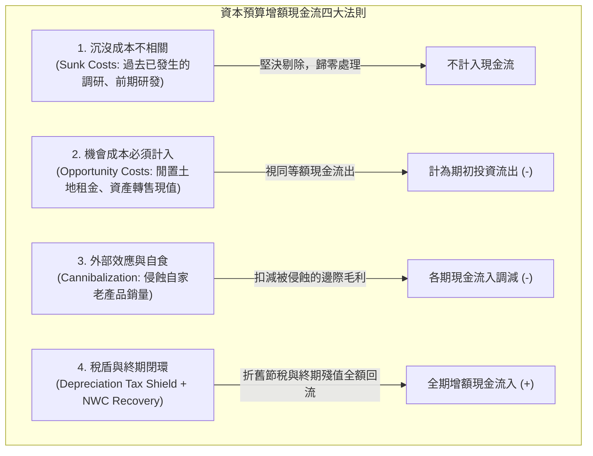

---
{"dg-publish":true,"permalink":"/98/zeng-e-cash-flow/","tags":["商業概念","資本預算","財務管理","投資決策","PMBA"],"dg-note-properties":{"aliases":["增額現金流量","Incremental Cash Flow","增量現金流","相關現金流量","Relevant Cash Flows"],"tags":["商業概念","資本預算","財務管理","投資決策","PMBA"]}}
---


# 增額現金流量 (Incremental Cash Flow & Capital Budgeting Principles)

> **【核心決策摘要】**
> **增額現金流量（Incremental Cash Flow，又稱相關現金流 Relevant Cash Flows）** 是資本預算（Capital Budgeting）與企業投資決策中**唯一符合經濟學邏輯的現金流計量標準**。其核心定義貫徹「**有它無它原則（The With-Without Principle）**」——即**企業在「接受該專案」與「不接受該專案」兩種狀態下，全公司整體未來現金流的淨差額**。評估增額現金流必須徹底擺脫會計科目的應計制干擾，嚴格恪守四大黃金法則：**沉沒成本完全不相關（Sunk Costs are Irrelevant）**、**機會成本必須計入（Opportunity Costs must be Included）**、**副作用與自食效應必須扣除（Side Effects / Cannibalization）**、**營運資金追加與終期殘值全生命週期閉環（NWC Recovery & Terminal Salvage）**。

---

## 1. 概念核心定義與本質 (Executive Definition & Theoretical Essence)

### 1.1 核心定義與「有它無它原則」
增額現金流量在公司理財中被嚴格定義為：**直接因採納該項投資決策而產生的全公司邊際現金流入與邊際現金流出之差額**。

$$\text{Incremental Cash Flow}_t = \text{Firm Cash Flow with Project}_t - \text{Firm Cash Flow without Project}_t$$

```
高階經理人唯一審計提問：
「這筆現金流是因為批准了這個專案才發生的嗎？如果今天徹底否決這個專案，這筆錢還會進出公司帳戶嗎？」
 • 若答案是「會」 ──► 非相關現金流，堅決剔除！
 • 若答案是「否」 ──► 真正的增額現金流，必須計入！
```

### 1.2 本質解析：四大常犯錯誤與會計思維陷阱
企業投資評估中最普遍的錯誤，是將「會計損益表思維」直接搬到「資本預算決策」中：
1. **沉沒成本心魔（Sunk Cost Fallacy）**：已經花出去的錢無法收回，但在心理學與官僚政治中，經理人常為了「證明過去的決策沒錯」而繼續對虧損專案追加投資（如協和號客機 Concorde 謬誤）。
2. **免費資產錯覺（Free Asset Illusion）**：使用公司既有的土地、廠房或閒置伺服器，帳面上看似無新增支出，實質上剝奪了出租或轉售的「機會成本（Opportunity Cost）」。
3. **老產品自食（Cannibalization）**：推出新產品時，只計算新產品的銷售額，忽視了新產品有 40% 的銷量是搶奪自家的老產品，高估了增額毛利。
4. **營運資金遺漏（Working Capital Neglect）**：只計算購買機器設備的資本支出（CapEx），遺漏了擴產所需的庫存備料與應收帳款追加（$\Delta\text{NWC}$）。

---

## 2. 資本預算四大黃金檢驗法則 (The 4 Golden Rules of Capital Budgeting)



### 2.1 法則一：沉沒成本完全不相關（Sunk Costs are Irrelevant）
- **定義**：在決策時點之前已經發生、且無法透過當前或未來任何決策改變的不可逆支出。
- **典型代表**：專案立項前委託麥肯錫進行的 500 萬元市場調研費、過去兩年投入的 2,000 萬元前期實驗室研發費。
- **實務準則**：無論專案做與不做，這筆錢都已經花掉了。在計算專案 NPV 時，**其相關現金流嚴格為零**。將沉沒成本計入專案只會造成扭曲。

### 2.2 法則二：機會成本必須計入（Opportunity Costs must be Included）
- **定義**：將一項資源投向該專案時，所放棄的「次優替代方案（Next-best Alternative）」的潛在現金收益。
- **典型代表**：專案計畫使用公司總部後方一塊閒置土地，該土地若不建新廠，目前市場可賣得 1.5 億元（稅後）。
- **實務準則**：在專案期初現金流中，必須計入 **-\$1.5 億元** 的現金流出。天下沒有白吃的午餐，資產被佔用即代表機會損失。

### 2.3 法則三：自食效應與外部效應（Erosion / Cannibalization / Synergies）
- **負外部性（自食效應）**：Apple 推出 iPad 時，搶奪了部分 MacBook 的銷售份額。計算 iPad 的增額現金流時，必須扣除「因 MacBook 銷量下滑所損失的稅後邊際貢獻毛利（Contribution Margin）」。
- **正外部性（互補綜效 Synergies）**：Sony 推出 PS5 主機時，能帶動高毛利數位遊戲下載與周邊手把銷售。這部分額外帶來的全公司增額現金流入應歸功於主機專案。

### 2.4 法則四：全生命週期稅務與營運資金閉環
1. **折舊稅盾（Depreciation Tax Shield）**：折舊本身非現金流出，但它能抵減應稅所得，產生的節稅效應為純現金流入：
   $$\text{Tax Shield} = \text{D\&A} \times t$$
2. **淨營運資金全期閉環（NWC Cycle）**：期初隨銷量備貨發生 $\Delta\text{NWC} > 0$（現金流出）；專案結束時，停止進料並出清庫存，**NWC 將 100% 逆向全額收回**（$\Delta\text{NWC} < 0$，現金流入，參見 [[net-working-capital-2_淨營運資金回收]]）。
3. **設備處分殘值稅後現金流（After-tax Salvage Value）**：
   $$\text{After-tax Salvage} = \text{Market Salvage Price} - t \times (\text{Market Salvage Price} - \text{Book Value})$$

---

## 3. 數理模型與增額現金流主控公式 (Mathematical Modeling & Master Formula)

一個投資專案在全生命週期 $t$ 期的總增額現金流，可整合為標準主控方程式：

$$\begin{aligned}
\text{Incremental CF}_t &= \underbrace{(\Delta\text{Sales}_t - \Delta\text{Costs}_t - \text{Cannibalization}_t)}_{\text{邊際營運利益增額}} \times (1 - t) \\
&\quad + \underbrace{\Delta\text{Depreciation}_t \times t}_{\text{折舊稅盾}} \\
&\quad - \underbrace{\Delta\text{NWC}_t}_{\text{淨營運資金追加/回收}} \\
&\quad - \underbrace{\text{CapEx}_t}_{\text{當期追加資本支出}} \\
&\quad + \underbrace{\text{After-tax Salvage}_t}_{\text{僅在終止年發生的處分殘值}}
\end{aligned}$$

---

## 4. 產業標竿與實戰應用場景 (Industry Benchmarks & Applications)

| 決策場景 | 增額現金流關鍵考量點 | 易犯常見盲點 | 經理人正確做法 |
| :--- | :--- | :--- | :--- |
| **傳統車廠推行電動車 (EV)** | 極為龐大的自食效應（Cannibalization）；燃油車發動機專用設備提前報廢減損 | 誤將全額 EV 銷售額計為增額營收，忽略燃油車工廠開工率不足的固定成本分攤 | 僅計算 EV 創造的「純新增客群毛利」，扣除搶奪燃油車的損失；但需將「不轉型將被法規罰款或淘汰」的潛在損失納入基準 |
| **半導體晶圓廠設備汰舊換新** | 舊機台出售的稅後殘值（Salvage）；新機台帶來的良率提升與電費節約 | 忽視舊機台如果繼續使用所需的昂貴維護費用 | 採用「差額增量法」：新機增額流 = 新機營運流 - 舊機維持流 |
| **製藥巨頭新藥研發進入臨床** | 前期 Phase 1/2 數億美元臨床研發已是沉沒成本；現有專利到期面臨學名藥斷崖 | 認為前期已投入 3 億美元，現在放棄太可惜（沉沒成本謬誤） | 僅看後續 Phase 3 所需追加資金與上市後現金流的現值對比（Forward-looking NPV） |

---

## 5. 經典企業個案深度剖析 (Deep Dive Case Studies)

### 5.1 成功典範：Apple 敢於自食 iPod 的極致增額思考
- **商業背景**：2005 年，iPod 佔蘋果全公司總營收超過 **45%**，是利潤率最高的核心超級金牛。
- **賈伯斯的增額決策**：
  1. 賈伯斯洞察到智慧型手機必將整合音樂播放功能，即便蘋果不做，諾基亞與摩托羅拉也會做。
  2. 2007 年推出 iPhone，其核心功能之一就是「一台擁有觸控螢幕的寬螢幕 iPod」。
  3. **增額現金流哲學**：「**如果我們不自我吞噬，別人也會將我們吞噬（If you don't cannibalize yourself, someone else will）**」。被自食的 iPod 現金流在「無它狀態下」本來就注定歸零。
- **成效**：儘管 iPod 業務隨後歸零，但 iPhone 創造了商業史上最強大的增額現金流帝國，帶動蘋果市值從千億突破 3 兆美元。

### 5.2 失敗警示：英法協和號客機（Concorde）的「沉沒成本無底洞」
- **歷史悲劇**：1960 年代英法兩國政府聯合研發協和號超音速客機。
- **決策沉淪過程**：
  1. 研發中途成本嚴重超支數倍，且石油危機爆發導致超音速客機高油耗、高噪聲的商業致命傷暴露無遺。
  2. 每次內閣會議評估停損時，官員均表示：「我們已經投入了 10 億英鎊，如果現在取消，過去所有的血汗與納稅人的錢就全部打水漂了！」
  3. 沉沒成本心魔綁架了兩國政府，導致該專案持續注資數十年，累計耗資數十億美元，最終僅生產了 20 架客機，商業營運長期虧損，成為行為經濟學中「**協和號謬誤（Concorde Fallacy）**」的同義詞。

---

## 6. 高階經理人決策實戰工具箱 (Executive Action Playbook)

### 6.1 資本預算增額現金流審計檢核表 (The Incremental Audit Checklist)
- [ ] **審計 1：前期已支付的研發費、諮詢費、可行性調研費，是否已 100% 從投資成本中剔除？**
- [ ] **審計 2：專案所使用的土地、廠房、閒置設備，是否已按「稅後公允市場轉售/出租價值」計入機會成本流出？**
- [ ] **審計 3：新產品是否會搶奪現有產品線的市場？（自食效應扣減額 = 被侵蝕銷量 $\times$ 原產品邊際貢獻毛利）。**
- [ ] **審計 4：總部行政管理費用（Overhead Allocation）是否僅計入了「純新增的增額管理費」？（嚴禁分攤原本就存在的既有總部固定費用！）。**
- [ ] **審計 5：專案終止年（Terminal Year）是否準確計入了設備處分稅後殘值與淨營運資金（NWC）的全額回收？**

---

## 7. 關聯知識網絡與導航地圖 (Knowledge Network & Cross-References)

### 7.1 本主題核心三部曲
- **[[payback-period_回收期間法]]** · 初始投資流動性回本速度、四大理論缺陷與第一道初篩漏斗
- **[[discounted-payback-period_折現回收期間法]]** · 引入資本成本折現、NPV 連動定理與動態回本邊界
- **[[zeng-e-cash-flow_增額現金流量]]** · 資本預算唯一度量標準、沉沒成本剔除、機會成本與自食效應（本篇）

### 7.2 跨領域財務與策略鏈結
- [[capital-budgeting_資本預算]] · 資本預算決策工具全景圖譜與立項框架
- [[capital-expenditure_資本支出]] · 資本支出項目之立項審核與生命週期監控
- [[NPV_淨現值法 _Net Present Value]] · 增額現金流量折現後的絕對財富創造量尺
- [[net-working-capital-2_淨營運資金回收]] · 專案終止時營運資金 100% 變現回流機制
- [[real-options_實質選擇權]] · 考慮未來不確定性時對增額現金流之管理彈性估值

### 7.3 課程筆記與導航主頁
- [[M1-2_三大景氣循環與資本評價邏輯]] · 資本評價邏輯、設備循環與增額投資評估
- [[_創業與企業財務策略 MOC]] · 企業財務策略與資本市場運作全景地圖
- [[home]] · 全球 PMBA 知識庫總導航主頁面