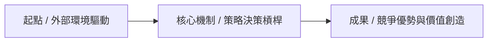

---
{"dg-publish":true,"permalink":"/99//","tags":["PMBA","核心必修","{{course_name}}"],"dg-note-properties":{"類別":"課程筆記","課程名稱":"{{course_name}}","單元編號":"{{lecture_id}}","主題":"{{title}}","上課日期":"{{date}}","狀態":"🟢 已完成","tags":["PMBA","核心必修","{{course_name}}"]}}
---

# 🚀 {{lecture_id}} {{title}}

> [!abstract] **導讀與知識圖譜對接**
> - **所屬課程**：[[_{{course_name}} MOC\|{{course_name}} 全課導航]]
> - **修課地圖**：[[00_學程修課地圖 & 進度追蹤\|00_學程修課地圖 & 進度追蹤]]
> - **本日核心概念**：[[概念卡片1\|概念卡片1]] ｜ [[概念卡片2\|概念卡片2]] ｜ [[概念卡片3\|概念卡片3]]

---

## 💡 一、 核心摘要（Executive Summary）
> *以高階經理人視野，提煉 3~5 條本日最關鍵的商業本質、決策啟發與底層邏輯。*

1. **[關鍵洞察一：商業本質]**：...
2. **[關鍵洞察二：動態權衡]**：...
3. **[關鍵洞察三：競爭與價值]**：...
4. **[關鍵洞察四：長期治理/資產累積]**：...

---

## 🏛️ 二、 核心理論與架構模型（Theoretical Foundations）

### 1. [理論模型 A：名稱]
- **核心本質與學術定義**：...
- **架構流程圖（Mermaid 結構化可視化）**：

- **核心維度與評估指標**：
  - **維度 1**：...
  - **維度 2**：...

---

### 2. [理論模型 B：維度對比矩陣]
| 比較維度 | 典範 A / 傳統模式 | 典範 B / 現代模式 | 經理人策略含意 |
| :--- | :--- | :--- | :--- |
| **核心假設** | ... | ... | ... |
| **運作機制** | ... | ... | ... |
| **組織挑戰** | ... | ... | ... |
| **競爭優勢來源** | ... | ... | ... |

*(若包含財務/量化或經濟學公式，此處使用 LaTeX 排版，例如：$ROI = \frac{\text{營業利益}}{\text{投入資本}}$ 或 $WACC = \frac{E}{V}r_e + \frac{D}{V}r_d(1-T_c)$)*

---

## ⚠️ 三、 實務應用與經理人思維（Managerial Implications）

### 1. [實務痛點 / 治理矛盾 / 決策盲點]
- **病徵解構（Symptom Analysis）**：
  - 常見組織病徵或經理人易落入之 KPI 陷阱...
- **誘因機制與制度根源（Incentives & Institutional Drivers）**：
  - 導致該問題的根本誘因結構（如短期主義、資訊不對稱、代理問題）...
- **高階經理人破局之道（Actionable Solutions）**：
  - 制度設計與管理槓桿...

### 2. [跨維度權衡與資源配置（Trade-offs）]
- **短期效益 vs. 長期競爭力**：...
- **效率 vs. 韌性**：...

---

## 🎯 四、 課堂核心案例深度啟發（Case Study Insights）

### 1. [個案名稱 / 企業實例 A]
- **企業背景與面臨挑戰**：...
- **關鍵決策與戰略轉折點**：...
- **理論對照與成敗啟示**：
  - **對照理論**：[[關聯商業概念名]]
  - **實務啟示**：...

### 2. [個案名稱 / 企業實例 B]
- **情境與決策衝突**：...
- **實務啟示與經理人借鏡**：...

---

## 💡 五、 實務工作反思與行動方案（Self-Reflection & Action）
- [ ] **自我提問**：當前所屬產業或企業在面對上述課題時，具備哪些防禦優勢？或存在哪些潛在盲點？
- [ ] **行動方案**：週一回到工作崗位後，能立即進行驗證、溝通或落實的管理舉措為何？

---

## 🔗 六、 關聯主題與概念庫索引
- **引用的商業概念庫卡片**：
  - [[概念一]]
  - [[概念二]]
  - [[概念三]]
- **章節導航**：
  - 上一單元：[[L0X_...]]
  - 下一單元：[[L0X_...]]
  - 返回全課目錄：[[_{{course_name}} MOC|{{course_name}} 全課導航]]