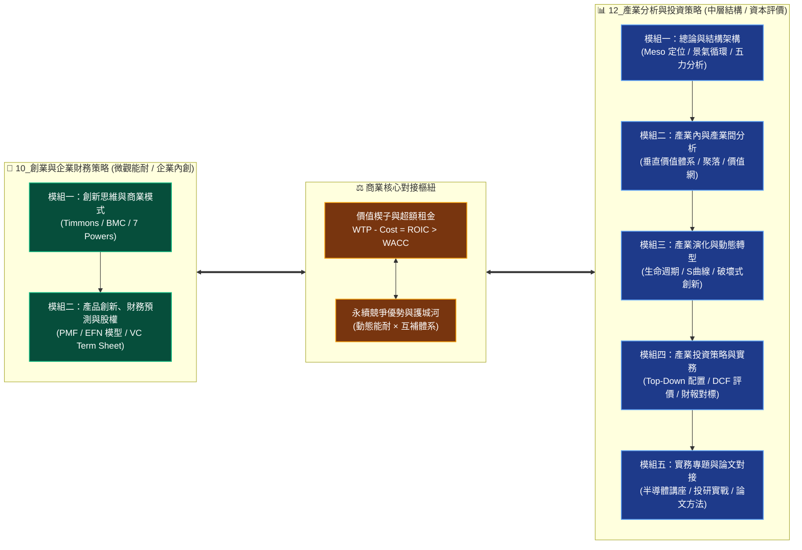

---
{"dg-publish":true,"permalink":"/home/","title":"PMBA 核心專業選修知識庫","tags":["gardenEntry"],"dg-note-properties":{"title":"PMBA 核心專業選修知識庫"}}
---

# 📚 PMBA 核心專業選修知識庫
> **National Taiwan University · Professional MBA Knowledge Portal**  
> 國立臺灣大學 PMBA 主題選修核心知識樞紐 · 雙軌高階商業決策動態體系

> [!ABSTRACT] 💡 數位花園定位與全景導航 (Executive Abstract)
> 本知識庫為 PMBA 兩大旗艦主題選修課程之數位知識中樞，架構上貫通**「微觀新創財務與能耐（Micro / Firm）」**與**「中層產業結構與資本市場（Meso / Industry）」**，打通從商業模式創新、精實假說驗證、財務三表動態聯動、外部融資需求（EFN）、創投與私募股權（VC/PE），到產業中層結構（SCP）、波特五力、價值體系、技術 S 曲線、Top-Down 資產配置與企業內在價值估算之完整商管決策閉環。

---

## 🏛️ 知識庫架構總覽：微觀創能 $\times$ 中層產業雙軌模型

---

## 🧭 主題選修旗艦課程全景導航

### 🚀 課程一：10_創業與企業財務策略 (Entrepreneurship & Corporate Financial Strategy)

> [!NOTE] 📌 課程核心定位與進度狀態
> - **核心宗旨**：打通「好點子 $\rightarrow$ 好事業 $\rightarrow$ 好公司 $\rightarrow$ 好投資」的商業化轉譯路徑，整合商業模式設計、價值主張、精實產品驗證、新創動態財務預測與創投/私募股權決策。
> - **進度狀態**：**全課程兩大模組共 15 篇深度精深筆記已 100% 建置沉澱完成**。
>   - **Module 1 (W01~W04 創新思維與商業模式)**：10 篇核心筆記完全就緒。
>   - **Module 2 (W05~W08 產品創新、財務預測與股權策略)**：5 篇進階筆記全數就緒。

#### 1. 課程導航、總經時事與個案實務樞紐
| 樞紐分類 | 導航筆記連結 | 核心內容與分析焦點 |
| :--- | :--- | :--- |
| 🗺️ **課程總覽地圖** | [[04_主題選修/10_創業與企業財務策略/_歷史版本封存/_創業與企業財務策略 MOC\|_創業與企業財務策略 MOC]] | 全課程知識地圖、模組索引、思考架構與概念卡片對接體系 |
| 🧠 **全景心智圖導航** | [[04_主題選修/10_創業與企業財務策略/00_課程導航與進度/mindmap_創業與企業財務策略_心智圖導航\|mindmap_創業與企業財務策略_心智圖導航]] | 視覺化心智圖階層架構，掌握創業家精神至資本市場之邏輯流 |
| 🌐 **創投總經時事庫** | [[04_主題選修/10_創業與企業財務策略/_歷史版本封存/macro_資本市場與創投總經時事\|macro_資本市場與創投總經時事]] | 美債殖利率、FOMC 利率政策、HLW 自然利率模型、日圓套利平倉、AI 算力逆價差 |
| 🏢 **新創融資案例庫** | [[04_主題選修/10_創業與企業財務策略/_歷史版本封存/cases_新創與企業融資案例庫\|cases_新創與企業融資案例庫]] | Airbnb、藍河科技 Blue River、奇異 GE、友達/群創 FOPLP、台積電 vs 鴻海財務結構 |

#### 2. 模組一：創新思維與商業模式 (Module 1, 10 篇)
| 模組編號 | 核心課題與筆記名稱 | 經典理論與決策工具箱 |
| :--- | :--- | :--- |
| **M1-1** | [[04_主題選修/10_創業與企業財務策略/02_模組筆記/Module_1_創新思維與商業模式/M1-1_創業本質與創業家精神\|M1-1_創業本質與創業家精神]] | 熊彼得創造性破壞、Timmons 創業三要素、肥尾分佈與非對稱回報理論 |
| **M1-2** | [[04_主題選修/10_創業與企業財務策略/_歷史版本封存/M1-2_白板決策鏈與財務價值三角\|M1-2_白板決策鏈與財務價值三角]] | 資本傳導鏈、生命週期投融資矩陣、Gordon 模型、杜邦三因子、AV/EPV/GV 估值模型 |
| **M1-3** | [[04_主題選修/10_創業與企業財務策略/02_模組筆記/Module_1_創新思維與商業模式/M1-3_數位新經濟與精實創業方法論\|M1-3_數位新經濟與精實創業方法論]] | 五大新經濟與科技引擎、MVP/PMF/Pivot 精驗閉環、Steve Blank 顧客開發模型 |
| **M1-4** | [[04_主題選修/10_創業與企業財務策略/02_模組筆記/Module_1_創新思維與商業模式/M1-4_創意思考工具與設計思考方法\|M1-4_創意思考工具與設計思考方法]] | 水平思考法、六頂思考帽、Drucker 創新七來源、Design Thinking EDIPT × 兩全思維 |
| **M1-5** | [[04_主題選修/10_創業與企業財務策略/02_模組筆記/Module_1_創新思維與商業模式/M1-5_創業構想發展與兩階段可行性評估\|M1-5_創業構想發展與兩階段可行性評估]] | 創業機會八步驟、初步評估 8 大問題、深入評估 5 大維度、STP 與 AIO 生活型態畫像 |
| **M1-6** | [[04_主題選修/10_創業與企業財務策略/02_模組筆記/Module_1_創新思維與商業模式/M1-6_創業觀念模式與商業計畫書審查\|M1-6_創業觀念模式與商業計畫書審查]] | Timmons / Bruyat / Dollinger / 劉謝四大模式、BP 審查六維度、TAM/SAM/SOM 估算 |
| **M1-7** | [[04_主題選修/10_創業與企業財務策略/02_模組筆記/Module_1_創新思維與商業模式/M1-7_創新策略思維與平衡計分卡架構\|M1-7_創新策略思維與平衡計分卡架構]] | As-Is $\rightarrow$ To-Be 差距模型、平衡計分卡 BSC 四構面因果鏈與 KPI 落地、競爭優勢四基石 |
| **M1-8** | [[04_主題選修/10_創業與企業財務策略/02_模組筆記/Module_1_創新思維與商業模式/M1-8_企業內部資源理論與動態能耐矩陣\|M1-8_企業內部資源理論與動態能耐矩陣]] | 資源基礎理論 RBV、VRIO 檢驗矩陣、動態能耐三部曲 (Sensing/Seizing/Transforming) |
| **M1-9** | [[04_主題選修/10_創業與企業財務策略/02_模組筆記/Module_1_創新思維與商業模式/M1-9_商業模式畫布架構與價值主張設計\|M1-9_商業模式畫布架構與價值主張設計]] | BMC 九大要素與四大導向、感知淨價值方程式、Showrooming、RFM/CLV 單位經濟學 |
| **M1-10**| [[04_主題選修/10_創業與企業財務策略/02_模組筆記/Module_1_創新思維與商業模式/M1-10_七大市場力量與商業戰略價值公式\|M1-10_七大市場力量與商業戰略價值公式]]| 7 Powers 七大市場力量解構、商模到戰略躍遷、價值公式 $\text{Value} = \text{規模} \times \text{力量}$ |

#### 3. 模組二：產品創新、財務預測與股權融資 (Module 2, 5 篇)
| 模組編號 | 核心課題與筆記名稱 | 經典理論與決策工具箱 |
| :--- | :--- | :--- |
| **M2-1** | [[04_主題選修/10_創業與企業財務策略/02_模組筆記/Module_2_產品創新與精實驗證/M2-1_精實產品開發與服務創新驗證\|M2-1_精實產品開發與服務創新驗證]] | 精實假說驗證閉環、四大 MVP 類型、PMF 金字塔、Sean Ellis 40% 指標、Cohort 留存、CCC 推導 |
| **M2-2** | [[04_主題選修/10_創業與企業財務策略/02_模組筆記/Module_2_產品創新與精實驗證/M2-2_產品組合策略與品牌權益管理\|M2-2_產品組合策略與品牌權益管理]] | Kotler 產品層次同心圓、Aaker 品牌權益、CBBE 品牌共鳴金字塔、行銷 7.0、Ansoff 矩陣 |
| **M2-3** | [[04_主題選修/10_創業與企業財務策略/02_模組筆記/Module_2_產品創新與精實驗證/M2-3_創業行銷策略與全能屋模型\|M2-3_創業行銷策略與全能屋模型]] | 全能屋 Omnihouse CI-EL vs PI-PM、5D 動態 $\rightarrow$ 4C 場域、PDB 競爭力、J-Curve 跨越 |
| **M2-4** | [[04_主題選修/10_創業與企業財務策略/02_模組筆記/Module_2_產品創新與精實驗證/M2-4_新創財務預測與外部融資需求模型\|M2-4_新創財務預測與外部融資需求模型]]| 財務三表動態聯動、銷售百分比法、外部融資需求 EFN 方程式、內部/永續成長率、Runway 矩陣 |
| **M2-5** | [[04_主題選修/10_創業與企業財務策略/02_模組筆記/Module_2_產品創新與精實驗證/M2-5_創業投資與私募股權運作機制\|M2-5_創業投資與私募股權運作機制]] | VC/PE 基金週期、募資階段 Seed~IPO、Cap Table 股權稀釋模型、Term Sheet 核心防禦條款 |

---

### 📊 課程二：12_產業分析與投資策略 (Industry Analysis & Investment Strategy)

> [!NOTE] 📌 課程核心定位與進度狀態
> - **核心宗旨**：介於「宏觀總體經濟（Macro）」與「微觀個別企業（Micro）」之間的中層產業分析樞紐（Meso-level Analysis），貫通結構分析（SCP）、波特五力、市場空間、垂直價值體系、產業演化動態與資本市場投資評價。
> - **進度狀態**：**全課程五大模組共 20 篇核心筆記與架構地圖已 100% 完整建置**。
>   - **Module 1 (總論與結構架構)**：8 篇核心筆記完全就緒。
>   - **Module 2 (產業內與產業間分析)**：3 篇垂直體系、聚落與價值網競合筆記完全就緒。
>   - **Module 3 (產業演化與動態轉型)**：2 篇生命週期與全球化轉型筆記完全就緒。
>   - **Module 4 (產業投資策略與實務)**：3 篇評價估值、資產配置與財報分析筆記完全就緒。
>   - **Module 5 (實務專題與期末整合)**：4 篇半導體業師、實戰投研、論文對接與決策心法完全就緒。

#### 1. 課程導航、總體經濟與個案實務樞紐
| 樞紐分類 | 導航筆記連結 | 核心內容與分析焦點 |
| :--- | :--- | :--- |
| 🗺️ **課程總覽地圖** | [[04_主題選修/12_產業分析與投資策略/_產業分析與投資策略 MOC\|_產業分析與投資策略 MOC]] | 全課程中層定位地圖、16 週學習里程碑與核心樞紐架構 |
| 📊 **進度追蹤看板** | [[05_AI選修/10_AiX/00_課程導航與進度/progress_📊 課程與筆記進度追蹤\|progress_📊 課程與筆記進度追蹤]] | 全課程五大模組筆記與核心商管工具進度追蹤儀表板 |
| 🧠 **全景心智圖導航** | [[04_主題選修/12_產業分析與投資策略/00_課程導航與進度/mindmap_產業分析與投資策略_心智圖導航\|mindmap_產業分析與投資策略_心智圖導航]] | 產業分析方法論與決策工具箱全景心智圖架構 |
| 📐 **M1 模組架構圖** | [[04_主題選修/12_產業分析與投資策略/02_模組筆記/Module_1_總論與架構/M1_模組架構心智圖\|M1_模組架構心智圖]] | 模組一總論與架構專屬心智圖解析 |
| 🌐 **總體經濟時事庫** | [[04_主題選修/12_產業分析與投資策略/01_總體與個案/macro_總體經濟與課前時事\|macro_總體經濟與課前時事]] | 四階傳導模型、Fed 利率走勢與 Core PCE、美債殖利率、歐盟 CBAM 碳關稅 |
| 🏢 **產業企業案例庫** | [[04_主題選修/12_產業分析與投資策略/01_總體與個案/cases_企業與產業案例庫\|cases_企業與產業案例庫]] | 台積電技術寡占、鴻海規模經濟、中租-KY 信用利差、廣達/緯創 AI 伺服器雙軌轉型 |

#### 2. 五大模組核心知識晶體 (Modules 1 ~ 5, 20 篇)

##### 🔹 模組一：總論與結構架構 (Module 1, Intra-Industry Analysis, 8 篇)
- 📑 **M1-1 產業分析本質與中層定位**：[[04_主題選修/12_產業分析與投資策略/02_模組筆記/Module_1_總論與架構/M1-1_產業分析本質與中層定位\|M1-1_產業分析本質與中層定位]]  
  *(中層 Meso 樞紐、政府/企業/投資人三大視角、Porter 替代性定義 vs NAICS 官方分類、產業動態模糊化、標準分析六步驟)*
- 📑 **M1-2 三大景氣循環與資本評價邏輯**：[[04_主題選修/12_產業分析與投資策略/02_模組筆記/Module_1_總論與架構/M1-2_三大景氣循環與資本評價邏輯\|M1-2_三大景氣循環與資本評價邏輯]]  
  *(基欽存貨 3~4 年、朱格拉設備 7~10 年、康波長波 20~30 年、廣達 10 年時間序列分析、DCF 內在價值三要素、Hurdle Rate)*
- 📑 **M1-3 產業獲利結構差異與十大經典理論**：[[04_主題選修/12_產業分析與投資策略/02_模組筆記/Module_1_總論與架構/M1-3_產業獲利結構差異與十大經典理論\|M1-3_產業獲利結構差異與十大經典理論]]  
  *(鴻海/台積電/中租跨產業獲利驅動因子、實體通路對標統一超/全家/寶雅 41% ROE、十大經典理論地圖全覽)*
- 📑 **M1-4 台灣產業發展歷程與決策工具箱**：[[04_主題選修/12_產業分析與投資策略/02_模組筆記/Module_1_總論與架構/M1-4_台灣產業發展歷程與決策工具箱\|M1-4_台灣產業發展歷程與決策工具箱]]  
  *(台灣戰後七大升級浪潮、互補性策略聯盟網絡護城河、專案立項七大檢核問句、PMBA 碩士論文 20~50 頁實戰對接指南)*
- 📑 **M1-5 波特五力分析與量化架構**：[[04_主題選修/12_產業分析與投資策略/99_歷史舊版備份/M1-5_波特五力分析與量化架構\|M1-5_波特五力分析與量化架構]]  
  *(五力深層驅動因子、Baumol 可競爭市場定價、CR4/HHI 市場集中度量化、台灣製藥單一買方體制實證、反制五力四大戰略)*
- 📑 **M1-6 產業分析模式與九大分析工具矩陣**：[[04_主題選修/12_產業分析與投資策略/02_模組筆記/Module_1_總論與架構/M1-6_產業分析模式與九大分析工具矩陣\|M1-6_產業分析模式與九大分析工具矩陣]]  
  *(九大經典分析矩陣完整映射、外部環境與內部能力適配、分析工具選用決策樹)*
- 📑 **M1-7 產業市場空間與策略群組**：[[04_主題選修/12_產業分析與投資策略/99_歷史舊版備份/M1-7_產業市場空間與策略群組\|M1-7_產業市場空間與策略群組]]  
  *(TAM/SAM/SOM 三層市場空間界定、策略群組地圖 SGM 繪製實務、移動障礙 Mobility Barriers、同儕競爭空白區辨識)*
- 📑 **M1-8 商業生態系與平台網絡**：[[04_主題選修/12_產業分析與投資策略/02_模組筆記/Module_1_總論與架構/M1-8_商業生態系與平台網絡\|M1-8_商業生態系與平台網絡]]  
  *(商業生態系結構特徵、Keystone 主導者 vs Niche 利基者 vs Dominator 支配者、雙邊市場網絡效應、平台包夾防禦策略)*

##### 🔹 模組二：產業內與產業間分析 (Module 2, Inter-Industry Analysis, 3 篇)
- 📑 **M2-1 產業垂直價值體系**：[[04_主題選修/12_產業分析與投資策略/99_歷史舊版備份/M2-1_產業垂直價值體系\|M2-1_產業垂直價值體系]]  
  *(內部價值鏈延伸至跨產業垂直價值體系、微笑曲線 Smile Curve 利潤池分佈、自製 Make vs 外購 Buy、交易成本理論 TCE)*
- 📑 **M2-2 產業聚落與地理生態**：[[04_主題選修/12_產業分析與投資策略/02_模組筆記/Module_2_產業內與產業間分析/M2-2_產業聚落與地理生態\|M2-2_產業聚落與地理生態]]  
  *(波特鑽石模型四大關鍵要素、新竹科學園區與台灣高科技聚落綜效、地理鄰近性與隱性知識外溢效應)*
- 📑 **M2-3 產業價值網與競合分析**：[[04_主題選修/12_產業分析與投資策略/99_歷史舊版備份/M2-3_產業價值網與競合分析\|M2-3_產業價值網與競合分析]]  
  *(Brandenburger 價值網 Value Net 架構、互補品 Complementors 的正和博弈、PARTS 賽局戰略架構實務)*

##### 🔹 模組三：產業演化與動態轉型 (Module 3, Evolution & Transformation, 2 篇)
- 📑 **M3-1 產業生命週期與技術 S 曲線**：[[04_主題選修/12_產業分析與投資策略/99_歷史舊版備份/M3-1_產業生命週期與技術S曲線\|M3-1_產業生命週期與技術S曲線]]  
  *(產業生命週期各階段策略取捨、Foster 技術 S 曲線與不連續性、主導設計 Dominant Design 確立與跨越鴻溝 Chasm 模型)*
- 📑 **M3-2 產業發展轉型戰略與全球化動態**：[[04_主題選修/12_產業分析與投資策略/02_模組筆記/Module_3_產業演化與動態轉型/M3-2_產業發展轉型戰略與全球化動態\|M3-2_產業發展轉型戰略與全球化動態]]  
  *(企業轉型雙軌矩陣、破壞式創新防禦機制、全球化地緣政治供應鏈重組、台灣半導體與電子業全球布局戰略)*

##### 🔹 模組四：產業投資策略與實務 (Module 4, Investment Strategies, 3 篇)
- 📑 **M4-1 產業評價與估值基石**：[[04_主題選修/12_產業分析與投資策略/04_產業投資策略與實務/M4-1_產業評價與估值基石\|M4-1_產業評價與估值基石]]  
  *(相對估值法 P/E、P/B、EV/EBITDA 之產業適用性、絕對估值 DCF 敏感度分析、成長股 PEG 模型與價值股安全邊際)*
- 📑 **M4-2 產業投資策略與資產配置**：[[04_主題選修/12_產業分析與投資策略/04_產業投資策略與實務/M4-2_產業投資策略與資產配置\|M4-2_產業投資策略與資產配置]]  
  *(Top-Down 由上而下投資哲學、美林投資時鐘與四象限資產輪動、防禦型 vs 週期型產業配置、產業多空對沖策略)*
- 📑 **M4-3 財務報表與產業績效評析**：[[04_主題選修/12_產業分析與投資策略/04_產業投資策略與實務/M4-3_財務報表與產業績效評析\|M4-3_財務報表與產業績效評析]]  
  *(三表穿透式產業對標分析、杜邦五因子拆解各產業 ROE 來源、營運資本管理與自由現金流 FCF 質量檢驗)*

##### 🔹 模組五：實務專題與期末整合 (Module 5, Capstone & Integration, 4 篇)
- 📑 **M5-1 業師講座半導體分析**：[[04_主題選修/12_產業分析與投資策略/05_實務專題與期末整合/M5-1_業師講座半導體分析\|M5-1_業師講座半導體分析]]  
  *(台灣半導體晶圓代工、IC 設計與先進封裝生態鏈深度拆解、地緣政治與算力基建展望)*
- 📑 **M5-2 業師講座產業投資實務**：[[04_主題選修/12_產業分析與投資策略/05_實務專題與期末整合/M5-2_業師講座產業投資實務\|M5-2_業師講座產業投資實務]]  
  *(機構投資人拜訪調研框架、賣方研究報告解讀、資本市場實戰投研覆盤)*
- 📑 **M5-3 期末報告與論文對接指南**：[[04_主題選修/12_產業分析與投資策略/05_實務專題與期末整合/M5-3_期末報告與論文對接指南\|M5-3_期末報告與論文對接指南]]  
  *(PMBA 產業分析期末實戰報告架構、碩士論文研究問題提煉與研究方法適配指引)*
- 📑 **M5-4 全課程總結與決策心法**：[[04_主題選修/12_產業分析與投資策略/05_實務專題與期末整合/M5-4_全課程總結與決策心法\|M5-4_全課程總結與決策心法]]  
  *(全課程 20 篇核心知識晶體串聯、高階經理人產業洞察與戰略決策心法總結)*

---

## 💡 98_商業概念庫 (Commercial Concept Library)

> [!TIP] 🧠 核心商業分析架構與理論卡片精選索引
> 商業概念庫收錄 700+ 份標準原子化卡片，以下為兩門選修課程高頻穿透引用之經典理論與模型索引（均已嚴格核對實體檔名）：

- ⚙️ **戰略分析與競爭結構**：
  - [[98_商業概念庫/PESTEL分析\|PESTEL 分析 (PESTEL Framework)]] ｜ [[_Pipeline_Logs/backup_before_concept_merge/bo-te-five-forces-analysis_波特五力分析\|波特五力分析 (Porter's Five Forces)]] ｜ [[98_商業概念庫/competitive-matrix_競爭矩陣\|競爭矩陣 (Competitive Matrix)]] ｜ [[98_商業概念庫/key-success-factors-ksf_關鍵成功因素\|關鍵成功因素 (KSF)]] ｜ [[98_商業概念庫/strategic-planning_策略規劃\|策略規劃 (Strategic Planning)]] ｜ [[98_商業概念庫/business-ecosystem_商業生態系\|商業生態系 (Business Ecosystem)]] ｜ [[98_商業概念庫/platform-envelopment_平台包夾\|平台包夾 (Platform Envelopment)]] ｜ [[98_商業概念庫/two-sided-market_雙邊市場\|雙邊市場 (Two-Sided Market)]] ｜ [[98_商業概念庫/BCG_Matrix_波士頓矩陣與動態現金流\|波士頓矩陣 (BCG Matrix)]] ｜ [[98_商業概念庫/GE_McKinsey_Matrix_通用奇異矩陣\|通用奇異矩陣 (GE-McKinsey Matrix)]] ｜ [[98_商業概念庫/TAM\|總體潛在市場 (TAM)]] ｜ [[98_商業概念庫/SAM\|可服務市場 (SAM)]] ｜ [[98_商業概念庫/SOM\|可獲取市場 (SOM)]] ｜ [[98_商業概念庫/forward-integration_前向整合\|前向整合 (Forward Integration)]] ｜ [[98_商業概念庫/backward-integration_後向整合\|後向整合 (Backward Integration)]] ｜ [[98_商業概念庫/merger-acquisition-integration_併購後整合\|併購後整合 (PMI)]] ｜ [[98_商業概念庫/enterprise-m-and-a_企業併購\|企業併購 (M&A)]] ｜ [[98_商業概念庫/industry-life-cycle_產業生命週期\|產業生命週期 (ILC)]] ｜ [[98_商業概念庫/cyclical-industry_週期性產業\|週期性產業 (Cyclical Industry)]] ｜ [[98_商業概念庫/strategic-leadership_策略領導力\|策略領導力 (Strategic Leadership)]] ｜ [[98_商業概念庫/VRIO架構\|VRIO 資源基礎架構]] ｜ [[98_商業概念庫/SWOT分析\|SWOT 與 TOWS 矩陣]] ｜ [[98_商業概念庫/cost-leadership-strategy_成本領導策略\|成本領導策略]] ｜ [[98_商業概念庫/differentiation-strategy_差異化策略\|差異化策略]] ｜ [[98_商業概念庫/focused-strategy_集中化策略\|集中化策略 (隱形冠軍)]] ｜ [[98_商業概念庫/market-leadership-zhe_市場領導者\|市場領導者]] ｜ [[98_商業概念庫/market_市場挑戰者\|市場挑戰者]] ｜ [[98_商業概念庫/market-2_市場跟隨者\|市場跟隨者]] ｜ [[98_商業概念庫/market-niche_市場利基者\|市場利基者]] ｜ [[98_商業概念庫/market-concentration_市場集中度\|市場集中度 (HHI)]] ｜ [[98_商業概念庫/network-effects_網絡效應\|網絡效應 (梅特卡夫定律)]]

- 🚀 **創業創新與行銷管理**：
  - [[98_商業概念庫/Entrepreneurial_Marketing_創業行銷\|創業行銷 (Entrepreneurial Marketing)]] ｜ [[98_商業概念庫/Omnihouse_全能屋模型 Omnihouse Model\|全能屋模型 (Omnihouse Model)]] ｜ [[98_商業概念庫/Marketing_Creativity_行銷創意生產力\|行銷創意生產力 (Marketing Creativity)]] ｜ [[98_商業概念庫/brand-equity_品牌權益\|品牌權益 (Brand Equity)]] ｜ [[98_商業概念庫/_待改寫草稿庫/stay-at-home-economy_宅經濟\|宅經濟 (Stay-at-Home Economy)]] ｜ [[98_商業概念庫/cap-table_股權結構表 Cap Table\|股權結構表 (Cap Table)]] ｜ [[98_商業概念庫/term-sheet_投資意向書 Term Sheet\|投資意向書 (Term Sheet)]] ｜ [[98_商業概念庫/product-life-cycle_產品生命週期\|產品生命週期 (PLC)]] ｜ [[98_商業概念庫/corporate-life-cycle_企業生命週期\|企業生命週期 (Corporate Life Cycle)]] ｜ [[98_商業概念庫/entrepreneurial-life-cycle_創業生命週期\|創業生命週期 (Entrepreneurial Life Cycle)]] ｜ [[98_商業概念庫/situational-leadership-theory_情境領導理論\|情境領導 (Situational Leadership)]] ｜ [[98_商業概念庫/transformational-leadership_轉換型領導\|轉換型領導 (Transformational Leadership)]] ｜ [[98_商業概念庫/transactional-leadership_交易型領導\|交易型領導 (Transactional Leadership)]] ｜ [[98_商業概念庫/servant-leadership_僕人式領導\|僕人式領導 (Servant Leadership)]] ｜ [[98_商業概念庫/authentic-leadership_真誠領導\|真誠領導 (Authentic Leadership)]] ｜ [[98_商業概念庫/Lewin三階段模型\|Lewin 三階段變革模型]] ｜ [[98_商業概念庫/Kotter變革八步驟\|Kotter 變革八步驟]] ｜ [[98_商業概念庫/learning-organization_學習型組織\|學習型組織 (The Fifth Discipline)]] ｜ [[98_商業概念庫/change-management_變革管理\|變革管理 (ADKAR)]] ｜ [[98_商業概念庫/matrix-organization_矩陣型組織\|矩陣型組織]] ｜ [[98_商業概念庫/Mintzberg管理者角色\|Mintzberg 管理者角色]] ｜ [[98_商業概念庫/POLC職能\|POLC 四大職能]] ｜ [[98_商業概念庫/organization-review-mechanism_組織覆盤機制\|組織覆盤機制 (AAR)]] ｜ [[98_商業概念庫/MVP最小可行產品\|最小可行產品 (MVP)]] ｜ [[98_商業概念庫/customer-development_客戶開發\|客戶開發 (Customer Dev)]] ｜ [[98_商業概念庫/customer_顧客體驗旅程\|顧客體驗旅程 (CJM)]] ｜ [[98_商業概念庫/STP分析\|STP 行銷策略分析]] ｜ [[98_商業概念庫/marketing-myopia_行銷近視症\|行銷近視症]] ｜ [[98_商業概念庫/marketing-4p-mix_行銷4P\|行銷 4P 與 4C 組合]] ｜ [[98_商業概念庫/customer-brand-equity_顧客基礎品牌權益\|品牌權益金字塔 (CBBE)]] ｜ [[98_商業概念庫/customer-loyalty_顧客忠誠度\|顧客忠誠度 (NPS)]] ｜ [[98_商業概念庫/brand-strategy_多品牌策略\|多品牌架構 (Brand Architecture)]] ｜ [[98_商業概念庫/brand-10_品牌延伸\|品牌延伸]] ｜ [[98_商業概念庫/brand-dilution_品牌稀釋\|品牌稀釋防禦]] ｜ [[98_商業概念庫/brand-3_品牌識別\|品牌識別 (Aaker Model)]] ｜ [[98_商業概念庫/brand-7_聯名品牌\|聯名品牌 (Co-branding)]] ｜ [[98_商業概念庫/brand-2_成分品牌\|成分品牌 (Ingredient Branding)]] ｜ [[98_商業概念庫/value-proposition_價值主張\|價值主張畫布 (VPC)]] ｜ [[98_商業概念庫/perception_知覺圖\|知覺定位圖 (Perceptual Map)]]

- 💰 **財務估值與資本市場**：
  - [[98_商業概念庫/EPV_盈餘能力價值模型 Earnings Power Value\|盈餘能力價值模型 (EPV)]] ｜ [[98_商業概念庫/SOTP_零件加總估值法 Sum of the Parts\|零件加總估值法 (SOTP)]] ｜ [[98_商業概念庫/Backwardation_AI算力逆價差\|AI 算力逆價差 (Backwardation)]] ｜ [[98_商業概念庫/dcf_現金流量折現法\|現金流量折現法 (DCF)]] ｜ [[98_商業概念庫/wacc_加權平均資本成本\|加權平均資本成本 (WACC)]] ｜ [[98_商業概念庫/ROIC_投入資本報酬率 Return on Invested Capital\|投入資本報酬率 (ROIC)]] ｜ [[98_商業概念庫/dupont-analysis_杜邦分析法\|杜邦分析法 (DuPont Analysis)]] ｜ [[98_商業概念庫/sustainable-growth-rate_永續成長率\|永續成長率 (SGR)]] ｜ [[98_商業概念庫/unit-economics-model_單位經濟模型\|單位經濟模型 (Unit Economics)]] ｜ [[98_商業概念庫/pvgo_成長機會現值\|成長機會現值 (PVGO)]] ｜ [[98_商業概念庫/real-options_實質選擇權\|實質選擇權 (Real Options)]] ｜ [[98_商業概念庫/diluted-eps_稀釋後每股盈餘\|稀釋後每股盈餘 (Diluted EPS)]] ｜ [[98_商業概念庫/pe-ratio_本益比\|本益比 (P/E Ratio)]] ｜ [[98_商業概念庫/davis-double-whammy_戴維斯雙殺效應\|戴維斯雙殺 (Davis Double Whammy)]] ｜ [[98_商業概念庫/DOL_營運槓桿\|營運槓桿度 (DOL)]] ｜ [[98_商業概念庫/financial-leverage_財務槓桿\|財務槓桿度 (DFL)]] ｜ [[98_商業概念庫/degree-of-total-leverage-dtl_總槓桿\|總槓桿度 (DTL)]] ｜ [[98_商業概念庫/financial-structure_財務結構\|財務結構 (Financial Structure)]] ｜ [[98_商業概念庫/capital-structure_資本結構\|資本結構 (Capital Structure)]] ｜ [[98_商業概念庫/theory-7_權衡理論\|權衡理論 (Trade-off Theory)]] ｜ [[98_商業概念庫/enterprise-value_企業價值\|企業價值 (EV)]] ｜ [[98_商業概念庫/company-value_公司內在價值\|公司內在價值 (Company Value)]] ｜ [[98_商業概念庫/dividend-policy_股利政策\|股利政策 (Dividend Policy)]] ｜ [[98_商業概念庫/dividend-irrelevance-theory_股利無關論\|股利無關論 (Dividend Irrelevance)]] ｜ [[98_商業概念庫/merger-acquisition_併購綜效\|併購綜效 (M&A Synergies)]] ｜ [[98_商業概念庫/acquisition-premium_收購溢價\|收購溢價 (Acquisition Premium)]] ｜ [[98_商業概念庫/sunk-cost_沉沒成本\|沉沒成本 (Sunk Cost)]] ｜ [[98_商業概念庫/opportunity-cost_機會成本\|機會成本 (Opportunity Cost)]] ｜ [[98_商業概念庫/cash-flow-statement_現金流量表\|現金流量表 (Cash Flow Statement)]] ｜ [[98_商業概念庫/insolvency-with-profit_黑字倒閉\|黑字倒閉 (Profitable Insolvency)]] ｜ [[98_商業概念庫/cash-flow-ratio_現金流量比率\|現金流量比率 (Cash Flow Ratio)]] ｜ [[98_商業概念庫/cash-pao-dao_現金跑道\|現金跑道 (Cash Runway)]] ｜ [[98_商業概念庫/inventory-3_存貨周轉率\|存貨周轉率 (ITR)]] ｜ [[98_商業概念庫/total-assets_總資產周轉率\|總資產周轉率 (TATR)]] ｜ [[98_商業概念庫/fixed-assets_固定資產周轉率\|固定資產周轉率 (FATR)]] ｜ [[98_商業概念庫/interest-coverage-ratio_利息保障倍數\|利息保障倍數 (TIE)]] ｜ [[98_商業概念庫/receivable-3_應收帳款周轉率\|應收帳款周轉率 (RTR)]] ｜ [[98_商業概念庫/long-term-capital-to-fixed-assets-ratio_長期資金佔不動產廠房及設備比率\|長期資金佔固定資產比率]] ｜ [[98_商業概念庫/DER\|負債權益比 (DER)]] ｜ [[98_商業概念庫/financial-cost_財務危機成本\|財務危機成本 (Altman Z-Score)]] ｜ [[98_商業概念庫/direct-bankruptcy-cost_直接破產成本\|直接破產成本]] ｜ [[98_商業概念庫/indirect-bankruptcy-cost_間接破產成本\|間接破產成本]] ｜ [[98_商業概念庫/balance-sheet_資產負債表\|資產負債表 (Balance Sheet)]] ｜ [[98_商業概念庫/liability-cost_負債成本\|負債成本]] ｜ [[98_商業概念庫/off-balance-sheet-liabilities_表外負債\|表外負債 (IFRS 16)]] ｜ [[98_商業概念庫/leverage-acquisition_槓桿收購\|槓桿收購 (LBO)]] ｜ [[98_商業概念庫/IFRS 15 客戶合約收入\|IFRS 15 客戶合約收入]] ｜ [[98_商業概念庫/accounting-equation_會計恆等式\|會計恆等式]] ｜ [[98_商業概念庫/risk-return_風險與報酬權衡\|CAPM 與證券市場線 (SML)]] ｜ [[98_商業概念庫/internal-rate-of-return-2_修正內部報酬率\|修正內部報酬率 (MIRR)]] ｜ [[98_商業概念庫/financial-derivatives_衍生性金融商品\|衍生性金融商品]] ｜ [[98_商業概念庫/options_選擇權\|選擇權理論 (Black-Scholes)]] ｜ [[98_商業概念庫/risk-management_金融風險管理\|金融風險管理 (VaR 模型)]] ｜ [[98_商業概念庫/top-down-investing_由上而下投資法\|美林投資時鐘]] ｜ [[98_商業概念庫/alpha-excess-return_超額報酬\|超額報酬 (Alpha vs. Beta)]]

- 🌐 **宏觀環境分析與產業格局**：
  - [[98_商業概念庫/macro-environment-analysis_總體環境分析\|總體環境分析 (PESTEL)]] ｜ [[98_商業概念庫/macroeconomic-triangle_總體經濟三角\|蒙代爾三元悖論 (Trilemma)]] ｜ [[98_商業概念庫/scenario-planning_情境規劃\|殼牌情境規劃 (Scenario Planning)]] ｜ [[98_商業概念庫/political-environment_政治環境\|政治環境與地緣風險]] ｜ [[98_商業概念庫/economic-environment_經濟環境\|經濟環境與景氣循環]] ｜ [[98_商業概念庫/socio-demographic-environment_社會人口環境\|社會文化與人口結構]] ｜ [[98_商業概念庫/technological-environment_技術環境\|技術環境與 S 曲線]] ｜ [[98_商業概念庫/natural-environment_自然環境\|自然環境與氣候風險]] ｜ [[98_商業概念庫/regulatory-environment_法規環境\|法規監管與合規治理]] ｜ [[98_商業概念庫/startup-environment_創業環境\|新創生態系 (Isenberg 6支柱)]] ｜ [[98_商業概念庫/economic-moat_經濟護城河\|經濟護城河 (Morningstar 5來源)]] ｜ [[98_商業概念庫/globalization_全球化\|全球化與慢球化 (Slowbalization)]] ｜ [[98_商業概念庫/global-outsourcing_全球外包\|全球外包與近岸友岸重組]] ｜ [[98_商業概念庫/industry-analysis_產業分析\|產業分析與 SCP 範式]] ｜ [[98_商業概念庫/industry-structure_產業結構\|四種市場結構 (完全競爭至獨佔)]] ｜ [[98_商業概念庫/industry-concentration_產業集中度\|產業集中度 (CR4 & HHI 指數)]]

- 👥 **組織行為、動機激勵與領導權力**：
  - [[98_商業概念庫/intrinsic-vs-extrinsic-motivation_內在激勵與外在激勵\|內在激勵與自我決定論 (SDT)]] ｜ [[98_商業概念庫/achievement-motivation_成就動機\|麥克利蘭三大需求理論 (nAch)]] ｜ [[98_商業概念庫/bases-of-social-power_權力基礎\|法蘭西與雷文五大權力基礎]] ｜ [[98_商業概念庫/equity-theory_公平理論\|亞當斯公平理論與組織正義]] ｜ [[98_商業概念庫/goal-setting-theory_目標設定理論\|洛克目標設定理論與 OKR]] ｜ [[98_商業概念庫/path-goal-theory_路徑目標理論\|豪斯路徑-目標權變領導]] ｜ [[98_商業概念庫/job-enrichment_工作豐富化\|工作豐富化與工作特性模型 (JCM)]] ｜ [[98_商業概念庫/job-satisfaction_工作滿意度\|工作滿意度與組織公民行為 (OCB)]] ｜ [[98_商業概念庫/legitimate-power_法定權\|法定權與組織權威邊界]] ｜ [[98_商業概念庫/reward-power_獎賞權\|獎賞權與激勵相容]] ｜ [[98_商業概念庫/coercive-power_強制權\|強制權與恐懼文化火爐原則]] ｜ [[98_商業概念庫/expert-power_專家權\|專家權與無權力的影響力]] ｜ [[98_商業概念庫/power-distance_權力距離\|霍夫斯泰德權力距離 (PDI)]] ｜ [[98_商業概念庫/job-enlargement_工作擴大化\|工作擴大化 (水平擴展)]] ｜ [[98_商業概念庫/job-rotation_工作輪調\|工作輪調與通才領導力]] ｜ [[98_商業概念庫/founding-team_創始團隊\|創始團隊黃金鐵三角]] ｜ [[98_商業概念庫/entrepreneurship-team_創業家與團隊\|創業團隊動態股權成熟 (Vesting)]] ｜ [[98_商業概念庫/startup-team_創業團隊\|新創團隊演化 (Tuckman 5階段)]]

- 🛠️ **精實營運、流程再造與品質控制**：
  - [[98_商業概念庫/corporate-process_企業流程再造\|企業流程再造 (BPR)]] ｜ [[98_商業概念庫/quality-management_全面品質管理\|全面品質管理與六標準差 (TQM)]] ｜ [[98_商業概念庫/process-management_流程管理\|流程管理與限制理論 (TOC)]] ｜ [[98_商業概念庫/capacity-expansion_產能擴張\|產能擴張時機矩陣]] ｜ [[98_商業概念庫/operational-planning_作業性規劃\|作業性規劃與關鍵路徑 (CPM)]] ｜ [[98_商業概念庫/lean-startup_精實創業\|精實創業方法論 (Lean Startup)]] ｜ [[98_商業概念庫/control-process_控制流程\|管理控制四步閉環]] ｜ [[98_商業概念庫/control-6_前饋控制\|前饋控制 (事前預防)]] ｜ [[98_商業概念庫/control_即時控制\|即時控制 (豐田安燈系統)]] ｜ [[98_商業概念庫/control-5_回饋控制\|回饋控制 (事後覆盤)]] ｜ [[98_商業概念庫/control-7_控制職能\|POLC 控制職能雙螺旋]] ｜ [[98_商業概念庫/control-2_控制幅度\|控制幅度與組織扁平化]] ｜ [[98_商業概念庫/control-4_官僚控制\|官僚控制與科層理性]] ｜ [[98_商業概念庫/control-3_宗族控制\|宗族控制與高信任文化 (Netflix)]] ｜ [[98_商業概念庫/internal-control-2_內部控制\|COSO 內部控制整合架構]] ｜ [[98_商業概念庫/control-cost_控制成本與效益\|控制成本與效益權衡分析]]

- 📊 **會計成本要素、財報分析比率與稅盾價值**：
  - [[98_商業概念庫/income-statement_損益表\|綜合損益表結構與盈餘品質分析]] ｜ [[98_商業概念庫/comparative-financial-statement-analysis_比較財務報表分析\|比較財務報表分析 (水平/垂直/趨勢)]] ｜ [[98_商業概念庫/common-size-analysis_同型百分比分析\|同型百分比分析 (結構性損益拆解)]] ｜ [[98_商業概念庫/cost-of-goods-sold_營業成本\|營業成本結構與邊際貢獻]] ｜ [[98_商業概念庫/cost-2_銷貨成本\|銷貨成本計量 (COGS & 存貨流轉)]] ｜ [[98_商業概念庫/cost-value_成本與淨變現價值孰低法\|成本與淨變現價值孰低法 (LCM 存貨跌價)]] ｜ [[98_商業概念庫/operating-revenue_營業收入\|營業收入認列 (IFRS 15 五步法)]] ｜ [[98_商業概念庫/operating-expenses_營業費用\|營業費用控管 (SGA & 營運槓桿)]] ｜ [[98_商業概念庫/non-operating-income-expenses_營業外收支\|營業外收支與盈餘持續性分析]] ｜ [[98_商業概念庫/rd-expense_研發費用\|研發費用資本化 vs 費用化]] ｜ [[98_商業概念庫/rd-expense-ratio_研發費用率\|研發費用率與創新強度對標]] ｜ [[98_商業概念庫/bad-debt-expense-ratio_壞帳費用率\|壞帳費用率與信用風險減損 (ECL 模型)]] ｜ [[98_商業概念庫/cash-zhe-kou-cost_現金折扣成本\|現金折扣隱含年化資金成本 (2/10 net 30)]] ｜ [[98_商業概念庫/cost_等額年成本法\|等額年成本法 (EAC 不等年限設備選型)]] ｜ [[98_商業概念庫/financial-2_財務報表附註\|財務報表附註與審計暗號穿透]] ｜ [[98_商業概念庫/depreciation-methods_折舊方法\|折舊方法與資產攤銷策略 (直線/DDB/數量)]] ｜ [[98_商業概念庫/depreciation-tax-shield_折舊稅盾\|折舊稅盾與資本預算現金流效益]] ｜ [[98_商業概念庫/tax-shield_稅盾\|企業稅盾總綱與價值創造機制 (MM定理)]] ｜ [[98_商業概念庫/interest-tax-shield_利息稅盾\|利息稅盾與負債融資效益 (WACC優化)]] ｜ [[98_商業概念庫/equity-2_權益法\|長期股權投資權益法與實質影響力會計]]

- 💡 **創業機會辨識、商業模式驗證與盡職調查**：
  - [[98_商業概念庫/entrepreneurial-opportunity_創業機會\|創業機會辨識與機會評價 (Timmons模型)]] ｜ [[98_商業概念庫/entrepreneurship_創業\|創業管理本質與組織創業機制 (Stevenson模型)]] ｜ [[98_商業概念庫/entrepreneurship-spirit_創業精神\|創業精神維度與創業導向 (EO 5維度)]] ｜ [[98_商業概念庫/entrepreneurship-2_連續創業家\|連續創業家認知機制與網絡資本]] ｜ [[98_商業概念庫/entrepreneur-traits_創業者特質\|創業者心理特質與效果邏輯 (Effectuation)]] ｜ [[98_商業概念庫/entrepreneurial-capability_創業能力\|創業動態能力與新創組織賦能 (Sensing/Seizing/Transforming)]] ｜ [[98_商業概念庫/entrepreneurial-risk_創業風險\|創業風險本質與雙重失誤決策 (沉船 vs 錯失良機)]] ｜ [[98_商業概念庫/ideation-process_創意發想\|創意發想程序與設計思考價值成型 (雙鑽石模型)]] ｜ [[98_商業概念庫/business-feasibility-analysis_商業可行性分析\|商業可行性分析與四維評估框架 (Gatekeeping)]] ｜ [[98_商業概念庫/business-model-validation_商業模式驗證\|商業模式驗證與假說驅動精實循環 (Sean Ellis 40%)]] ｜ [[98_商業概念庫/business-model-pivot_商業模式軸轉\|商業模式軸轉架構與十種軸轉路徑]] ｜ [[98_商業概念庫/business-growth-stage_興業階段\|新創企業生命週期階段與早熟擴張陷阱]] ｜ [[98_商業概念庫/elevator-pitch_電梯簡報\|電梯簡報說服架構與高衝擊融資表達 (5步黃金骨架)]] ｜ [[98_商業概念庫/due-diligence_盡職調查\|投資盡職調查與全維度風險穿透架構 (QoE/FDD/LDD/CDD)]] ｜ [[98_商業概念庫/enterprise-value-evaluation_企業價值評估\|企業價值評估模型與早期新創定價 (VC/Berkus/Scorecard)]] ｜ [[98_商業概念庫/resource-bricolage_資源拼湊\|創業資源拼湊理論與逆境破局行動 (Baker & Nelson)]] ｜ [[98_商業概念庫/resource-integration_資源整合\|企業資源整合與生態系協同機制 (Sirmon資源編排)]]

- 🏛️ **資本市場結構、金融定價理論與股利學派**：
  - [[98_商業概念庫/capital-market_資本市場\|資本市場架構與長期資產配置功能]] ｜ [[98_商業概念庫/market-3_初級市場\|初級市場承銷機制與資本形成 (IPO/SPO/競價拍賣)]] ｜ [[98_商業概念庫/market-5_次級市場\|次級市場微觀結構與流動性定價 (訂單驅動 vs 報價驅動)]] ｜ [[98_商業概念庫/market-4_貨幣市場\|貨幣市場工具運作與流動性調度 (T-Bills/CP/Repo)]] ｜ [[98_商業概念庫/wan-mei-capital-market_完美資本市場\|完美資本市場假說與金融基準參照系 (PCM/MM基準)]] ｜ [[98_商業概念庫/convertible-corporate-bonds_可轉換公司債\|可轉換公司債評價架構與發行策略 (債底+買權)]] ｜ [[98_商業概念庫/capital-3_資本公積\|資本公積會計本質與權益重組限制 (資本維持原則)]] ｜ [[98_商業概念庫/capital_資本利得\|資本利得定價機制與股東總報酬拆解 (TSR/戈登模型)]] ｜ [[98_商業概念庫/theory-6_啄食順序理論\|啄食順序理論與資訊不對稱融資階梯 (內部>負債>股權)]] ｜ [[98_商業概念庫/theory-4_鳥在手理論\|鳥在手理論與股利確定性溢價 (林中二鳥 vs 手中一鳥)]] ｜ [[98_商業概念庫/theory-5_稅差理論\|稅差理論與股東客戶群效應 (資本利得避稅優勢)]] ｜ [[98_商業概念庫/theory-3_買賣權平價理論\|買賣權平價理論與無套利合成定價 (Put-Call Parity)]] ｜ [[98_商業概念庫/stock-split_股票分割\|股票分割機制與微觀流動性信號 (拆股/反向分割)]] ｜ [[98_商業概念庫/treasury-stock_庫藏股票\|庫藏股票會計本質與資本回購策略 (股東權益抵銷)]] ｜ [[98_商業概念庫/company-value_公司內在價值\|公司內在價值定價邏輯與安全邊際框架 (DCF/巴菲特估值)]] ｜ [[98_商業概念庫/ex-dividend-date_除息交易日\|除息交易日機制與稅務除權除息定價 (填息 vs 貼息)]]

- 🛡️ **波特競爭博弈、價值鏈重構與資源基礎理論 (RBV)**：
  - [[98_商業概念庫/value-chain_價值鏈\|波特價值鏈架構與活動邊際解構 (主要活動 vs 支援活動)]] ｜ [[98_商業概念庫/value-chain-2_價值鏈佈局\|全球價值鏈配置與協調戰略 (微笑曲線與GVC)]] ｜ [[98_商業概念庫/industrial-organization-theory_產業組織理論\|產業組織理論與 SCP 典範 (結構-行為-績效)]] ｜ [[98_商業概念庫/competence_議價能力\|商業談判議價能力與剩餘索取權博弈 (BATNA)]] ｜ [[98_商業概念庫/bargaining-power-of-buyers_買方議價能力\|買方議價能力分析與顧客鎖定防衛 (五力分析第二力)]] ｜ [[98_商業概念庫/bargaining-power-of-suppliers_供應商議價能力\|供應商議價能力分析與關鍵資源瓶頸制衡 (五力分析第三力)]] ｜ [[98_商業概念庫/potential-entrants_潛在進入者\|潛在進入者威脅與結構性進入障礙防禦 (五力分析第一力)]] ｜ [[98_商業概念庫/resource-based-view-rbv_資源基礎理論\|資源基礎理論與 VRIO 能耐護城河 (Barney能耐學派)]] ｜ [[98_商業概念庫/resource-allocation_資源配置\|策略性資源配置程序與資本配給博弈 (Bower-Burgelman)]] ｜ [[98_商業概念庫/asset-specificity_專用性資產\|資產專用性理論與套牢問題治理 (TCE準租與整合)]] ｜ [[98_商業概念庫/company-2_可比公司法\|可比公司法評價乘數與同業相對估值 (EV/EBITDA/市銷率)]] ｜ [[98_商業概念庫/strategy-4_毒藥丸策略\|毒藥丸反收購防禦與股權稀釋機制 (股東權益計畫)]] ｜ [[98_商業概念庫/strategy-5_戰略思維\|高階戰略思維架構與非對稱競爭演化 (明茨伯格戰略)]] ｜ [[98_商業概念庫/strategy-6_多國化策略\|多國化策略與在地響應矩陣 (Bartlett & Ghoshal IR網格)]]

- 🧠 **消費者購買決策歷程、涉入度與跨文化組織行為**：
  - [[98_商業概念庫/decision_消費者購買決策歷程\|消費者購買決策歷程五階段模型 (CDP/EKB模型)]] ｜ [[98_商業概念庫/behavior-4_複雜購買行為\|複雜購買行為與認知失調防衛 (高涉入顯著差異)]] ｜ [[98_商業概念庫/behavior-2_習慣性購買行為\|習慣性購買行為與品牌穿透路徑 (低涉入微小差異)]] ｜ [[98_商業概念庫/behavior-3_尋求多樣化行為\|尋求多樣化購買行為與市場動態防禦 (低涉入顯著差異)]] ｜ [[98_商業概念庫/theory-2_涉入度理論\|涉入度理論與 FCB 傳播方格矩陣 (Vaughn矩陣)]] ｜ [[98_商業概念庫/buyer-remorse_買家懊悔\|買家懊悔與購後認知失調化解機制 (Festinger理論)]] ｜ [[98_商業概念庫/organizational-buying-behavior_組織購買行為\|B2B 組織購買行為與採購決策單位 (DMU採購中心)]] ｜ [[98_商業概念庫/culture-dimension_霍夫斯泰德文化維度\|霍夫斯泰德文化維度理論與跨國組織管理 (Hofstede六維度)]] ｜ [[98_商業概念庫/culture-2_文化智商\|文化智商四維模型與跨文化領導力 (Earley & Ang CQ)]] ｜ [[98_商業概念庫/culture_高低語境文化\|高語境與低語境文化理論及跨國商務溝通 (Edward T. Hall)]] ｜ [[98_商業概念庫/gui-yin-theory_歸因理論\|歸因理論、共變模型與組織認知偏誤 (Kelley共變與FAE)]] ｜ [[98_商業概念庫/contingency-theory_權變理論\|組織管理權變理論與環境動態適配 (Burns & Stalker)]] ｜ [[98_商業概念庫/intuitive-decision-making_直覺決策\|直覺決策模型與識別啟發決策 (RPD與快思慢想)]] ｜ [[98_商業概念庫/decision-analysis_決策直覺與分析\|決策直覺與分析之動態平衡及決策衛生 (康納曼雜訊治理)]]

- 💳 **企業融資策略、以長支長與營運資金匹配**：
  - [[98_商業概念庫/financial-forecast_財務預測\|財務預測模型與銷售百分比法 (AFN/外部融資需求)]] ｜ [[98_商業概念庫/gross-profit_營業毛利\|營業毛利結構與毛利率動態分析 (VPCM四大因數)]] ｜ [[98_商業概念庫/financing-activities_籌資活動\|籌資活動現金流與資本籌措架構 (CFF生命週期)]] ｜ [[98_商業概念庫/financing_債券融資\|公司債融資架構與債務限制條款 (Debt Covenants)]] ｜ [[98_商業概念庫/financing-strategy_保守型融資策略\|保守型營運資金融資策略與流動性緩衝 (低風險防禦)]] ｜ [[98_商業概念庫/financing-strategy-2_激進型融資策略\|激進型營運資金融資策略與槓桿風險 (短債長用套利)]] ｜ [[98_商業概念庫/strategy-3_到期配合策略\|到期配合與自償性融資策略 (Hedging Principle)]] ｜ [[98_商業概念庫/matched-funding_以長支長\|以長支長財務原則與流動性安全邊際 (長期資金覆蓋)]] ｜ [[98_商業概念庫/maturity-mismatch_以短支長\|以短支長期限錯配風險與流動性危機 (流動性踩踏)]] ｜ [[98_商業概念庫/revolving-credit_循環信用貸款\|循環信用貸款與企業備用流動性管理 (Revolver保險箱)]] ｜ [[98_商業概念庫/capital-2_資本限額\|資本限額決策與獲利指數資本配給 (PI專案優化)]] ｜ [[98_商業概念庫/equity-cost_權益成本\|權益資本成本估算與資產定價模型 (CAPM與機會成本)]] ｜ [[98_商業概念庫/retained-earnings_保留盈餘\|保留盈餘本質、內部融資策略與股利權衡 (巴菲特一美元)]] ｜ [[98_商業概念庫/credit-policy_信用政策\|企業信用政策架構、應收帳款管理與五C原則 (賒銷風控)]]

- 🤝 **併購攻防、善意與敵意收購及退場機制**：
  - [[98_商業概念庫/acquisition_公開收購\|公開收購機制與標購溢價定價博弈 (Tender Offer)]] ｜ [[98_商業概念庫/acquisition-2_善意收購\|善意收購程序與併購協議條款談判 (Merger Agreement)]] ｜ [[98_商業概念庫/merger-acquisition-2_敵意併購\|敵意併購戰術與公司控制權爭奪 (Hostile Takeover)]] ｜ [[98_商業概念庫/merger-acquisition-3_多角化併購\|多角化併購理論與多元化折價陷阱 (Conglomerate Discount)]] ｜ [[98_商業概念庫/financial_財務綜效\|財務綜效評估與稅盾融資槓桿 (Coinsurance Effect)]] ｜ [[98_商業概念庫/operating_營運綜效\|營運綜效與規模經濟範疇整合 (Cost & Revenue Synergies)]] ｜ [[98_商業概念庫/winners-curse_勝者詛咒\|勝者詛咒與併購溢價價值破壞 (Hubris Hypothesis)]] ｜ [[98_商業概念庫/proxy-fight_委託書爭奪\|委託書爭奪戰與股東治理博弈 (Proxy Contest/UPC)]] ｜ [[98_商業概念庫/white-knight_白衣騎士\|白衣騎士與白衣護衛反收購防禦 (White Knight & Squire)]] ｜ [[98_商業概念庫/greenmail_綠色郵件\|綠色郵件勒索防禦與目標股份溢價買回 (Greenmail)]] ｜ [[98_商業概念庫/golden-parachute_黃金降落傘\|黃金降落傘高管離職補償與代理成本 (Double-Trigger)]] ｜ [[98_商業概念庫/scorched-earth-defense_焦土政策\|焦土政策防禦與皇冠明珠資產剝離 (Crown Jewels/Unocal)]] ｜ [[98_商業概念庫/exit-mechanism_退場機制\|投資退場機制與資本回收路徑 (IPO/Trade Sale/MBO)]] ｜ [[98_商業概念庫/exit-barriers_退出障礙\|產業退出障礙與沉沒專用性資產 (波特五力退出壁壘)]]

- 🌍 **跨國企業導向、全球整合與在地回應策略**：
  - [[98_商業概念庫/strategy-7_全球化策略\|全球化標準策略與規模經濟優勢 (Global Strategy/MES)]] ｜ [[98_商業概念庫/strategy-8_跨國化策略\|跨國型策略與全球整合網絡模型 (Transnational/CoE)]] ｜ [[98_商業概念庫/integration_全球整合與在地回應\|全球整合與在地回應的雙重張力動態平衡 (I-R架構)]] ｜ [[98_商業概念庫/orientation-5_母國中心導向\|母國中心導向與跨國組織集權管控 (Ethnocentric/PCN)]] ｜ [[98_商業概念庫/orientation-4_多中心導向\|多中心導向與海外子公司高度自治 (Polycentric/HCN)]] ｜ [[98_商業概念庫/orientation-3_全球中心導向\|全球中心導向與無國界協同網絡 (Geocentric/TCN)]] ｜ [[98_商業概念庫/kua-guo-enterprise_跨國企業\|跨國企業本質、治理結構與組織演化 (Dunning OLI典範)]] ｜ [[98_商業概念庫/licensing-and-franchising_授權與特許加盟\|國際授權與特許加盟模式 (輕資產擴張與風控)]] ｜ [[98_商業概念庫/purchasing-power-parity-ppp_購買力平價\|購買力平價理論與跨國定價機制 (PPP/大麥克指數)]] ｜ [[98_商業概念庫/lv-di-investment_綠地投資\|綠地投資與海外全新設廠決策 (Greenfield vs M&A)]] ｜ [[98_商業概念庫/corporate-3_合資企業\|跨國合資企業治理與控制權博弈 (IJV/學習競賽)]] ｜ [[98_商業概念庫/company-3_獨資子公司\|全資海外子公司策略與實體控制 (WOS/絕對控制權)]]
- 👥 **組織激勵理論、工作特性模型與績效治理**：
  - [[98_商業概念庫/xu-qiu-ceng-ci-theory_需求層次理論\|馬斯洛需求層次理論與現代工作激勵 (五層金字塔/ERG)]] ｜ [[98_商業概念庫/san-xu-qiu-theory_三需求理論\|麥克利蘭高階領導三需求理論 (成就/親和/制度權力)]] ｜ [[98_商業概念庫/reinforcement-theory_強化理論\|斯金納操作制約與組織行為強化理論 (正負強化/OB Mod)]] ｜ [[98_商業概念庫/hawthorne-experiments_霍桑實驗\|霍桑實驗歷程與人群關係學派誕生 (梅奧社會人假設)]] ｜ [[98_商業概念庫/hawthorne-effect_霍桑效應\|霍桑效應機制與非正式組織動態 (被關注效應/MBWA)]] ｜ [[98_商業概念庫/model_工作特性模型\|哈克曼與奧爾德姆工作特性模型 (JCM五維度/MPS乘數)]] ｜ [[98_商業概念庫/three-components-of-attitude_態度三要素\|工作態度三要素與認知失調化解 (ABC模型/組織承諾)]] ｜ [[98_商業概念庫/model-2_大五人格模型\|大五人格特質模型在組織行為之應用 (OCEAN績效預測)]] ｜ [[98_商業概念庫/locus-of-control_內外控傾向\|內外控傾向心理學與管理領導韌性 (Rotter控制源)]] ｜ [[98_商業概念庫/person-job-fit_人職匹配\|人職匹配理論與組織適配架構 (PJ與PO文化適配)]] ｜ [[98_商業概念庫/peter-principle_彼得原理\|彼得原理不稱職陷阱與雙軌晉升治理 (技術管理雙軌)]] ｜ [[98_商業概念庫/key-performance-indicator-kpi_關鍵績效指標\|關鍵績效指標體系與目標對齊架構 (SMART與古德哈特定律)]] ｜ [[98_商業概念庫/performance-standards_績效標準\|績效標準制定與行為觀察量表 (BARS行為錨定評級)]] ｜ [[98_商業概念庫/nine-box-matrix_九宮格法\|人才九宮格矩陣與高潛能人才盤點 (績效潛力二維矩陣)]]

---

## 🏷️ 知識庫標籤與導航索引

- **全站主要目錄**：`04_主題選修/10_創業與企業財務策略` ｜ `04_主題選修/12_產業分析與投資策略` ｜ `98_商業概念庫`
- **學程主題標籤**：`#PMBA` `#主題選修` `#創業管理` `#企業財務策略` `#產業分析` `#投資策略` `#商業概念庫` `#DigitalGarden`
