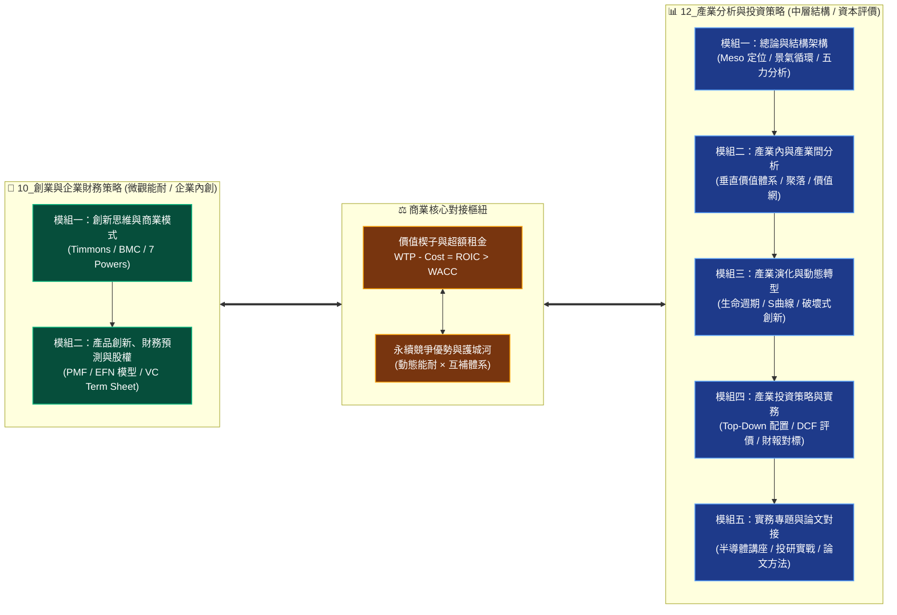

---
{"dg-publish":true,"permalink":"/home/","title":"PMBA 核心專業選修知識庫","tags":["gardenEntry"],"dg-note-properties":{"title":"PMBA 核心專業選修知識庫"}}
---

# 📚 PMBA 核心專業選修知識庫
> **National Taiwan University · Professional MBA Knowledge Portal**  
> 國立臺灣大學 PMBA 主題選修核心知識樞紐 · 雙軌高階商業決策動態體系

> [!ABSTRACT] 💡 數位花園定位與全景導航 (Executive Abstract)
> 本知識庫為 PMBA 兩大旗艦主題選修課程之數位知識中樞，架構上貫通**「微觀新創財務與能耐（Micro / Firm）」**與**「中層產業結構與資本市場（Meso / Industry）」**，打通從商業模式創新、精實假說驗證、財務三表動態聯動、外部融資需求（EFN）、創投與私募股權（VC/PE），到產業中層結構（SCP）、波特五力、價值體系、技術 S 曲線、Top-Down 資產配置與企業內在價值估算之完整商管決策閉環。

---

## 🏛️ 知識庫架構總覽：微觀創能 $\times$ 中層產業雙軌模型

---

## 🧭 主題選修旗艦課程全景導航

### 🚀 課程一：10_創業與企業財務策略 (Entrepreneurship & Corporate Financial Strategy)

> [!NOTE] 📌 課程核心定位與進度狀態
> - **核心宗旨**：打通「好點子 $\rightarrow$ 好事業 $\rightarrow$ 好公司 $\rightarrow$ 好投資」的商業化轉譯路徑，整合商業模式設計、價值主張、精實產品驗證、新創動態財務預測與創投/私募股權決策。
> - **進度狀態**：**全課程兩大模組共 15 篇深度精深筆記已 100% 建置沉澱完成**。
>   - **Module 1 (W01~W04 創新思維與商業模式)**：10 篇核心筆記完全就緒。
>   - **Module 2 (W05~W08 產品創新、財務預測與股權策略)**：5 篇進階筆記全數就緒。

#### 1. 課程導航、總經時事與個案實務樞紐
| 樞紐分類 | 導航筆記連結 | 核心內容與分析焦點 |
| :--- | :--- | :--- |
| 🗺️ **課程總覽地圖** | [[_創業與企業財務策略 MOC]] | 全課程知識地圖、模組索引、思考架構與概念卡片對接體系 |
| 🧠 **全景心智圖導航** | [[mindmap_創業與企業財務策略_心智圖導航]] | 視覺化心智圖階層架構，掌握創業家精神至資本市場之邏輯流 |
| 🌐 **創投總經時事庫** | [[macro_資本市場與創投總經時事]] | 美債殖利率、FOMC 利率政策、HLW 自然利率模型、日圓套利平倉、AI 算力逆價差 |
| 🏢 **新創融資案例庫** | [[cases_新創與企業融資案例庫]] | Airbnb、藍河科技 Blue River、奇異 GE、友達/群創 FOPLP、台積電 vs 鴻海財務結構 |

#### 2. 模組一：創新思維與商業模式 (Module 1, 10 篇)
| 模組編號 | 核心課題與筆記名稱 | 經典理論與決策工具箱 |
| :--- | :--- | :--- |
| **M1-1** | [[M1-1_創業本質與創業家精神]] | 熊彼得創造性破壞、Timmons 創業三要素、肥尾分佈與非對稱回報理論 |
| **M1-2** | [[M1-2_白板決策鏈與財務價值三角]] | 資本傳導鏈、生命週期投融資矩陣、Gordon 模型、杜邦三因子、AV/EPV/GV 估值模型 |
| **M1-3** | [[M1-3_數位新經濟與精實創業方法論]] | 五大新經濟與科技引擎、MVP/PMF/Pivot 精驗閉環、Steve Blank 顧客開發模型 |
| **M1-4** | [[M1-4_創意思考工具與設計思考方法]] | 水平思考法、六頂思考帽、Drucker 創新七來源、Design Thinking EDIPT × 兩全思維 |
| **M1-5** | [[M1-5_創業構想發展與兩階段可行性評估]] | 創業機會八步驟、初步評估 8 大問題、深入評估 5 大維度、STP 與 AIO 生活型態畫像 |
| **M1-6** | [[M1-6_創業觀念模式與商業計畫書審查]] | Timmons / Bruyat / Dollinger / 劉謝四大模式、BP 審查六維度、TAM/SAM/SOM 估算 |
| **M1-7** | [[M1-7_創新策略思維與平衡計分卡架構]] | As-Is $\rightarrow$ To-Be 差距模型、平衡計分卡 BSC 四構面因果鏈與 KPI 落地、競爭優勢四基石 |
| **M1-8** | [[M1-8_企業內部資源理論與動態能耐矩陣]] | 資源基礎理論 RBV、VRIO 檢驗矩陣、動態能耐三部曲 (Sensing/Seizing/Transforming) |
| **M1-9** | [[M1-9_商業模式畫布架構與價值主張設計]] | BMC 九大要素與四大導向、感知淨價值方程式、Showrooming、RFM/CLV 單位經濟學 |
| **M1-10**| [[M1-10_七大市場力量與商業戰略價值公式]]| 7 Powers 七大市場力量解構、商模到戰略躍遷、價值公式 $\text{Value} = \text{規模} \times \text{力量}$ |

#### 3. 模組二：產品創新、財務預測與股權融資 (Module 2, 5 篇)
| 模組編號 | 核心課題與筆記名稱 | 經典理論與決策工具箱 |
| :--- | :--- | :--- |
| **M2-1** | [[M2-1_精實產品開發與服務創新驗證]] | 精實假說驗證閉環、四大 MVP 類型、PMF 金字塔、Sean Ellis 40% 指標、Cohort 留存、CCC 推導 |
| **M2-2** | [[M2-2_產品組合策略與品牌權益管理]] | Kotler 產品層次同心圓、Aaker 品牌權益、CBBE 品牌共鳴金字塔、行銷 7.0、Ansoff 矩陣 |
| **M2-3** | [[M2-3_創業行銷策略與全能屋模型]] | 全能屋 Omnihouse CI-EL vs PI-PM、5D 動態 $\rightarrow$ 4C 場域、PDB 競爭力、J-Curve 跨越 |
| **M2-4** | [[M2-4_新創財務預測與外部融資需求模型]]| 財務三表動態聯動、銷售百分比法、外部融資需求 EFN 方程式、內部/永續成長率、Runway 矩陣 |
| **M2-5** | [[M2-5_創業投資與私募股權運作機制]] | VC/PE 基金週期、募資階段 Seed~IPO、Cap Table 股權稀釋模型、Term Sheet 核心防禦條款 |

---

### 📊 課程二：12_產業分析與投資策略 (Industry Analysis & Investment Strategy)

> [!NOTE] 📌 課程核心定位與進度狀態
> - **核心宗旨**：介於「宏觀總體經濟（Macro）」與「微觀個別企業（Micro）」之間的中層產業分析樞紐（Meso-level Analysis），貫通結構分析（SCP）、波特五力、市場空間、垂直價值體系、產業演化動態與資本市場投資評價。
> - **進度狀態**：**全課程五大模組共 20 篇核心筆記與架構地圖已 100% 完整建置**。
>   - **Module 1 (總論與結構架構)**：8 篇核心筆記完全就緒。
>   - **Module 2 (產業內與產業間分析)**：3 篇垂直體系、聚落與價值網競合筆記完全就緒。
>   - **Module 3 (產業演化與動態轉型)**：2 篇生命週期與全球化轉型筆記完全就緒。
>   - **Module 4 (產業投資策略與實務)**：3 篇評價估值、資產配置與財報分析筆記完全就緒。
>   - **Module 5 (實務專題與期末整合)**：4 篇半導體業師、實戰投研、論文對接與決策心法完全就緒。

#### 1. 課程導航、總體經濟與個案實務樞紐
| 樞紐分類 | 導航筆記連結 | 核心內容與分析焦點 |
| :--- | :--- | :--- |
| 🗺️ **課程總覽地圖** | [[_產業分析與投資策略 MOC]] | 全課程中層定位地圖、16 週學習里程碑與核心樞紐架構 |
| 📊 **進度追蹤看板** | [[progress_📊 課程與筆記進度追蹤]] | 全課程五大模組筆記與核心商管工具進度追蹤儀表板 |
| 🧠 **全景心智圖導航** | [[mindmap_產業分析與投資策略_心智圖導航]] | 產業分析方法論與決策工具箱全景心智圖架構 |
| 📐 **M1 模組架構圖** | [[M1_模組架構心智圖]] | 模組一總論與架構專屬心智圖解析 |
| 🌐 **總體經濟時事庫** | [[macro_總體經濟與課前時事]] | 四階傳導模型、Fed 利率走勢與 Core PCE、美債殖利率、歐盟 CBAM 碳關稅 |
| 🏢 **產業企業案例庫** | [[cases_企業與產業案例庫]] | 台積電技術寡占、鴻海規模經濟、中租-KY 信用利差、廣達/緯創 AI 伺服器雙軌轉型 |

#### 2. 五大模組核心知識晶體 (Modules 1 ~ 5, 20 篇)

##### 🔹 模組一：總論與結構架構 (Module 1, Intra-Industry Analysis, 8 篇)
- 📑 **M1-1 產業分析本質與中層定位**：[[M1-1_產業分析本質與中層定位]]  
  *(中層 Meso 樞紐、政府/企業/投資人三大視角、Porter 替代性定義 vs NAICS 官方分類、產業動態模糊化、標準分析六步驟)*
- 📑 **M1-2 三大景氣循環與資本評價邏輯**：[[M1-2_三大景氣循環與資本評價邏輯]]  
  *(基欽存貨 3~4 年、朱格拉設備 7~10 年、康波長波 20~30 年、廣達 10 年時間序列分析、DCF 內在價值三要素、Hurdle Rate)*
- 📑 **M1-3 產業獲利結構差異與十大經典理論**：[[M1-3_產業獲利結構差異與十大經典理論]]  
  *(鴻海/台積電/中租跨產業獲利驅動因子、實體通路對標統一超/全家/寶雅 41% ROE、十大經典理論地圖全覽)*
- 📑 **M1-4 台灣產業發展歷程與決策工具箱**：[[M1-4_台灣產業發展歷程與決策工具箱]]  
  *(台灣戰後七大升級浪潮、互補性策略聯盟網絡護城河、專案立項七大檢核問句、PMBA 碩士論文 20~50 頁實戰對接指南)*
- 📑 **M1-5 波特五力分析與量化架構**：[[M1-5_波特五力分析與量化架構]]  
  *(五力深層驅動因子、Baumol 可競爭市場定價、CR4/HHI 市場集中度量化、台灣製藥單一買方體制實證、反制五力四大戰略)*
- 📑 **M1-6 產業分析模式與九大分析工具矩陣**：[[M1-6_產業分析模式與九大分析工具矩陣]]  
  *(九大經典分析矩陣完整映射、外部環境與內部能力適配、分析工具選用決策樹)*
- 📑 **M1-7 產業市場空間與策略群組**：[[M1-7_產業市場空間與策略群組]]  
  *(TAM/SAM/SOM 三層市場空間界定、策略群組地圖 SGM 繪製實務、移動障礙 Mobility Barriers、同儕競爭空白區辨識)*
- 📑 **M1-8 商業生態系與平台網絡**：[[M1-8_商業生態系與平台網絡]]  
  *(商業生態系結構特徵、Keystone 主導者 vs Niche 利基者 vs Dominator 支配者、雙邊市場網絡效應、平台包夾防禦策略)*

##### 🔹 模組二：產業內與產業間分析 (Module 2, Inter-Industry Analysis, 3 篇)
- 📑 **M2-1 產業垂直價值體系**：[[M2-1_產業垂直價值體系]]  
  *(內部價值鏈延伸至跨產業垂直價值體系、微笑曲線 Smile Curve 利潤池分佈、自製 Make vs 外購 Buy、交易成本理論 TCE)*
- 📑 **M2-2 產業聚落與地理生態**：[[M2-2_產業聚落與地理生態]]  
  *(波特鑽石模型四大關鍵要素、新竹科學園區與台灣高科技聚落綜效、地理鄰近性與隱性知識外溢效應)*
- 📑 **M2-3 產業價值網與競合分析**：[[M2-3_產業價值網與競合分析]]  
  *(Brandenburger 價值網 Value Net 架構、互補品 Complementors 的正和博弈、PARTS 賽局戰略架構實務)*

##### 🔹 模組三：產業演化與動態轉型 (Module 3, Evolution & Transformation, 2 篇)
- 📑 **M3-1 產業生命週期與技術 S 曲線**：[[M3-1_產業生命週期與技術S曲線]]  
  *(產業生命週期各階段策略取捨、Foster 技術 S 曲線與不連續性、主導設計 Dominant Design 確立與跨越鴻溝 Chasm 模型)*
- 📑 **M3-2 產業發展轉型戰略與全球化動態**：[[M3-2_產業發展轉型戰略與全球化動態]]  
  *(企業轉型雙軌矩陣、破壞式創新防禦機制、全球化地緣政治供應鏈重組、台灣半導體與電子業全球布局戰略)*

##### 🔹 模組四：產業投資策略與實務 (Module 4, Investment Strategies, 3 篇)
- 📑 **M4-1 產業評價與估值基石**：[[M4-1_產業評價與估值基石]]  
  *(相對估值法 P/E、P/B、EV/EBITDA 之產業適用性、絕對估值 DCF 敏感度分析、成長股 PEG 模型與價值股安全邊際)*
- 📑 **M4-2 產業投資策略與資產配置**：[[M4-2_產業投資策略與資產配置]]  
  *(Top-Down 由上而下投資哲學、美林投資時鐘與四象限資產輪動、防禦型 vs 週期型產業配置、產業多空對沖策略)*
- 📑 **M4-3 財務報表與產業績效評析**：[[M4-3_財務報表與產業績效評析]]  
  *(三表穿透式產業對標分析、杜邦五因子拆解各產業 ROE 來源、營運資本管理與自由現金流 FCF 質量檢驗)*

##### 🔹 模組五：實務專題與期末整合 (Module 5, Capstone & Integration, 4 篇)
- 📑 **M5-1 業師講座半導體分析**：[[M5-1_業師講座半導體分析]]  
  *(台灣半導體晶圓代工、IC 設計與先進封裝生態鏈深度拆解、地緣政治與算力基建展望)*
- 📑 **M5-2 業師講座產業投資實務**：[[M5-2_業師講座產業投資實務]]  
  *(機構投資人拜訪調研框架、賣方研究報告解讀、資本市場實戰投研覆盤)*
- 📑 **M5-3 期末報告與論文對接指南**：[[M5-3_期末報告與論文對接指南]]  
  *(PMBA 產業分析期末實戰報告架構、碩士論文研究問題提煉與研究方法適配指引)*
- 📑 **M5-4 全課程總結與決策心法**：[[M5-4_全課程總結與決策心法]]  
  *(全課程 20 篇核心知識晶體串聯、高階經理人產業洞察與戰略決策心法總結)*

---

## 💡 98_商業概念庫 (Commercial Concept Library)

> [!TIP] 🧠 核心商業分析架構與理論卡片精選索引
> 商業概念庫收錄 700+ 份標準原子化卡片，以下為兩門選修課程高頻穿透引用之經典理論與模型索引（均已嚴格核對實體檔名）：

- ⚙️ **戰略分析與競爭結構**：
  - [[PESTEL分析|PESTEL 分析 (PESTEL Framework)]] ｜ [[bo-te-five-forces-analysis_波特五力分析|波特五力分析 (Porter's Five Forces)]] ｜ [[competitive-matrix_競爭矩陣|競爭矩陣 (Competitive Matrix)]] ｜ [[key-success-factors-ksf_關鍵成功因素|關鍵成功因素 (KSF)]] ｜ [[strategic-planning_策略規劃|策略規劃 (Strategic Planning)]] ｜ [[business-ecosystem_商業生態系|商業生態系 (Business Ecosystem)]] ｜ [[platform-envelopment_平台包夾|平台包夾 (Platform Envelopment)]] ｜ [[two-sided-market_雙邊市場|雙邊市場 (Two-Sided Market)]] ｜ [[BCG_Matrix_波士頓矩陣與動態現金流|波士頓矩陣 (BCG Matrix)]] ｜ [[GE_McKinsey_Matrix_通用奇異矩陣|通用奇異矩陣 (GE-McKinsey Matrix)]] ｜ [[TAM|總體潛在市場 (TAM)]] ｜ [[SAM|可服務市場 (SAM)]] ｜ [[SOM|可獲取市場 (SOM)]] ｜ [[forward-integration_前向整合|前向整合 (Forward Integration)]] ｜ [[backward-integration_後向整合|後向整合 (Backward Integration)]] ｜ [[merger-acquisition-integration_併購後整合|併購後整合 (PMI)]] ｜ [[enterprise-m-and-a_企業併購|企業併購 (M&A)]] ｜ [[industry-life-cycle_產業生命週期|產業生命週期 (ILC)]] ｜ [[cyclical-industry_週期性產業|週期性產業 (Cyclical Industry)]] ｜ [[strategic-leadership_策略領導力|策略領導力 (Strategic Leadership)]] ｜ [[VRIO架構|VRIO 資源基礎架構]] ｜ [[SWOT分析|SWOT 與 TOWS 矩陣]] ｜ [[cost-leadership-strategy_成本領導策略|成本領導策略]] ｜ [[differentiation-strategy_差異化策略|差異化策略]] ｜ [[focused-strategy_集中化策略|集中化策略 (隱形冠軍)]] ｜ [[market-leadership-zhe_市場領導者|市場領導者]] ｜ [[market_市場挑戰者|市場挑戰者]] ｜ [[market-2_市場跟隨者|市場跟隨者]] ｜ [[market-niche_市場利基者|市場利基者]] ｜ [[market-concentration_市場集中度|市場集中度 (HHI)]] ｜ [[network-effects_網絡效應|網絡效應 (梅特卡夫定律)]]

- 🚀 **創業創新與行銷管理**：
  - [[Entrepreneurial_Marketing_創業行銷|創業行銷 (Entrepreneurial Marketing)]] ｜ [[Omnihouse_全能屋模型 Omnihouse Model|全能屋模型 (Omnihouse Model)]] ｜ [[Marketing_Creativity_行銷創意生產力|行銷創意生產力 (Marketing Creativity)]] ｜ [[brand-equity_品牌權益|品牌權益 (Brand Equity)]] ｜ [[stay-at-home-economy_宅經濟|宅經濟 (Stay-at-Home Economy)]] ｜ [[cap-table_股權結構表 Cap Table|股權結構表 (Cap Table)]] ｜ [[term-sheet_投資意向書 Term Sheet|投資意向書 (Term Sheet)]] ｜ [[product-life-cycle_產品生命週期|產品生命週期 (PLC)]] ｜ [[corporate-life-cycle_企業生命週期|企業生命週期 (Corporate Life Cycle)]] ｜ [[entrepreneurial-life-cycle_創業生命週期|創業生命週期 (Entrepreneurial Life Cycle)]] ｜ [[situational-leadership-theory_情境領導理論|情境領導 (Situational Leadership)]] ｜ [[transformational-leadership_轉換型領導|轉換型領導 (Transformational Leadership)]] ｜ [[transactional-leadership_交易型領導|交易型領導 (Transactional Leadership)]] ｜ [[servant-leadership_僕人式領導|僕人式領導 (Servant Leadership)]] ｜ [[authentic-leadership_真誠領導|真誠領導 (Authentic Leadership)]] ｜ [[Lewin三階段模型|Lewin 三階段變革模型]] ｜ [[Kotter變革八步驟|Kotter 變革八步驟]] ｜ [[learning-organization_學習型組織|學習型組織 (The Fifth Discipline)]] ｜ [[change-management_變革管理|變革管理 (ADKAR)]] ｜ [[matrix-organization_矩陣型組織|矩陣型組織]] ｜ [[Mintzberg管理者角色|Mintzberg 管理者角色]] ｜ [[POLC職能|POLC 四大職能]] ｜ [[organization-review-mechanism_組織覆盤機制|組織覆盤機制 (AAR)]] ｜ [[MVP最小可行產品|最小可行產品 (MVP)]] ｜ [[customer-development_客戶開發|客戶開發 (Customer Dev)]] ｜ [[customer_顧客體驗旅程|顧客體驗旅程 (CJM)]] ｜ [[STP分析|STP 行銷策略分析]] ｜ [[marketing-myopia_行銷近視症|行銷近視症]] ｜ [[marketing-4p-mix_行銷4P|行銷 4P 與 4C 組合]] ｜ [[customer-brand-equity_顧客基礎品牌權益|品牌權益金字塔 (CBBE)]] ｜ [[customer-loyalty_顧客忠誠度|顧客忠誠度 (NPS)]] ｜ [[brand-strategy_多品牌策略|多品牌架構 (Brand Architecture)]] ｜ [[brand-10_品牌延伸|品牌延伸]] ｜ [[brand-dilution_品牌稀釋|品牌稀釋防禦]] ｜ [[brand-3_品牌識別|品牌識別 (Aaker Model)]] ｜ [[brand-7_聯名品牌|聯名品牌 (Co-branding)]] ｜ [[brand-2_成分品牌|成分品牌 (Ingredient Branding)]] ｜ [[value-proposition_價值主張|價值主張畫布 (VPC)]] ｜ [[perception_知覺圖|知覺定位圖 (Perceptual Map)]]

- 💰 **財務估值與資本市場**：
  - [[EPV_盈餘能力價值模型 Earnings Power Value|盈餘能力價值模型 (EPV)]] ｜ [[SOTP_零件加總估值法 Sum of the Parts|零件加總估值法 (SOTP)]] ｜ [[Backwardation_AI算力逆價差|AI 算力逆價差 (Backwardation)]] ｜ [[dcf_現金流量折現法|現金流量折現法 (DCF)]] ｜ [[wacc_加權平均資本成本|加權平均資本成本 (WACC)]] ｜ [[ROIC_投入資本報酬率 Return on Invested Capital|投入資本報酬率 (ROIC)]] ｜ [[dupont-analysis_杜邦分析法|杜邦分析法 (DuPont Analysis)]] ｜ [[sustainable-growth-rate_永續成長率|永續成長率 (SGR)]] ｜ [[unit-economics-model_單位經濟模型|單位經濟模型 (Unit Economics)]] ｜ [[pvgo_成長機會現值|成長機會現值 (PVGO)]] ｜ [[real-options_實質選擇權|實質選擇權 (Real Options)]] ｜ [[diluted-eps_稀釋後每股盈餘|稀釋後每股盈餘 (Diluted EPS)]] ｜ [[pe-ratio_本益比|本益比 (P/E Ratio)]] ｜ [[davis-double-whammy_戴維斯雙殺效應|戴維斯雙殺 (Davis Double Whammy)]] ｜ [[DOL_營運槓桿|營運槓桿度 (DOL)]] ｜ [[financial-leverage_財務槓桿|財務槓桿度 (DFL)]] ｜ [[degree-of-total-leverage-dtl_總槓桿|總槓桿度 (DTL)]] ｜ [[financial-structure_財務結構|財務結構 (Financial Structure)]] ｜ [[capital-structure_資本結構|資本結構 (Capital Structure)]] ｜ [[theory-7_權衡理論|權衡理論 (Trade-off Theory)]] ｜ [[enterprise-value_企業價值|企業價值 (EV)]] ｜ [[company-value_公司內在價值|公司內在價值 (Company Value)]] ｜ [[dividend-policy_股利政策|股利政策 (Dividend Policy)]] ｜ [[dividend-irrelevance-theory_股利無關論|股利無關論 (Dividend Irrelevance)]] ｜ [[merger-acquisition_併購綜效|併購綜效 (M&A Synergies)]] ｜ [[acquisition-premium_收購溢價|收購溢價 (Acquisition Premium)]] ｜ [[sunk-cost_沉沒成本|沉沒成本 (Sunk Cost)]] ｜ [[opportunity-cost_機會成本|機會成本 (Opportunity Cost)]] ｜ [[cash-flow-statement_現金流量表|現金流量表 (Cash Flow Statement)]] ｜ [[insolvency-with-profit_黑字倒閉|黑字倒閉 (Profitable Insolvency)]] ｜ [[cash-flow-ratio_現金流量比率|現金流量比率 (Cash Flow Ratio)]] ｜ [[cash-pao-dao_現金跑道|現金跑道 (Cash Runway)]] ｜ [[inventory-3_存貨周轉率|存貨周轉率 (ITR)]] ｜ [[total-assets_總資產周轉率|總資產周轉率 (TATR)]] ｜ [[fixed-assets_固定資產周轉率|固定資產周轉率 (FATR)]] ｜ [[interest-coverage-ratio_利息保障倍數|利息保障倍數 (TIE)]] ｜ [[receivable-3_應收帳款周轉率|應收帳款周轉率 (RTR)]] ｜ [[long-term-capital-to-fixed-assets-ratio_長期資金佔不動產廠房及設備比率|長期資金佔固定資產比率]] ｜ [[DER|負債權益比 (DER)]] ｜ [[financial-cost_財務危機成本|財務危機成本 (Altman Z-Score)]] ｜ [[direct-bankruptcy-cost_直接破產成本|直接破產成本]] ｜ [[indirect-bankruptcy-cost_間接破產成本|間接破產成本]] ｜ [[balance-sheet_資產負債表|資產負債表 (Balance Sheet)]] ｜ [[liability-cost_負債成本|負債成本]] ｜ [[off-balance-sheet-liabilities_表外負債|表外負債 (IFRS 16)]] ｜ [[leverage-acquisition_槓桿收購|槓桿收購 (LBO)]] ｜ [[IFRS 15 客戶合約收入|IFRS 15 客戶合約收入]] ｜ [[accounting-equation_會計恆等式|會計恆等式]] ｜ [[risk-return_風險與報酬權衡|CAPM 與證券市場線 (SML)]] ｜ [[internal-rate-of-return-2_修正內部報酬率|修正內部報酬率 (MIRR)]] ｜ [[financial-derivatives_衍生性金融商品|衍生性金融商品]] ｜ [[options_選擇權|選擇權理論 (Black-Scholes)]] ｜ [[risk-management_金融風險管理|金融風險管理 (VaR 模型)]] ｜ [[top-down-investing_由上而下投資法|美林投資時鐘]] ｜ [[alpha-excess-return_超額報酬|超額報酬 (Alpha vs. Beta)]]

- 🌐 **宏觀環境分析與產業格局**：
  - [[macro-environment-analysis_總體環境分析|總體環境分析 (PESTEL)]] ｜ [[macroeconomic-triangle_總體經濟三角|蒙代爾三元悖論 (Trilemma)]] ｜ [[scenario-planning_情境規劃|殼牌情境規劃 (Scenario Planning)]] ｜ [[political-environment_政治環境|政治環境與地緣風險]] ｜ [[economic-environment_經濟環境|經濟環境與景氣循環]] ｜ [[socio-demographic-environment_社會人口環境|社會文化與人口結構]] ｜ [[technological-environment_技術環境|技術環境與 S 曲線]] ｜ [[natural-environment_自然環境|自然環境與氣候風險]] ｜ [[regulatory-environment_法規環境|法規監管與合規治理]] ｜ [[startup-environment_創業環境|新創生態系 (Isenberg 6支柱)]] ｜ [[economic-moat_經濟護城河|經濟護城河 (Morningstar 5來源)]] ｜ [[globalization_全球化|全球化與慢球化 (Slowbalization)]] ｜ [[global-outsourcing_全球外包|全球外包與近岸友岸重組]] ｜ [[industry-analysis_產業分析|產業分析與 SCP 範式]] ｜ [[industry-structure_產業結構|四種市場結構 (完全競爭至獨佔)]] ｜ [[industry-concentration_產業集中度|產業集中度 (CR4 & HHI 指數)]]

- 👥 **組織行為、動機激勵與領導權力**：
  - [[intrinsic-vs-extrinsic-motivation_內在激勵與外在激勵|內在激勵與自我決定論 (SDT)]] ｜ [[achievement-motivation_成就動機|麥克利蘭三大需求理論 (nAch)]] ｜ [[bases-of-social-power_權力基礎|法蘭西與雷文五大權力基礎]] ｜ [[equity-theory_公平理論|亞當斯公平理論與組織正義]] ｜ [[goal-setting-theory_目標設定理論|洛克目標設定理論與 OKR]] ｜ [[path-goal-theory_路徑目標理論|豪斯路徑-目標權變領導]] ｜ [[job-enrichment_工作豐富化|工作豐富化與工作特性模型 (JCM)]] ｜ [[job-satisfaction_工作滿意度|工作滿意度與組織公民行為 (OCB)]] ｜ [[legitimate-power_法定權|法定權與組織權威邊界]] ｜ [[reward-power_獎賞權|獎賞權與激勵相容]] ｜ [[coercive-power_強制權|強制權與恐懼文化火爐原則]] ｜ [[expert-power_專家權|專家權與無權力的影響力]] ｜ [[power-distance_權力距離|霍夫斯泰德權力距離 (PDI)]] ｜ [[job-enlargement_工作擴大化|工作擴大化 (水平擴展)]] ｜ [[job-rotation_工作輪調|工作輪調與通才領導力]] ｜ [[founding-team_創始團隊|創始團隊黃金鐵三角]] ｜ [[entrepreneurship-team_創業家與團隊|創業團隊動態股權成熟 (Vesting)]] ｜ [[startup-team_創業團隊|新創團隊演化 (Tuckman 5階段)]]

- 🛠️ **精實營運、流程再造與品質控制**：
  - [[corporate-process_企業流程再造|企業流程再造 (BPR)]] ｜ [[quality-management_全面品質管理|全面品質管理與六標準差 (TQM)]] ｜ [[process-management_流程管理|流程管理與限制理論 (TOC)]] ｜ [[capacity-expansion_產能擴張|產能擴張時機矩陣]] ｜ [[operational-planning_作業性規劃|作業性規劃與關鍵路徑 (CPM)]] ｜ [[lean-startup_精實創業|精實創業方法論 (Lean Startup)]] ｜ [[control-process_控制流程|管理控制四步閉環]] ｜ [[control-6_前饋控制|前饋控制 (事前預防)]] ｜ [[control_即時控制|即時控制 (豐田安燈系統)]] ｜ [[control-5_回饋控制|回饋控制 (事後覆盤)]] ｜ [[control-7_控制職能|POLC 控制職能雙螺旋]] ｜ [[control-2_控制幅度|控制幅度與組織扁平化]] ｜ [[control-4_官僚控制|官僚控制與科層理性]] ｜ [[control-3_宗族控制|宗族控制與高信任文化 (Netflix)]] ｜ [[internal-control-2_內部控制|COSO 內部控制整合架構]] ｜ [[control-cost_控制成本與效益|控制成本與效益權衡分析]]

- 📊 **會計成本要素、財報分析比率與稅盾價值**：
  - [[income-statement_損益表|綜合損益表結構與盈餘品質分析]] ｜ [[comparative-financial-statement-analysis_比較財務報表分析|比較財務報表分析 (水平/垂直/趨勢)]] ｜ [[common-size-analysis_同型百分比分析|同型百分比分析 (結構性損益拆解)]] ｜ [[cost-of-goods-sold_營業成本|營業成本結構與邊際貢獻]] ｜ [[cost-2_銷貨成本|銷貨成本計量 (COGS & 存貨流轉)]] ｜ [[cost-value_成本與淨變現價值孰低法|成本與淨變現價值孰低法 (LCM 存貨跌價)]] ｜ [[operating-revenue_營業收入|營業收入認列 (IFRS 15 五步法)]] ｜ [[operating-expenses_營業費用|營業費用控管 (SGA & 營運槓桿)]] ｜ [[non-operating-income-expenses_營業外收支|營業外收支與盈餘持續性分析]] ｜ [[rd-expense_研發費用|研發費用資本化 vs 費用化]] ｜ [[rd-expense-ratio_研發費用率|研發費用率與創新強度對標]] ｜ [[bad-debt-expense-ratio_壞帳費用率|壞帳費用率與信用風險減損 (ECL 模型)]] ｜ [[cash-zhe-kou-cost_現金折扣成本|現金折扣隱含年化資金成本 (2/10 net 30)]] ｜ [[cost_等額年成本法|等額年成本法 (EAC 不等年限設備選型)]] ｜ [[financial-2_財務報表附註|財務報表附註與審計暗號穿透]] ｜ [[depreciation-methods_折舊方法|折舊方法與資產攤銷策略 (直線/DDB/數量)]] ｜ [[depreciation-tax-shield_折舊稅盾|折舊稅盾與資本預算現金流效益]] ｜ [[tax-shield_稅盾|企業稅盾總綱與價值創造機制 (MM定理)]] ｜ [[interest-tax-shield_利息稅盾|利息稅盾與負債融資效益 (WACC優化)]] ｜ [[equity-2_權益法|長期股權投資權益法與實質影響力會計]]

- 💡 **創業機會辨識、商業模式驗證與盡職調查**：
  - [[entrepreneurial-opportunity_創業機會|創業機會辨識與機會評價 (Timmons模型)]] ｜ [[entrepreneurship_創業|創業管理本質與組織創業機制 (Stevenson模型)]] ｜ [[entrepreneurship-spirit_創業精神|創業精神維度與創業導向 (EO 5維度)]] ｜ [[entrepreneurship-2_連續創業家|連續創業家認知機制與網絡資本]] ｜ [[entrepreneur-traits_創業者特質|創業者心理特質與效果邏輯 (Effectuation)]] ｜ [[entrepreneurial-capability_創業能力|創業動態能力與新創組織賦能 (Sensing/Seizing/Transforming)]] ｜ [[entrepreneurial-risk_創業風險|創業風險本質與雙重失誤決策 (沉船 vs 錯失良機)]] ｜ [[ideation-process_創意發想|創意發想程序與設計思考價值成型 (雙鑽石模型)]] ｜ [[business-feasibility-analysis_商業可行性分析|商業可行性分析與四維評估框架 (Gatekeeping)]] ｜ [[business-model-validation_商業模式驗證|商業模式驗證與假說驅動精實循環 (Sean Ellis 40%)]] ｜ [[business-model-pivot_商業模式軸轉|商業模式軸轉架構與十種軸轉路徑]] ｜ [[business-growth-stage_興業階段|新創企業生命週期階段與早熟擴張陷阱]] ｜ [[elevator-pitch_電梯簡報|電梯簡報說服架構與高衝擊融資表達 (5步黃金骨架)]] ｜ [[due-diligence_盡職調查|投資盡職調查與全維度風險穿透架構 (QoE/FDD/LDD/CDD)]] ｜ [[enterprise-value-evaluation_企業價值評估|企業價值評估模型與早期新創定價 (VC/Berkus/Scorecard)]] ｜ [[resource-bricolage_資源拼湊|創業資源拼湊理論與逆境破局行動 (Baker & Nelson)]] ｜ [[resource-integration_資源整合|企業資源整合與生態系協同機制 (Sirmon資源編排)]]

- 🏛️ **資本市場結構、金融定價理論與股利學派**：
  - [[capital-market_資本市場|資本市場架構與長期資產配置功能]] ｜ [[market-3_初級市場|初級市場承銷機制與資本形成 (IPO/SPO/競價拍賣)]] ｜ [[market-5_次級市場|次級市場微觀結構與流動性定價 (訂單驅動 vs 報價驅動)]] ｜ [[market-4_貨幣市場|貨幣市場工具運作與流動性調度 (T-Bills/CP/Repo)]] ｜ [[wan-mei-capital-market_完美資本市場|完美資本市場假說與金融基準參照系 (PCM/MM基準)]] ｜ [[convertible-corporate-bonds_可轉換公司債|可轉換公司債評價架構與發行策略 (債底+買權)]] ｜ [[capital-3_資本公積|資本公積會計本質與權益重組限制 (資本維持原則)]] ｜ [[capital_資本利得|資本利得定價機制與股東總報酬拆解 (TSR/戈登模型)]] ｜ [[theory-6_啄食順序理論|啄食順序理論與資訊不對稱融資階梯 (內部>負債>股權)]] ｜ [[theory-4_鳥在手理論|鳥在手理論與股利確定性溢價 (林中二鳥 vs 手中一鳥)]] ｜ [[theory-5_稅差理論|稅差理論與股東客戶群效應 (資本利得避稅優勢)]] ｜ [[theory-3_買賣權平價理論|買賣權平價理論與無套利合成定價 (Put-Call Parity)]] ｜ [[stock-split_股票分割|股票分割機制與微觀流動性信號 (拆股/反向分割)]] ｜ [[treasury-stock_庫藏股票|庫藏股票會計本質與資本回購策略 (股東權益抵銷)]] ｜ [[company-value_公司內在價值|公司內在價值定價邏輯與安全邊際框架 (DCF/巴菲特估值)]] ｜ [[ex-dividend-date_除息交易日|除息交易日機制與稅務除權除息定價 (填息 vs 貼息)]]

- 🛡️ **波特競爭博弈、價值鏈重構與資源基礎理論 (RBV)**：
  - [[value-chain_價值鏈|波特價值鏈架構與活動邊際解構 (主要活動 vs 支援活動)]] ｜ [[value-chain-2_價值鏈佈局|全球價值鏈配置與協調戰略 (微笑曲線與GVC)]] ｜ [[industrial-organization-theory_產業組織理論|產業組織理論與 SCP 典範 (結構-行為-績效)]] ｜ [[competence_議價能力|商業談判議價能力與剩餘索取權博弈 (BATNA)]] ｜ [[bargaining-power-of-buyers_買方議價能力|買方議價能力分析與顧客鎖定防衛 (五力分析第二力)]] ｜ [[bargaining-power-of-suppliers_供應商議價能力|供應商議價能力分析與關鍵資源瓶頸制衡 (五力分析第三力)]] ｜ [[potential-entrants_潛在進入者|潛在進入者威脅與結構性進入障礙防禦 (五力分析第一力)]] ｜ [[resource-based-view-rbv_資源基礎理論|資源基礎理論與 VRIO 能耐護城河 (Barney能耐學派)]] ｜ [[resource-allocation_資源配置|策略性資源配置程序與資本配給博弈 (Bower-Burgelman)]] ｜ [[asset-specificity_專用性資產|資產專用性理論與套牢問題治理 (TCE準租與整合)]] ｜ [[company-2_可比公司法|可比公司法評價乘數與同業相對估值 (EV/EBITDA/市銷率)]] ｜ [[strategy-4_毒藥丸策略|毒藥丸反收購防禦與股權稀釋機制 (股東權益計畫)]] ｜ [[strategy-5_戰略思維|高階戰略思維架構與非對稱競爭演化 (明茨伯格戰略)]] ｜ [[strategy-6_多國化策略|多國化策略與在地響應矩陣 (Bartlett & Ghoshal IR網格)]]

- 🧠 **消費者購買決策歷程、涉入度與跨文化組織行為**：
  - [[decision_消費者購買決策歷程|消費者購買決策歷程五階段模型 (CDP/EKB模型)]] ｜ [[behavior-4_複雜購買行為|複雜購買行為與認知失調防衛 (高涉入顯著差異)]] ｜ [[behavior-2_習慣性購買行為|習慣性購買行為與品牌穿透路徑 (低涉入微小差異)]] ｜ [[behavior-3_尋求多樣化行為|尋求多樣化購買行為與市場動態防禦 (低涉入顯著差異)]] ｜ [[theory-2_涉入度理論|涉入度理論與 FCB 傳播方格矩陣 (Vaughn矩陣)]] ｜ [[buyer-remorse_買家懊悔|買家懊悔與購後認知失調化解機制 (Festinger理論)]] ｜ [[organizational-buying-behavior_組織購買行為|B2B 組織購買行為與採購決策單位 (DMU採購中心)]] ｜ [[culture-dimension_霍夫斯泰德文化維度|霍夫斯泰德文化維度理論與跨國組織管理 (Hofstede六維度)]] ｜ [[culture-2_文化智商|文化智商四維模型與跨文化領導力 (Earley & Ang CQ)]] ｜ [[culture_高低語境文化|高語境與低語境文化理論及跨國商務溝通 (Edward T. Hall)]] ｜ [[gui-yin-theory_歸因理論|歸因理論、共變模型與組織認知偏誤 (Kelley共變與FAE)]] ｜ [[contingency-theory_權變理論|組織管理權變理論與環境動態適配 (Burns & Stalker)]] ｜ [[intuitive-decision-making_直覺決策|直覺決策模型與識別啟發決策 (RPD與快思慢想)]] ｜ [[decision-analysis_決策直覺與分析|決策直覺與分析之動態平衡及決策衛生 (康納曼雜訊治理)]]

- 💳 **企業融資策略、以長支長與營運資金匹配**：
  - [[financial-forecast_財務預測|財務預測模型與銷售百分比法 (AFN/外部融資需求)]] ｜ [[gross-profit_營業毛利|營業毛利結構與毛利率動態分析 (VPCM四大因數)]] ｜ [[financing-activities_籌資活動|籌資活動現金流與資本籌措架構 (CFF生命週期)]] ｜ [[financing_債券融資|公司債融資架構與債務限制條款 (Debt Covenants)]] ｜ [[financing-strategy_保守型融資策略|保守型營運資金融資策略與流動性緩衝 (低風險防禦)]] ｜ [[financing-strategy-2_激進型融資策略|激進型營運資金融資策略與槓桿風險 (短債長用套利)]] ｜ [[strategy-3_到期配合策略|到期配合與自償性融資策略 (Hedging Principle)]] ｜ [[matched-funding_以長支長|以長支長財務原則與流動性安全邊際 (長期資金覆蓋)]] ｜ [[maturity-mismatch_以短支長|以短支長期限錯配風險與流動性危機 (流動性踩踏)]] ｜ [[revolving-credit_循環信用貸款|循環信用貸款與企業備用流動性管理 (Revolver保險箱)]] ｜ [[capital-2_資本限額|資本限額決策與獲利指數資本配給 (PI專案優化)]] ｜ [[equity-cost_權益成本|權益資本成本估算與資產定價模型 (CAPM與機會成本)]] ｜ [[retained-earnings_保留盈餘|保留盈餘本質、內部融資策略與股利權衡 (巴菲特一美元)]] ｜ [[credit-policy_信用政策|企業信用政策架構、應收帳款管理與五C原則 (賒銷風控)]]

- 🤝 **併購攻防、善意與敵意收購及退場機制**：
  - [[acquisition_公開收購|公開收購機制與標購溢價定價博弈 (Tender Offer)]] ｜ [[acquisition-2_善意收購|善意收購程序與併購協議條款談判 (Merger Agreement)]] ｜ [[merger-acquisition-2_敵意併購|敵意併購戰術與公司控制權爭奪 (Hostile Takeover)]] ｜ [[merger-acquisition-3_多角化併購|多角化併購理論與多元化折價陷阱 (Conglomerate Discount)]] ｜ [[financial_財務綜效|財務綜效評估與稅盾融資槓桿 (Coinsurance Effect)]] ｜ [[operating_營運綜效|營運綜效與規模經濟範疇整合 (Cost & Revenue Synergies)]] ｜ [[winners-curse_勝者詛咒|勝者詛咒與併購溢價價值破壞 (Hubris Hypothesis)]] ｜ [[proxy-fight_委託書爭奪|委託書爭奪戰與股東治理博弈 (Proxy Contest/UPC)]] ｜ [[white-knight_白衣騎士|白衣騎士與白衣護衛反收購防禦 (White Knight & Squire)]] ｜ [[greenmail_綠色郵件|綠色郵件勒索防禦與目標股份溢價買回 (Greenmail)]] ｜ [[golden-parachute_黃金降落傘|黃金降落傘高管離職補償與代理成本 (Double-Trigger)]] ｜ [[scorched-earth-defense_焦土政策|焦土政策防禦與皇冠明珠資產剝離 (Crown Jewels/Unocal)]] ｜ [[exit-mechanism_退場機制|投資退場機制與資本回收路徑 (IPO/Trade Sale/MBO)]] ｜ [[exit-barriers_退出障礙|產業退出障礙與沉沒專用性資產 (波特五力退出壁壘)]]

- 🌍 **跨國企業導向、全球整合與在地回應策略**：
  - [[strategy-7_全球化策略|全球化標準策略與規模經濟優勢 (Global Strategy/MES)]] ｜ [[strategy-8_跨國化策略|跨國型策略與全球整合網絡模型 (Transnational/CoE)]] ｜ [[integration_全球整合與在地回應|全球整合與在地回應的雙重張力動態平衡 (I-R架構)]] ｜ [[orientation-5_母國中心導向|母國中心導向與跨國組織集權管控 (Ethnocentric/PCN)]] ｜ [[orientation-4_多中心導向|多中心導向與海外子公司高度自治 (Polycentric/HCN)]] ｜ [[orientation-3_全球中心導向|全球中心導向與無國界協同網絡 (Geocentric/TCN)]] ｜ [[kua-guo-enterprise_跨國企業|跨國企業本質、治理結構與組織演化 (Dunning OLI典範)]] ｜ [[licensing-and-franchising_授權與特許加盟|國際授權與特許加盟模式 (輕資產擴張與風控)]] ｜ [[purchasing-power-parity-ppp_購買力平價|購買力平價理論與跨國定價機制 (PPP/大麥克指數)]] ｜ [[lv-di-investment_綠地投資|綠地投資與海外全新設廠決策 (Greenfield vs M&A)]] ｜ [[corporate-3_合資企業|跨國合資企業治理與控制權博弈 (IJV/學習競賽)]] ｜ [[company-3_獨資子公司|全資海外子公司策略與實體控制 (WOS/絕對控制權)]]
- 👥 **組織激勵理論、工作特性模型與績效治理**：
  - [[xu-qiu-ceng-ci-theory_需求層次理論|馬斯洛需求層次理論與現代工作激勵 (五層金字塔/ERG)]] ｜ [[san-xu-qiu-theory_三需求理論|麥克利蘭高階領導三需求理論 (成就/親和/制度權力)]] ｜ [[reinforcement-theory_強化理論|斯金納操作制約與組織行為強化理論 (正負強化/OB Mod)]] ｜ [[hawthorne-experiments_霍桑實驗|霍桑實驗歷程與人群關係學派誕生 (梅奧社會人假設)]] ｜ [[hawthorne-effect_霍桑效應|霍桑效應機制與非正式組織動態 (被關注效應/MBWA)]] ｜ [[model_工作特性模型|哈克曼與奧爾德姆工作特性模型 (JCM五維度/MPS乘數)]] ｜ [[three-components-of-attitude_態度三要素|工作態度三要素與認知失調化解 (ABC模型/組織承諾)]] ｜ [[model-2_大五人格模型|大五人格特質模型在組織行為之應用 (OCEAN績效預測)]] ｜ [[locus-of-control_內外控傾向|內外控傾向心理學與管理領導韌性 (Rotter控制源)]] ｜ [[person-job-fit_人職匹配|人職匹配理論與組織適配架構 (PJ與PO文化適配)]] ｜ [[peter-principle_彼得原理|彼得原理不稱職陷阱與雙軌晉升治理 (技術管理雙軌)]] ｜ [[key-performance-indicator-kpi_關鍵績效指標|關鍵績效指標體系與目標對齊架構 (SMART與古德哈特定律)]] ｜ [[performance-standards_績效標準|績效標準制定與行為觀察量表 (BARS行為錨定評級)]] ｜ [[nine-box-matrix_九宮格法|人才九宮格矩陣與高潛能人才盤點 (績效潛力二維矩陣)]]
- 🔄 **營運週期、損益平衡分析與經營能力分析**：
  - [[operating-cycle_營業週期|營業週期理論與現金轉換週期模型 (OC與CCC動態轉換)]] ｜ [[operating-efficiency-analysis_經營能力分析|企業經營能力分析與週轉率體系 (杜邦效率與資產管理比率)]] ｜ [[operating-activities_營業活動|營業活動現金流量與盈餘品質檢驗 (直接法間接法與CFO分析)]] ｜ [[operating-income_營業利益|營業利益衡量與核心本業獲利能力 (EBIT與營運槓桿度)]] ｜ [[operating-information_營運部門資訊|營運部門資訊揭露與集團分部報告 (IFRS 8管理方法與CODM)]] ｜ [[operating-management_生產與營運管理|生產與營運管理架構與持續改善哲學 (Hayes策略四階段與精實TOC)]] ｜ [[bep-break-even-point_損益平衡點|本量利損益平衡點分析與安全邊際 (BEP門檻與多產品組合)]] ｜ [[break-even-analysis_損益平衡分析|損益平衡分析進階應用與敏感度測試 (CVP目標利潤與自製外包)]] ｜ [[financial-break-even_財務損益平衡點|財務損益平衡點與每股盈餘無異分析 (EBIT-EPS與負債融資風險)]] ｜ [[stocks-and-flows_存量與流量|存量與流量系統動力學及財報本質 (浴缸微積分與四大報表)]] ｜ [[income-structure_損益結構|損益結構垂直百分比分析與獲利瀑布 (毛利率至淨利率瀑布模型)]] ｜ [[income-loss-3_綜合損益表|綜合損益表架構與全面收益觀 (IAS 1二元板塊與透明度)]] ｜ [[income-loss-2_其他綜合損益|其他綜合損益與累積其他權益變動 (OCI分類與重分類Recycle機制)]] ｜ [[matching-principle_配合原則|收入費用配合原則與權責發生制基石 (直接因果分攤與資本化界線)]]
- 💡 **設計思考、破壞性創新與新科技擴散**：
  - [[design-thinking_設計思考|以人為本設計思考與雙菱形模型 (Stanford d.school五階段與HCD)]] ｜ [[diffusion-of-innovations_創新擴散理論|羅傑斯創新擴散理論與巴斯擴散模型 (五大採用者群體與S曲線)]] ｜ [[crossing-the-chasm_跨越鴻溝|摩爾高科技行銷跨越鴻溝理論 (願景家務實家衝突與灘頭堡戰術)]] ｜ [[early-adopters_早期採用者|早期採用者特質與意見領袖價值 (願景驅動與客製化陷阱防範)]] ｜ [[creative-destruction_創造性破壞|熊彼得創造性破壞與資本主義動態演化 (五大創新形態與長波循環)]] ｜ [[innovation_創新|商業創新分類學與多布林十形態 (維持性破壞性與架構性創新)]] ｜ [[innovation-traits_創新特質|創新知覺五大屬性與採納速率模型 (相對優勢相容性與可試用性)]] ｜ [[creativity_創意|組織創造力三元組件與發散收斂思維 (Amabile模型與皮克斯智囊團)]] ｜ [[scamper-method_奔馳法|奔馳法創意思考檢核表技術 (SCAMPER七維度與營運重組)]] ｜ [[TRIZ理論|阿奇舒勒萃智發明問題解決理論 (理想解IFR與40發明創新原理)]] ｜ [[validated-learning_驗證式學習|精實創業驗證式學習與回饋循環 (Build-Measure-Learn與創新會計)]] ｜ [[hyperautomation_超自動化|企業級超自動化架構與智慧端到端協同 (Gartner趨勢與認知代理)]] ｜ [[large-language-model_大型語言模型|大型語言模型架構原理與企業價值棧 (Transformer規模法則與RAG)]] ｜ [[CUDA|輝達CUDA運算架構與軟硬體垂直整合護城河 (GPGPU平行計算與雙邊網絡)]]
- 🚀 **創業融資、創辦人特質與商業模式驗證**：
  - [[timmons-model_提蒙斯創業模型|提蒙斯創業三要素動態平衡模型 (商機團隊與資源動態適配)]] ｜ [[business-opportunity-identification_商業機會辨識|商業機會辨識與市場吸引力評估 (柯茲納發掘與熊彼得創造)]] ｜ [[business-model_商業模式|商業模式架構與奧斯瓦爾德九宮格畫布 (價值創造交付獲取與LTV/CAC)]] ｜ [[business-model-2_負碳商業模式|負碳商業模式與氣候科技價值重構 (全生命週期LCA與耐久碳移除)]] ｜ [[business-plan_商業計畫書|商業計畫書十大模組與自下而上財務推演 (執行摘要與精實動態手冊)]] ｜ [[pitch-deck_募資簡報|投資人募資簡報與川崎十頁敘事弧線 (10/20/30法則與牽引力鐵證)]] ｜ [[use-of-proceeds-plan_資金用途規劃|資金用途規劃與里程碑資本配置 (倒推跑道法與研發行銷配比)]] ｜ [[startup-stages_創業階段|創業生命週期六大階段與J曲線演進 (死亡之谷跨越與融資輪次)]] ｜ [[seed-stage_種子初創期|種子初創期突破與SAFE股權協議 (估值上限與4年成熟機制)]] ｜ [[business-scaling-stage_展業階段|展業規模擴張期與霍夫曼閃電擴張 (鄧巴數斷層與反直覺法則)]] ｜ [[bootstrapping-finance_自籌資金|自籌資金滾雪球創業與客戶融資模式 (零稀釋自主權與Mailchimp神話)]] ｜ [[3F法則|早期天使3F融資法則與公司治理防禦 (SAFE協議與表決權信託)]] ｜ [[VC|風險投資運作機制與冪律分佈法則 (LP-GP結構與Term Sheet條款博弈)]] ｜ [[Burn Rate|燒錢率控管與現金跑道極限推演 (毛淨燒錢率與Default Alive矩陣)]]

  - 📊 **資本預算決策、專案互斥評估與現金折現**：
    - [[independent-projects_獨立專案|獨立投資專案評價準則與資本限額排序 (NPV法則與整數規劃)]] ｜ [[mutually-exclusive-projects_互斥專案|互斥專案評估與NPV/IRR排序衝突仲裁 (規模差異與時序差異)]] ｜ [[fisher-intersection_費雪交叉點|費雪交叉點數理求解與專案排序逆轉 (差額IRR與利率敏感度)]] ｜ [[index_獲利指數|獲利指數與資本配置效率最大化 (效益成本比與資本限額優化)]] ｜ [[decision-2_設備重置決策|設備重置決策與增額現金流量分析 (沉沒成本排除與舊機處分稅盾)]] ｜ [[equivalent-annual-annuity_等額年金法|等額年金法與等額年成本EAC模型 (壽命不對稱專案年化標準化)]] ｜ [[double-counting-fallacy_雙重計算陷阱|資本預算雙重計算陷阱防範 (融資利息隔離與折舊非現金本質)]] ｜ [[effect_侵蝕效應|侵蝕效應與自我蠶食現金流判定 (附帶效應與防禦性主動創新)]] ｜ [[effect-2_費雪效應|費雪效應名目與實質利率映射方程式 (通膨折現配對一致性原則)]] ｜ [[time-value-2_貨幣時間價值|貨幣時間價值公理與複利折現模型 (終值現值與巴菲特複利雪球)]] ｜ [[investing-activities_投資活動|投資活動現金流量CFI與戰略再投資率 (資本支出CapEx與生命週期特徵)]] ｜ [[investment-risk_投資風險|專案投資風險三層維度與風險調整折現率 (獨立企業市場風險與RADR)]] ｜ [[zhe-jiu_折舊|固定資產折舊會計與折舊抵稅現值效應 (直線加速折舊與台積電實踐)]] ｜ [[analysis-2_敏感度分析|敏感度分析與關鍵變數壓力測試 (蜘蛛圖龍捲風圖與關鍵致命風險)]]

  - 🧠 **組織決策偏誤、有限理性與認知心智模式**：
    - [[bounded-rationality_有限理性|西蒙有限理性假說與行政人決策邊界 (搜尋成本與滿意解準則)]] ｜ [[satisficing-decision_滿意決策|滿意決策原則與抱負水準動態調節 (最大化陷阱與敏捷停止準則)]] ｜ [[rational-decision-model_理性決策模型|經典理性決策模型與多屬性效用規範 (六階段閉環與偽理性道具防禦)]] ｜ [[anchoring-effect_錨定效應|錨定與調整啟發式及錨定指數模型 (第一報價效應與賈伯斯iPad定價)]] ｜ [[confirmation-bias_確認偏誤|華生確認偏誤與貝氏推論失真模型 (三重過濾漏斗與事前驗屍法)]] ｜ [[fundamental-attribution-error_基本歸因謬誤|羅斯基本歸因謬誤與凱利共變模型 (行動者觀察者不對稱與公正文化)]] ｜ [[self-serving-bias_自利偏誤|自利偏誤與財報電話會議文本歸因 (動機防禦與Meta效率之年轉折)]] ｜ [[groupthink_團體迷思|詹尼斯團體迷思八大病徵與決策病理 (挑戰者號悲劇與魔鬼代言人)]] ｜ [[cognitive-dissonance_認知失調|費斯汀格認知失調理論與決策後失調 (承諾升級與柯達數位膠卷死結)]] ｜ [[decision-competence_模糊決策能力|深層模糊決策能耐與奈特不確定性 (意義建構實質選擇權與ASML破局)]] ｜ [[tolerance-for-ambiguity_模糊容忍度|巴德納模糊容忍度與認知閉合需求 (新奇複雜矛盾與納德拉微軟轉型)]] ｜ [[mode_心智模式|聖吉心智模式與阿吉里斯推論階梯 (左欄技術雙環學習與殼牌情境規劃)]] ｜ [[system_系統思考|福瑞斯特系統動力學與動態回饋思考 (存量流量時間延遲與亞馬遜飛輪)]] ｜ [[systems-school_系統學派|卡茨與卡恩開放系統組織管理理論 (負熵等終極性與豐田TPS實踐)]]

  - ⚔️ **動態競爭攻防、策略轉折點與產業結構演進**：
    - [[frontal-attack_正面進攻|正面進攻戰術與蘭徹斯特三倍資源法則 (全面對標4P與百事挑戰可口可樂)]] ｜ [[flank-defense_側翼防禦|側翼防禦策略與戰鬥品牌隔離機制 (邊界盲區防護與Intel賽揚阻擊)]] ｜ [[strategy_游擊戰策略|游擊戰略非對稱突擊與利基聚焦 (里斯特勞特三原則與維珍航空公關戰)]] ｜ [[pioneering_開創|開創者先發優勢與後發先至雙刃劍 (蒙哥馬利矩陣與蘋果快速卓越跟隨)]] ｜ [[strategic-inflection-point_關鍵轉折|葛洛夫十倍速關鍵轉折點與策略不協調 (唯有偏執狂得以生存與Intel轉型)]] ｜ [[strategy-9_轉機型策略|企業轉機型策略與二階段緊縮復甦 (Altman Z破產預警與IBM葛斯納逆轉)]] ｜ [[strategy-alliance_策略聯盟|策略聯盟混合治理架構與資源互補 (股權合資非股權契約與星空聯盟)]] ｜ [[structure-follows-strategy_結構跟隨策略|錢德勒結構跟隨策略命題與事業部演進 (U型至M型範式轉移與GM變革)]] ｜ [[stuck-in-the-middle_卡在中間|波特通用策略夾心陷阱與U型獲利曲線 (戰略取捨公理與西爾斯百貨崩塌)]] ｜ [[scp-framework_結構行為績效模型|哈佛學派結構行為績效SCP模型 (產業組織範式與台積電CapEx重構)]] ｜ [[signaling-theory_信號傳遞理論|斯賓塞信號傳遞理論與單調交叉條件 (有代價信號與現代汽車十年保固)]] ｜ [[cannibalization_自我蠶食|策略性自我蠶食與先發制人自毀創新 (增額利潤判定與iPhone弒父奇蹟)]] ｜ [[silo-effect_穀倉效應|組織穀倉效應與局部次佳化內耗 (邰蒂人類學透視與Sony隨身聽敗局)]] ｜ [[strategy-2_避險策略|策略性避險架構與營運韌性實質選擇權 (超越金融避險與豐田RESCUE實踐)]]

  - 🏛️ **公司組織形態、治理控制與平衡計分卡**：
    - [[company_公司|現代公司制度本質與所有權經營權分離 (伯利米恩斯假說與詹森代理成本)]] ｜ [[limited-liability_有限責任|股東有限責任原則與買權選擇權定價 (資本形成與揭穿公司面紗原則)]] ｜ [[close-corporation_閉鎖性股份有限公司|閉鎖性公司治理與特別股控制權防禦 (股份轉讓限制與雙層股權設計)]] ｜ [[internal-control_內部人控制|內部人控制在位鞏固與經理人霸權防禦 (青木昌彥假說與SOX內控審計)]] ｜ [[bureaucratic-system_官僚體制|韋伯理性法定官僚體制與科層架構 (六大理想特徵與巴金森定律異化)]] ｜ [[centralization-decentralization_集權與分權|集權與分權動態平衡與控制幅度模型 (授權核決矩陣與嬌生海爾治理)]] ｜ [[human-resources-management_人力資源管理|策略性人力資源管理SHRM與AMO行為模型 (哈佛密西根框架與網飛人才密度)]] ｜ [[balanced-scorecard-bsc_平衡計分卡|卡普蘭諾頓平衡計分卡與策略地圖因果鏈 (四大平衡維度與美孚石油大反轉)]] ｜ [[budget-control_預算控制|預算控制循環與彈性預算差異分析 (零基預算ZBB與超越預算敏捷革新)]] ｜ [[monitoring-and-measurement_監控衡量|管理監控衡量體系與領先落後指標 (古德哈特定律防禦與亞馬遜WBR)]] ｜ [[management-6_管理修正行動|管理控制論閉環與管理修正行動 (前饋即時回饋控制與豐田5Whys)]] ｜ [[efficiency-and-effectiveness_效率與效果|德魯克效率與效果二維矩陣 (做對的事與把事做對及諾基亞教訓)]] ｜ [[enterprise-management_企業管理|現代企業管理立體價值引擎架構 (法約爾管理職能與組織雙巧性演進)]]

  - 📈 **資本結構理論、每股盈餘與金融衍生品避險**：
    - [[modigliani-miller-theorem_莫迪利安尼米勒定理|莫迪利安尼米勒定理與資本結構無關論 (無稅有稅命題利息稅盾與權衡理論)]] ｜ [[earnings-per-share_每股盈餘|每股盈餘衡量與EBIT-EPS籌資無差異點 (基本稀釋庫藏股法與蘋果縮股奇蹟)]] ｜ [[net-income_本期淨利|本期淨利底線與營業現金流含金量 (權責發生制應計項異常與安隆教訓)]] ｜ [[share-repurchase_股票買回|公開市場股票買回與資本配置訊號 (盈餘殖利率條件波音教訓與蘋果實踐)]] ｜ [[pb-ratio_股價淨值比|股價淨值比與ROE-PB聯動定價模型 (巴菲特安全邊際與破淨折價陷阱)]] ｜ [[value-trap_價值陷阱|價值陷阱辨識與皮爾托斯基F分數 (週期頂峰結構顛覆與英特爾教訓)]] ｜ [[arbitrage_套利|單一價格法則與套利局限性模型 (純粹風險統計套利與LTCM清盤)]] ｜ [[no-arbitrage-equilibrium_無套利均衡|無套利均衡條件與資產定價第一基本定理 (複製組合平價公式與台積電CIP避險)]] ｜ [[commercial-paper_商業本票|商業本票貨幣市場貼現融資與展期風險 (備用信用額度與雷曼兄弟擠兌)]] ｜ [[price_履約價格|選擇權履約價格與價位狀態敏感度 (內在時間價值Delta與項圈避險結構)]] ｜ [[margin-system_保證金制度|期貨衍生品保證金制度與槓桿風險控制 (原始維持保證金與追繳斷頭防範)]] ｜ [[settlement_每日結算制度|中央結算所逐日盯市每日結算機制 (變動保證金流動性螺旋與穿倉防禦)]] ｜ [[interest-rate-swap_利率交換|利率交換合約結構與比較優勢融資 (普通固定浮動交換與久期ALM管理)]] ｜ [[currency-swap_貨幣交換|換匯換利跨國貨幣交換與雙重匯率避險 (本金利息交換與世界銀行IBM創始案)]]

  - 🧭 **管理技能三聯架構、領導權變模型與雙環反思實踐**：
    - [[conceptual-skills_概念技能|卡茲管理技能模型之頂層概念技能 (抽象階梯系統思考與納德拉微軟轉型)]] ｜ [[interpersonal-skills_人際技能|高管人際技能與心理安全感營造 (高曼情商非職權影響力與福特穆拉利救贖)]] ｜ [[technical-skills_技術技能|專業技術技能邊界與專家升遷陷阱 (彼得原理微觀管理病態與黃仁勳技術審美)]] ｜ [[managerial-mindset-shift_經理人思維轉型|個別貢獻者至經理人心智轉型 (領導梯隊六階段躍遷與谷歌氧氣計畫)]] ｜ [[fiedler-contingency-model_費德勒權變模型|費德勒領導權變模型與情境控制度 (八大象限最適風格適配與職務重構)]] ｜ [[partnership_最不受歡迎工作夥伴量表|最不受歡迎工作夥伴量表LPC (投射性測評認知複雜性與馬斯克納德拉風格對照)]] ｜ [[learning-learning_單環學習與雙環學習|阿吉里斯單環與雙環組織學習理論 (質疑底層假定與柯達富士軟片命運分水嶺)]] ｜ [[learning-2_標竿學習|坎普標竿管理全流程與差距分析 (競爭功能跨界標竿與西南航空F1換胎奇蹟)]] ｜ [[learning_行動學習|雷文斯行動學習公式與催化質疑探詢 (GE群策群力與真實難題同儕反思圈)]] ｜ [[reflective-practice_反思實踐|舍恩反思實踐者模型與就地實驗 (行動中反思隱性知識顯性化與美軍AAR)]] ｜ [[six-thinking-hats_六頂思考帽|德波諾水平思考與六頂思考帽 (平行思維動態編排與杜邦研發會議革命)]] ｜ [[force-field-analysis_力場分析|盧溫社會場論與變革力場分析 (準靜態平衡彈簧效應與削弱阻礙力第一定律)]] ｜ [[trade-on-thinking_兩全思維|羅傑馬丁兩全整合思維模型 (超越二元對立取捨與四季酒店蘋果破局)]] ｜ [[delphi-method_德爾菲法|蘭德公司德爾菲專家匿名多輪預測 (受控統計反饋收斂與半導體ITRS路線圖)]]

  - 🛍️ **顧客決策歷程、知覺價值與消費者行為**：
    - [[problem-recognition_問題確認|消費者購買決策歷程之問題確認 (理想現態落差喚起閾值與iPad被動需求)]] ｜ [[information_資訊搜尋|消費者資訊搜尋歷程與斯蒂格勒成本模型 (內部檢索外部探索與亞馬遜入口霸權)]] ｜ [[plan-evaluation_方案評估|候選品牌方案評估與考量集漏斗 (補償性多屬性模型非補償性法則與特斯拉突破)]] ｜ [[core-benefit_核心利益|科特勒五層次產品模型之核心利益 (李維特鑽頭孔洞隱喻與蘋果iPod千首歌)]] ｜ [[points-of-parity_共同點|凱勒策略定位共同點POP與容忍區間 (類別共同點競爭共同點中和與美樂淡啤)]] ｜ [[means-end-chain_手段目標鏈|古特曼手段目標鏈MEC模型與階梯訪談 (屬性後果終極價值躍遷與耐吉JustDoIt)]] ｜ [[mind-share_心智佔有率|心智佔有率與擴散激活記憶網絡 (未提示第一提及率與可口可樂神經盲測悖論)]] ｜ [[reference-groups_參考團體|社會認同參考團體四象限分類矩陣 (成員渴望解離群體影響與喬丹AirJordan)]] ｜ [[buying-center_採購中心|韋伯斯溫德B2B組織採購中心六大角色 (跨職能政治博弈與Salesforce破局)]] ｜ [[gatekeeper_把關者|B2B採購把關者防禦機制與非對稱風險 (行政技術守門人心理與Slack特洛伊木馬)]] ｜ [[derived-demand_衍生需求|工業品衍生需求本質與加速原理波動 (終端消費拉動牛鞭效應與IntelInside)]] ｜ [[perception-2_知覺|感官知覺三大選擇性過濾器與韋伯定律 (縮水式通膨JND門檻與紅牛難喝知覺)]] ｜ [[gap-model_差距模型|PZB服務品質五大差距模型與SERVQUAL (管理認知內部裂縫消除與麗思卡爾頓授權)]] ｜ [[theory_期望不一致理論|奧利佛顧客滿意度期望不一致理論 (知覺績效P與期望E落差及電馭叛客2077慘案)]]

- 📊 **資產負債結構、租賃公允價值與盈餘品質**：
  - [[asset-2_無形資產|IAS 38 無形資產可辨認性與研發資本化 (開發階段六大條件與美歐會計鴻溝)]] ｜ [[asset-3_使用權資產|IFRS 16 租賃會計表內化與使用權資產 (EBITDA與現金流重分類失真還原)]] ｜ [[goodwill_商譽|IFRS 3 企業合併商譽與不可逆減損測試 (現金產生單位CGU與AOL千億炸彈)]] ｜ [[value_公允價值|IFRS 13 公允價值三大層級輸入架構 (脫手價格與次貸危機標至神話破滅)]] ｜ [[income-loss_停業部門損益|IFRS 5 待出售處分群組與停業部門損益 (持續營業利益純化與GE分拆重塑)]] ｜ [[management-2_盈餘管理|應計項操縱與實質活動盈餘管理 (修正瓊斯模型DA檢驗與世通資本化舞弊)]] ｜ [[window-dressing_窗飾|期末資產負債表窗飾粉飾與過橋洗帳 (雷曼Repo105醜聞與期後事項審計)]] ｜ [[selling-expense-ratio_推銷費用率|推銷費用率營運槓桿與行銷資本效益 (單位經濟學CAC/LTV與瑞幸補貼戰)]] ｜ [[evaluation-c-principles_信用評估五C原則|商業銀行徵信五C原則與信用風險分析 (品格道德一票否決與阿特曼Z分數)]] ｜ [[finance-management_財務管理|現代公司財務管理核心治理決策體系 (三大核心決策ROIC利差與巴菲特資本配置)]] ｜ [[profitability_獲利能力|獲利能力矩陣與杜邦分析三維拆解 (淨利率週轉率槓桿與Costco極致週轉)]] ｜ [[sound-investment_好投資|葛拉漢與巴菲特價值投資體系 (內在價值折現安全邊際與經濟護城河)]] ｜ [[viable-business_好事業|商業模式自我造血機制與單元經濟學 (正自由現金流飛輪與WeWork泡沫對照)]]

- 🚀 **創業機會辨識、風險承擔與企業家精神**：
  - [[opportunity-recognition_創業機會辨識|Shane與Venkataraman創業機會辨識歷程 (警覺性先前知識與模式比對)]] ｜ [[opportunity-discovery_機會發掘|機會發掘實證論與創造論世紀對決 (外生非均衡套利與因果效果邏輯)]] ｜ [[opportunity_機會|提蒙斯模型機會評估五大核心維度 (機會之窗開啟關閉與Netflix串流拐點)]] ｜ [[risk-taking_風險承擔|企業家精神風險承擔傾向與可承受損失 (前景理論損失逆轉與SpaceX生死一役)]] ｜ [[schumpeter_熊彼得|熊彼得創造性破壞與五大創新形態 (循環流轉打破與Mark I/II典範轉移)]] ｜ [[information-asymmetry_資訊不對稱|資訊不對稱事前逆向選擇與事後道德風險 (檸檬市場模型與CarMax透明革命)]] ｜ [[Venkataraman|范卡塔拉曼個人機會雙構面創業研究綱領 (機會成本門檻與台積電適配)]] ｜ [[Dollinger|多林傑資源整合與新創組織化模型 (RBV資源動態組裝與聯發科Turnkey奇蹟)]] ｜ [[AFBP框架|品牌定位與價值主張AFBP四大構面 (屬性功能利益個性階梯與戴森十倍溢價)]] ｜ [[Nothing to Lose|無物可失背水一戰與非對稱凸性決策 (前景理論歸零心態與Airbnb賣麥片自救)]] ｜ [[great-idea_好創意|好創意轉化可行商業機會殘酷篩選漏斗 (維他命陷阱與Canva百億昇華)]] ｜ [[great-company_好公司|柯林斯從優秀到卓越與基業長青法則 (第五級領導刺蝟原則與微軟納德拉重生)]] ｜ [[growth-velocity_成長速度|新創成長速度與閃電擴張五大階段 (T2D3法則40法則與Uber/WeWork對照)]] ｜ [[phoenix-entrepreneur-loan_創業鳳凰貸款|微型創業鳳凰貸款與政策性普惠金融 (信貸配給失靈矯正95%信保與陪伴輔導)]]

- 🌐 **宏觀人口趨勢、肥尾不確定性與情境決策**：
  - [[K型經濟|K型經濟兩極分化與復甦動力學 (坎蒂隆效應與中產掏空及LVMH/拼多多對照)]] ｜ [[silver-economy_銀髮經濟|超高齡社會銀髮長壽經濟三大支柱 (資產高淨值去標籤化與雀巢機能轉型)]] ｜ [[single-economy_單身經濟|單身社會原子化一人戶與悅己消費 (一人食味集中座位與毛孩陪伴經濟)]] ｜ [[stay-at-home-economy_宅經濟|居家聯網宅經濟四大場景生態圈 (隨選外送串流娛樂與Netflix/Peloton)]] ｜ [[sharing-economy_共享經濟|共享經濟交易成本消融與閒置產能 (使用權勝過所有權分散式信任與Airbnb)]] ｜ [[fat-tail-theory_肥尾理論|塔勒布肥尾理論與極端斯坦黑天鵝 (冪律分佈破除常態與LTCM覆滅/Universa)]] ｜ [[normal-distribution_常態分配|高斯常態分配鐘形曲線與中心極限定理 (六標準差製程控制與金融尖峰肥尾誤用)]] ｜ [[monte-carlo-simulation_蒙地卡羅模擬|蒙地卡羅隨機抽樣模擬與風險敏感度 (破除靜態NPV與深海油田開採資本預算)]] ｜ [[analysis_情境分析|殼牌石油經典情境規劃法與多重世界觀 (2x2交叉矩陣與第一次石油危機登頂)]] ｜ [[contingency-planning_應變計畫|業務持續計畫BCP與高可靠度組織 (RTO/RPO量化指標與台積電震後十小時奇蹟)]] ｜ [[experience_經驗偏誤|經驗偏誤結果偏誤與火雞問題陷阱 (瓦爾德裝甲彈孔分析與柯達膠卷悲劇)]] ｜ [[short-term_短期主義|短期主義季度資本主義與代理困境 (Slashing R&D股票買回與波音/亞馬遜)]] ｜ [[goodharts-law_古德哈特定律|古德哈特定律指標目標化反噬法則 (坎貝爾定律眼鏡蛇效應與富國銀行醜聞)]]

---

## 🏷️ 知識庫標籤與導航索引

- **全站主要目錄**：`04_主題選修/10_創業與企業財務策略` ｜ `04_主題選修/12_產業分析與投資策略` ｜ `98_商業概念庫`
- **學程主題標籤**：`#PMBA` `#主題選修` `#創業管理` `#企業財務策略` `#產業分析` `#投資策略` `#商業概念庫` `#DigitalGarden`
